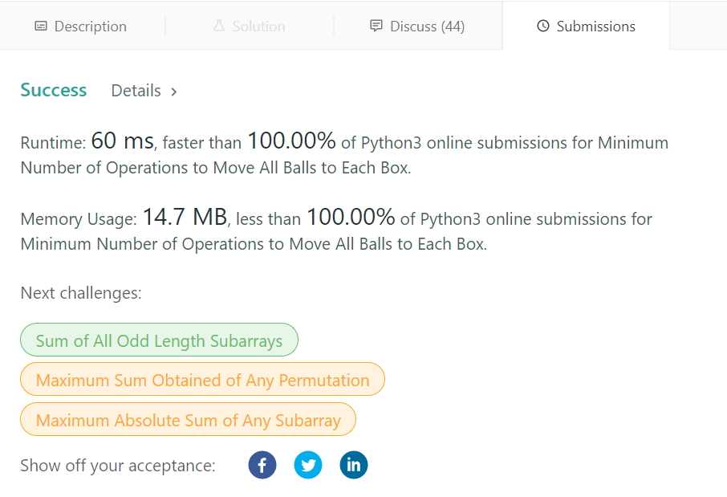

# Easy Python beats 100% time and space

**Author:** gauau
**Votes:** 172
**Link:** [https://leetcode.com/problems/minimum-number-of-operations-to-move-all-balls-to-each-box/solutions/1075895/](https://leetcode.com/problems/minimum-number-of-operations-to-move-all-balls-to-each-box/solutions/1075895/)

---

Similar to **238. Product of Array Except Self** and **42. Trapping Rain Water**.
For each index, the cost to move all boxes to it is sum of the cost ```leftCost``` to move all left boxes to it, and the cost ```rightCost``` to move all right boxes to it.
- ```leftCost``` for all indexes can be calculted using a single pass from left to right.
- ```rightCost``` for all indexes can be calculted using a single pass from right to left.
```
Example:
boxes      11010
leftCount  01223
leftCost   01358
rightCount 21100
rightCost  42100
ans        43458
```

```
class Solution:
    def minOperations(self, boxes: str) -> List[int]:
        ans = [0]*len(boxes)
        leftCount, leftCost, rightCount, rightCost, n = 0, 0, 0, 0, len(boxes)
        for i in range(1, n):
            if boxes[i-1] == '1': leftCount += 1
            leftCost += leftCount # each step move to right, the cost increases by # of 1s on the left
            ans[i] = leftCost
        for i in range(n-2, -1, -1):
            if boxes[i+1] == '1': rightCount += 1
            rightCost += rightCount
            ans[i] += rightCost
        return ans
```

