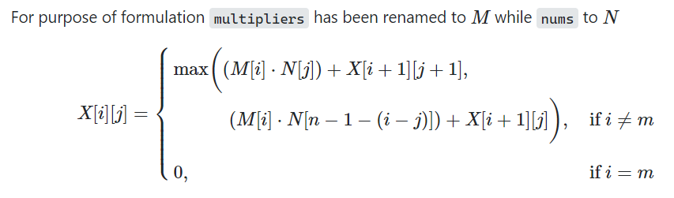

# 𝗪𝗵𝘆 Greedy Failed? From Level Zero | Beginner-Friendly | Fully Explained | Python | C

**Author:** RohitSgh
**Votes:** 157
**Link:** [https://leetcode.com/problems/maximum-score-from-performing-multiplication-operations/solutions/2156486/](https://leetcode.com/problems/maximum-score-from-performing-multiplication-operations/solutions/2156486/)

---

# \uD83D\uDE0B Greedy!

**Let's go Greedy!**

We have to pick integer `x` from **either end** of array `nums`. And, multiply that with `multipliers[i]`. Thus, let's pick larger `x` from either end. 

**`5` vs `3`, we will pick 5. Is it correct?**  
No! On checking constraints `-1000 \u2264 nums[i], multipliers[i] \u2264 1000`, both arrays can have negative integers. Thus, if `multipliers[i]` is `-10`, we would prefer adding `-30` instead of `-50`. Thus, we should choose, `x` which when multiplied with `multipliers[i]` gives the larger product.

<details><summary><b>\uD83E\uDD73 Let's Dry Run! (Click on Left Triangle to see)</b></summary> 
<pre>
<b>Input :</b> nums = [1,2,3], multipliers = [3,2,1]
<b>Taking Decision :</b>
- From multipliers <b>3</b>, nums is [1, 2, 3], from <b>3</b>x1 vs <b>3</b>x3, choose 3, add <u>9</u>.
- From multipliers <b>2</b>, nums is [1, 2], from <b>2</b>x1 and <b>2</b>x2, choose 2, add <u>4</u>.
- From multipliers <b>1</b>, nums is [1], add <u>1</u>.

<br/>

Total Score is <u>9+4+1</u>=<b>14</b>, which is Correct \u2714\uFE0F</pre></details>

<details><summary><b>\uD83D\uDE0E Another Example! (MUST CLICK  on Left Triangle to See)</b></summary><pre>
<b>Input :</b> nums = [-5,-3,-3,-2,7,1], multipliers = [-10,-5,3,4,6]
<b>Taking Decision :</b>  
- From multipliers <b>10</b>, nums [-5,-3,-3,-2,7,1], from (<b>-10</b>) (-5) and (<b>-10</b>)(1), choose -5, add <u>50</u>
- From multipliers <b>-5</b>, nums [-3,-3,-2,7,1], from (<b>-5</b>) (-3) and (<b>-5</b>)(1), choose -3, add <u>15</u>
- From multipliers <b>3</b>, nums [-3,-2,7,1], from (<b>3</b>) (-3) and (<b>3</b>)(1), choose 1, add <u>3</u>
- From multipliers <b>4</b>, nums [-3,-2,7], from (<b>4</b>) (-3) and (<b>4</b>)(7), choose 7, add <u>28</u>
- From multipliers <b>6</b>, nums [-3,-2], from (<b>6</b>) (-3) and (<b>6</b>)(-2), choose -2, add <u>-12</u>

<br/>

Total Score is <u>50+15+3+28+(-12)</u>=<b>84</b>, which...... 
isn't Correct \uD83D\uDE15. 102 is another <u>Optimal Solution</u> 
as given in Problem Example.</pre> </details>

Well, this version of greedy failed! 


> **How to Prove it?**
> [\u26A0: Spoiler Alert! Go to these links after reading the complete answer]
> This was asked on [Computer Science Stack Exchange](https://cs.stackexchange.com/q/151534/143377), and the [answer](https://cs.stackexchange.com/a/151551/143377) and [comments](https://cs.stackexchange.com/questions/151534/formal-proof-on-why-greedy-isnt-working-on-one-particular-problem#comment318613_151534) there suggests that 
>> - "To show that the greedy approach fails, all you have to do is come up with a counterexample. " 
>> - "To prove that the greedy algorithm is not optimal, it suffices to give one counterexample"

> We have given one example, where our version of greedy isn't giving <u>Optimal Solution</u>.

*(Another problem where we encounter similar situation is [120. Triangle](https://leetcode.com/problems/triangle/). After reading this answer, you can check the problem and one of the [counter example](https://leetcode.com/problems/triangle/discuss/2146127/why-greedy-fails-intuition-counter-example-dynamic-programming) for the same)* 

> **Still, what's the logical intuition behind the failure of greedy?**
> Greedy is `short-sighted`. In hope of global optimum, we take local optimum. But taking this Local Optimum perhaps <ins>may Restrict Potential Larger Positive Product in Future!</ins> 
> 
> Check this example,
> <pre> <b>Input :</b> nums = [2,1,1,1,1000,1,1,1,1,42], multipliers = [1,1,1,1,1] </pre>
> If very myopically, we choose 42 over 2, we would never be able to reach our treasure 1000. Since there are only 5 elements in multipliers, the only way to reach 1000 is by taking the Left route only. But one myopic step, and we lost optimal!
> 
> Another [Example](https://cs.stackexchange.com/a/151551/143377) 
> <pre> <b>Input :</b> nums = [5,4], multipliers = [1,2] </pre>
> Greedy would choose to multiply the 1 by a 5 rather than 4, giving an output of 1\u22C55+2\u22C54=13. But the second multiplier 2 is larger than the first multiplier and so should have been multiplied with the larger number 5 to get the maximum output (which is 1\u22C54+2\u22C55=14).


---


**What to do now?**
Look for every possible combination! Try all scenarios \uD83D\uDE29 
> - Choose one element from either side from `given nums` and then delete the chosen element (multiply and add to the score) to create `remaining nums`    
> - Choose another element from either side from `remaining nums` and then delete the chosen element (multiply and add to the score) to create `another remaining nums`    
> - Choose again ..... 

\u2666 Looking for every possible combination, is, in general not very Efficient.  
\u2666 But, this problem has certain properties.

1. **Optimal Substructure:** To get the maximum score for entire `multipliers`, we should ensure we have the maximum score for every subarray from the first index! For `multipliers[0:1]`, for `multipliers[0:2]`, and so on.... <br>

2. **Overlapping Subproblem:** We may need to compute for a particular (`nums`, `multipliers`) pair multiple times. By computing, we mean solving further from this state.  **Rough Example:** `nums = [a,b,c,d,e]` and `multipliers = [u,v,w,x,y,z]`
    - **Pattern-1: Two-Left, One Right**
        - From `multipliers`, we have `u`, from nums `a vs e`, choose `a`
        - From `multipliers`, we have `v`, from nums `b vs e`, choose `b`  
        - From `multipliers`, we have `w`, from nums `c vs e`, choose `e`
        - From `multipliers`, we have <u>`x`</u>, from nums `c vs d`, choose <u>`c`</u>
    - **Pattern-2: One-Right, Three Left**
        - From `multipliers`, we have `u`, from nums `a vs e`, choose `e`
        - From `multipliers`, we have `v`, from nums `a vs d`, choose `a`  
        - From `multipliers`, we have `w`, from nums `b vs d`, choose `b`
        - From `multipliers`, we have <u>`x`</u>, from nums `c vs d`, choose <u>`c`</u>   
<br>Thus, although beginning with different rules, we have reached a situation where we have to proceed with the same sub-problem/state(<u>`x`</u>-<u>`c`</u>). Thus, we can solve this once, and use its result again and again!


Hence, **Dynamic Programming**. Choose the best from all possible states. And, instead of computing again and again, save what you have already computed. Memoizing the pre-visited states while trying all the possible scenarios will reduce the complexity.


----


# \uD83D\uDCD1 Dynamic Programming
As evident from the above two examples [Posted as Pattern], to determine a **state**, we essentially need 3 things
- `L`: left pointer in `nums`. Indicates we have used `L` numbers from left in `nums`.
- `R`: right pointer in `nums`. Indicates we have used `R` numbers from right in `nums`.
- `W`: number of operations done. Will be one more than the current index of `multipliers`

Hence, there are 3 state variables, `L`, `R`, and `W`.  Hence, it's a 3D Dynamic Programming Problem. And to memoize it, we may need 3D Array.
> If there are `n` state variables, then we need an array of <u>atmost</u> `n` dimensions.

But, without much brain-storming, we CAN reduce 3 state variables to 2.   
The `R` can be calculated as `(n - 1) - (W - L) `. 
> **How?**
> Well, there are `n` elements in `nums`. If we have done `W` operations, and left is *ahead* by `L`, means there are `W - L` operations from right. Thus, right should be *behind* `n-1` by `W-L`. Thus, the formula.

Thus, in our formulation, the state will be defined by two variables `i` and `j`. Let's used `X` to denote state, and thus, `X` represents the array where data will be memoized.

> `X[i][j]` stores the **maximum possible score** after we have done `i` total operations and used `j` numbers from the left/start side.

Thus, from this state, we have two options
- **Choose Left:** Then, the number of operations will increase by one. And, so does the left pointer. Thus, we will multiply `mulitpliers[i]` and `nums[j]` (since we have chosen from left), and add this product to the (optimal) result of state `X[i+1][j+1]`.
- **Choose Right:** Then also the number of operations will increase by one. Thus, we will multiply `mulitpliers[i]` with `nums[n-1-(i-j)]` (since we have chosen from right), and add this product to the (optimal) result of state `X[i+1][j]` (Now, `j` will not increment since the number has not been chosen from left).

Choose **maximum** of results obtained from choosing from left, or right. 

If `i==m`, means we have performed `m` operations, add 0. The base condition of Recursion.

Thus, we can formulate

> [](https://postimg.cc/kRWkLKV6)

And, the Code!

----


# \uD83D\uDDA5 Code

**Python**
- Recursive using [@lru_cache(None)](https://docs.python.org/3/library/functools.html#functools.lru_cache) 

```python
class Solution:
    def maximumScore(self, nums: List[int], multipliers: List[int]) -> int:
        n = len(nums)
        m = len(multipliers)
        
        @lru_cache(None)
        #To Save Computed Result
        
        def X(i, left):
            
            if i==m:
                return 0
            
            return max  (   (multipliers[i] * nums[left])          + X(i + 1, left + 1), 
                            (multipliers[i] * nums[n-1-(i-left)])  + X(i + 1, left)       )        
                
        #Start from Zero operations
        return X(0,0)
```

- Iterative.

```python
class Solution:
    def maximumScore(self, nums: List[int], multipliers: List[int]) -> int:
        n, m = len(nums), len(multipliers)
        dp = [[0] * (m + 1) for _ in range(m + 1)]
        
        for i in range(m - 1, -1, -1):
            for left in range(i, -1, -1):
    
                dp[i][left] = max (  multipliers[i] * nums[left]               + dp[i + 1][left + 1], 
                                     multipliers[i] * nums[n - 1 - (i - left)] + dp[i + 1][left]       )        
                
        return dp[0][0]
```

**Time Complexity :** O(m<sup>2</sup>) as evident from loops
**Space Complexity :** O(m<sup>2</sup>) as evident from `dp`


----


# \u23F3 Optimizing
We can optimize this in space dimension. On carefully observing the formula in the image and iterative code, we can conclude that for computing present row `i`, we need next row `i+1` only. Moreover, we can fill the column backward, since present column `left` depends on `left+1` and `left` only. Thus, we are not losing any essential information while filling 1D array this way. 

```python
class Solution:
    def maximumScore(self, nums: List[int], multipliers: List[int]) -> int:
        n, m = len(nums), len(multipliers)
        dp = [0] * (m + 1)
        
        for i in range(m - 1, -1, -1):
            nextRow = dp.copy()
            #Present Row is now nextRow, since iterating upwards
            
            for left in range(i,-1,-1):
                
                dp[left] = max (  multipliers[i] * nums[left]               + nextRow[left + 1], 
                                  multipliers[i] * nums[n - 1 - (i - left)] + nextRow[left]       )        
                
        return dp[0]
```

**Time Complexity  :** O(m<sup>2</sup>) as evident from loops
**Space Complexity :** O(m) as evident from `dp`
> [](https://postimg.cc/Y4R2s4GC)


---


# \uD83D\uDCA1 Conclusion

Hence, starting from very intuitive greedy, we realized we were wrong and ultimately we have to check for all possible combinations which isn't efficient. Problem has two key properties, thus Dynamic Programming! Here is one of the Final [but not claiming to be most optimized] Code, with O(m<sup>2</sup>) Time Complexity and O(m) Space Complexity.

```c []
int max(int a, int b) {return a>b ? a : b ;}

int maximumScore(int* nums, int numsSize, int* multipliers, int multipliersSize)
{
    int n = numsSize, m=multipliersSize;
    register int i, left, k;

    int dp[m+1];
    for (k=0; k<=m ; k++) dp[k]=0;
    
    for(i=m-1; i>=0; i--)
    {
        int nextRow[m+1];
        for (register int k=0; k<=m ; k++) nextRow[k]=dp[k];
    
        for (left=i; left>=0; left--)
        {
            dp[left] = max (  multipliers[i] * nums[left]               + nextRow[left + 1], 
                              multipliers[i] * nums[n - 1 - (i - left)] + nextRow[left]       );     
        }
    }
    
    return dp[0];
}
```
```python3 []
class Solution:
    def maximumScore(self, nums: List[int], multipliers: List[int]) -> int:
        n, m = len(nums), len(multipliers)
        dp = [0] * (m + 1)
        
        for i in range(m - 1, -1, -1):
            nextRow = dp.copy()
            #Present Row is now nextRow, since iterating upwards
            
            for left in range(i,-1,-1):
                
                dp[left] = max (  multipliers[i] * nums[left]               + nextRow[left + 1], 
                                  multipliers[i] * nums[n - 1 - (i - left)] + nextRow[left]       )        
                
        return dp[0]
```


<br>

- \u2B06\uFE0F If you have gained some insights, feel free to upvote. Button Below 
- \u2B50 Feel free to add to your Favorite Solutions by clicking on Star.
- \uD83D\uDE15 If you are confused, or have some doubts, post comments.
- \uD83D\uDCA1 Any mistake or Have another idea? Share in Comments. 


----


# \uD83E\uDD16 \uD835\uDDD8\uD835\uDDF1\uD835\uDDF6\uD835\uDE01\uD835\uDE00/\uD835\uDDE5\uD835\uDDF2\uD835\uDDFD\uD835\uDDF9\uD835\uDE06\uD835\uDDF6\uD835\uDDFB\uD835\uDDF4 \uD835\uDE01\uD835\uDDFC \uD835\uDDE4\uD835\uDE02\uD835\uDDF2\uD835\uDDFF\uD835\uDDF6\uD835\uDDF2\uD835\uDE00

Space for your feedback. This Section will take care of Edits and Reply to Comments/Doubts.

**Edit :** Thanks for all the motivating comments. This article was written on Old UI, hence few sections are less readable. Although, I believe content quality isn't compromised. \u2764

---------- 
  <br>
