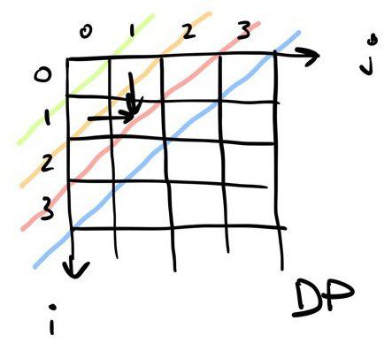

# ✅ [Solution][Swift] DP (Dynamic Programming) (564ms, beats 100%)

**Author:** adanilyak
**Votes:** 1
**Link:** [https://leetcode.com/problems/maximum-score-from-performing-multiplication-operations/solutions/2583345/](https://leetcode.com/problems/maximum-score-from-performing-multiplication-operations/solutions/2583345/)

---

**TC:** O(m ^ 2)
**SC:** O(m ^ 2)

Main idea is traverse the diagonals one by one and building the solution for each cell by choosing the max between top and left cells.

**i** - number of operations
**j** - number of nums taken from the tail of nums array.



```
class Solution {
    func maximumScore(_ nums: [Int], _ multipliers: [Int]) -> Int {
        
        let n = nums.count
        let m = multipliers.count
        
        var dp = Array(repeating: Array(repeating: 0, count: m + 1),
                       count: m + 1)
        
        var maxScore = Int.min
        
        for i in 0...m {
            for j in 0...i {
                
                if i == 0, j == 0 {
                    dp[i - j][j] = 0
                } else if i - j == 0 {
                    dp[i - j][j] = dp[i - j][j - 1] + multipliers[i - 1] * nums[n - j]
                } else if i != 0, j == 0 {
                    dp[i - j][j] = dp[i - j - 1][j] + multipliers[i - 1] * nums[i - 1]
                } else {
                    dp[i - j][j] = max(dp[i - j][j - 1] + multipliers[i - 1] * nums[n - j],
                                       dp[i - j - 1][j] + multipliers[i - 1] * nums[i - j - 1])
                }
                
                if i == m {
                    maxScore = max(maxScore, dp[i - j][j])
                }
            }
        }
        
        return maxScore   
    }
}
```