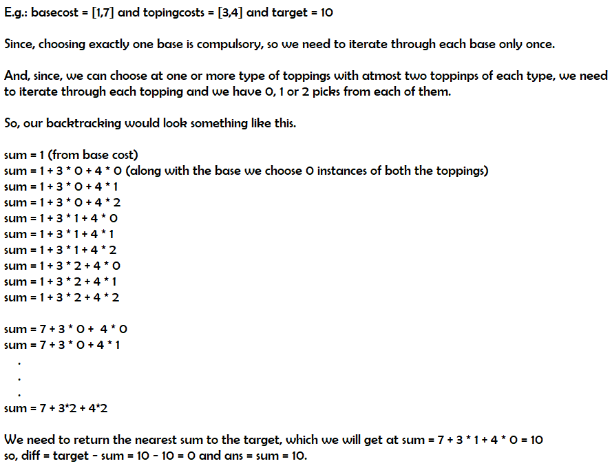

# Python: Explained Easy Backtracking with Time and Space complexity

**Author:** meaditya70
**Votes:** 15
**Link:** [https://leetcode.com/problems/closest-dessert-cost/solutions/1275679/](https://leetcode.com/problems/closest-dessert-cost/solutions/1275679/)

---

Just by looking at the constrains 1<=n,m<=10 we can say that this problem can be easily solved using backtracking.

Idea: Generate all possible solutions, In the below given fashion.


I hope this recursive idea makes sense!

Let n = number of bases and m = number of toppings
Time = O(n) for base and O(3^m) for toppings as each toppings has three possibilities (0,1,2)  = O(n * 3^m).
Space = O(3^n) for a ternary tree (3-way recursive stack).

The Full code:
```
class Solution:
    def closestCost(self, baseCosts: List[int], toppingCosts: List[int], target: int) -> int:
        self.ans = self.diff = float('inf')
        
        n = len(baseCosts)
        m = len(toppingCosts)
        
        
        def solve(sum, target, indx):
            if abs(sum - target) < self.diff:
                self.diff = abs(sum - target)
                self.ans = sum
            elif abs(sum - target) == self.diff:
                self.ans = min(self.ans, sum)
            
            
            if indx == m:
                return
            
            i = indx
            for count in range(3):
                sum += toppingCosts[i]*count
                solve(sum,target,i+1)
                sum -= toppingCosts[i]*count
        
        for i in baseCosts:
            solve(i, target, 0)
        return self.ans
```
