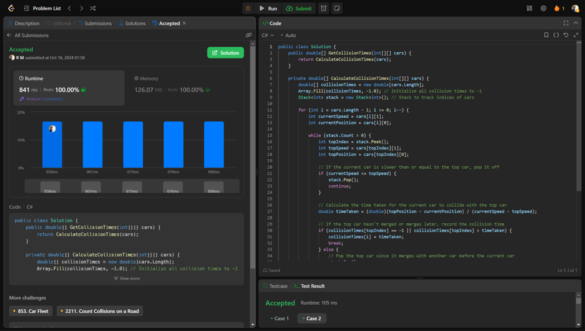

# 💥💥 Beats 100% on runtime and memory [EXPLAINED]

**Author:** r9n
**Votes:** 0
**Link:** [https://leetcode.com/problems/car-fleet-ii/solutions/5919429/](https://leetcode.com/problems/car-fleet-ii/solutions/5919429/)

---




# Intuition
To determine when two cars will collide, we need to calculate the time it takes for one car to reach the position of another car in front of it. If a faster car is behind a slower car, it may collide based on their speeds and positions. We also need to consider if the slower car has already merged with another car before the collision occurs.

# Approach
Start from the last car and use a stack to track cars; for each car, check if it can collide with the car in front by calculating the time taken; if the current car is slower, discard it; if a collision is possible, update the time, and keep adding valid cars to the stack.

# Complexity
- Time complexity:
O(n) because each car is processed once.

- Space complexity:
O(n) due to the stack that may store all cars in the worst case.

# Code
```csharp []
public class Solution {
    public double[] GetCollisionTimes(int[][] cars) {
        return CalculateCollisionTimes(cars);
    }

    private double[] CalculateCollisionTimes(int[][] cars) {
        double[] collisionTimes = new double[cars.Length];
        Array.Fill(collisionTimes, -1.0); // Initialize all collision times to -1
        Stack<int> stack = new Stack<int>(); // Stack to track indices of cars

        for (int i = cars.Length - 1; i >= 0; i--) {
            int currentSpeed = cars[i][1];
            int currentPosition = cars[i][0];

            while (stack.Count > 0) {
                int topIndex = stack.Peek();
                int topSpeed = cars[topIndex][1];
                int topPosition = cars[topIndex][0];

                // If the current car is slower than or equal to the top car, pop it off
                if (currentSpeed <= topSpeed) {
                    stack.Pop();
                    continue;
                }

                // Calculate the time taken for the current car to collide with the top car
                double timeTaken = (double)(topPosition - currentPosition) / (currentSpeed - topSpeed);

                // If the top car hasn't merged or merges later, record the collision time
                if (collisionTimes[topIndex] == -1 || collisionTimes[topIndex] > timeTaken) {
                    collisionTimes[i] = timeTaken;
                    break;
                } else {
                    // Pop the top car since it merges with another car before the current car
                    stack.Pop();
                }
            }

            // Push the current car's index onto the stack
            stack.Push(i);
        }

        return collisionTimes;
    }
}

```