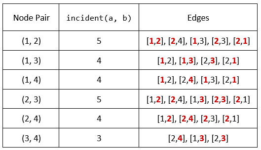

# [1782. Count Pairs Of Nodes](https://leetcode.com/problems/count-pairs-of-nodes/)

| Category | Difficulty | Likes | Dislikes |
| :------: | :--------: | :---: | :------: |
| Algorithms | Hard | 341 | 172 |

**Tags:** [`array`](https://leetcode.com/tag/array), [`hash-table`](https://leetcode.com/tag/hash-table), [`two-pointers`](https://leetcode.com/tag/two-pointers), [`binary-search`](https://leetcode.com/tag/binary-search), [`graph`](https://leetcode.com/tag/graph), [`sorting`](https://leetcode.com/tag/sorting), [`counting`](https://leetcode.com/tag/counting)

**Companies:** `amazon`

## Description

You are given an undirected graph defined by an integer `n`, the number of nodes, and a 2D integer array `edges`, the edges in the graph, where `edges[i] = [u_i, v_i]` indicates that there is an **undirected** edge between `u_i` and `v_i`. You are also given an integer array `queries`.

Let `incident(a, b)` be defined as the **number of edges** that are connected to **either** node `a` or `b`.

The answer to the `j^th` query is the **number of pairs** of nodes `(a, b)` that satisfy **both** of the following conditions:

	- `a  queries[j]`

Return *an array *`answers`* such that *`answers.length == queries.length`* and *`answers[j]`* is the answer of the *`j^th`* query*.

Note that there can be **multiple edges** between the same two nodes.

 

**Example 1:**


```

Input: n = 4, edges = [[1,2],[2,4],[1,3],[2,3],[2,1]], queries = [2,3]
Output: [6,5]
Explanation: The calculations for incident(a, b) are shown in the table above.
The answers for each of the queries are as follows:
- answers[0] = 6. All the pairs have an incident(a, b) value greater than 2.
- answers[1] = 5. All the pairs except (3, 4) have an incident(a, b) value greater than 3.

```

**Example 2:**

```

Input: n = 5, edges = [[1,5],[1,5],[3,4],[2,5],[1,3],[5,1],[2,3],[2,5]], queries = [1,2,3,4,5]
Output: [10,10,9,8,6]

```

 

**Constraints:**

	- `2 <= n <= 2 * 10^4`

	- `1 <= edges.length <= 10^5`

	- `1 <= u_i, v_i <= n`

	- `u_i != v_i`

	- `1 <= queries.length <= 20`

	- `0 <= queries[j] < edges.length`

---

**Links:** [Submissions](https://leetcode.com/problems/count-pairs-of-nodes/) | [Solutions](https://leetcode.com/problems/count-pairs-of-nodes/)
