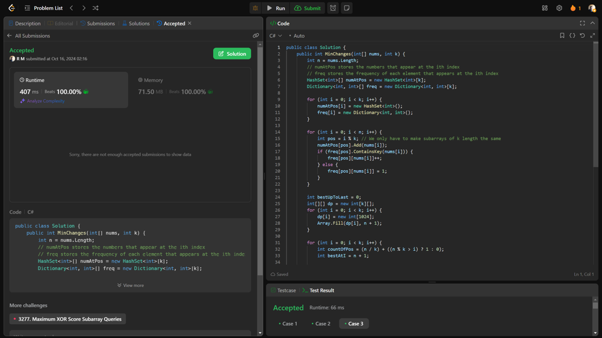

# 💥💥 Beats 100% on runtime and memory [EXPLAINED]

**Author:** r9n
**Votes:** 0
**Link:** [https://leetcode.com/problems/make-the-xor-of-all-segments-equal-to-zero/solutions/5919474/](https://leetcode.com/problems/make-the-xor-of-all-segments-equal-to-zero/solutions/5919474/)

---




# Intuition
The goal is to make sure that every segment of size k in the array has an XOR sum of zero. To achieve this, we need to determine how many changes are necessary to the elements in the array, since changing elements can affect the XOR value of these segments.

# Approach
We use dynamic programming to track the minimum changes needed for each segment, iterating through the array while keeping track of the frequency of elements at each position modulo k and calculating the best way to adjust the elements to achieve the desired XOR condition.

# Complexity
- Time complexity:
O(n\u22C5k\u22C5m), where \uD835\uDC5B n is the length of the array, \uD835\uDC58 k is the segment size, and \uD835\uDC5A m is the maximum value for XOR calculations (limited to 1024).

- Space complexity:
O(k\u22C5m) for the dynamic programming table and frequency counts.

# Code
```csharp []
public class Solution {
    public int MinChanges(int[] nums, int k) {
        int n = nums.Length;
        // numAtPos stores the numbers that appear at the ith index
        // freq stores the frequency of each element that appears at the ith index
        HashSet<int>[] numAtPos = new HashSet<int>[k];
        Dictionary<int, int>[] freq = new Dictionary<int, int>[k];

        for (int i = 0; i < k; i++) {
            numAtPos[i] = new HashSet<int>();
            freq[i] = new Dictionary<int, int>();
        }

        for (int i = 0; i < n; i++) {
            int pos = i % k; // We only have to make subarrays of k length the same
            numAtPos[pos].Add(nums[i]);
            if (freq[pos].ContainsKey(nums[i])) {
                freq[pos][nums[i]]++;
            } else {
                freq[pos][nums[i]] = 1;
            }
        }

        int bestUpToLast = 0;
        int[][] dp = new int[k][];
        for (int i = 0; i < k; i++) {
            dp[i] = new int[1024];
            Array.Fill(dp[i], n + 1);
        }

        for (int i = 0; i < k; i++) {
            int countOfPos = (n / k) + ((n % k > i) ? 1 : 0);
            int bestAtI = n + 1;

            for (int j = 0; j < 1024; j++) { // Can make XOR from 0-1023 for every index
                if (i == 0) {
                    // If it's the first index, we just have to change it to j by number of pos minus the number of times it already appears at i
                    dp[i][j] = countOfPos - (freq[i].ContainsKey(j) ? freq[i][j] : 0);
                } else {
                    // Either we can place a number that already appears most times at index i
                    foreach (int x in numAtPos[i]) {
                        dp[i][j] = Math.Min(dp[i][j], dp[i - 1][j ^ x] + countOfPos - (freq[i].ContainsKey(x) ? freq[i][x] : 0));
                    }
                    // Or we can just place the number x on all positions of i
                    dp[i][j] = Math.Min(dp[i][j], bestUpToLast + countOfPos);
                }
                bestAtI = Math.Min(bestAtI, dp[i][j]);
            }
            bestUpToLast = bestAtI;
        }
        return dp[k - 1][0];
    }
}

```