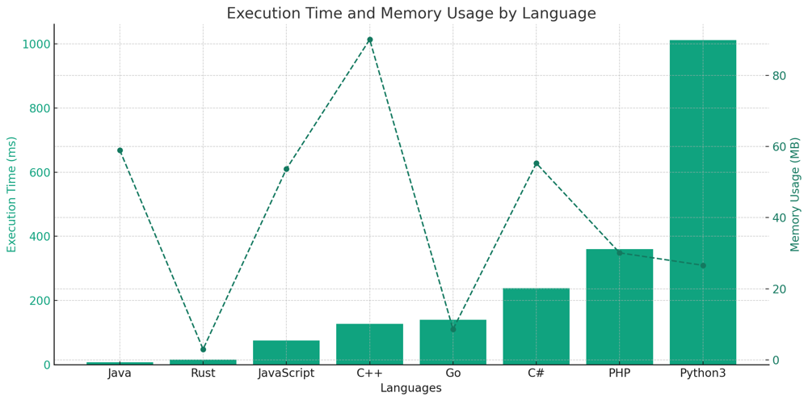

# ✅ 92.13% Two Pointers

**Author:** vanAmsen
**Votes:** 80
**Link:** [https://leetcode.com/problems/maximum-score-of-a-good-subarray/solutions/4194071/](https://leetcode.com/problems/maximum-score-of-a-good-subarray/solutions/4194071/)

---

# Intuition
The core of the problem revolves around identifying a subarray where the outcome of multiplying its length by its minimum element is the largest. A vital insight here is recognizing that the subarray yielding the utmost score will invariably encompass the element at index `k`. This observation drives the solution's strategy: initiate from the element at index `k` and consistently widen our window in both left and right directions. Throughout this expansion, we meticulously maintain the minimum element within this evolving window. This enables us to determine the score for every possible window and subsequently amplify it to the maximum.

## Live Coding with Comments
https://youtu.be/VZ3q3TMhuXQ?si=HBYf8Oefh8uBrUoM

# Approach
1. **Initialization**: 
   - We kick off by positioning the `left` and `right` pointers at index `k`. 
   - The variable `min_val` is promptly initialized with the element present at index `k`.
   - Simultaneously, `max_score` is set to the value of `min_val`. This essentially represents the score of the subarray `[k, k]`, a window with only one element, the `k`-th element.

2. **Expansion**:
   - During every loop iteration, we're faced with a decision: Should we shift the `left` pointer to the left, or should we move the `right` pointer to the right?
   - This decision hinges on two factors: 
     1. Ensuring we haven't reached the boundaries of the array.
     2. Comparing the values adjacent to the current `left` and `right` pointers to decide the more promising direction for expansion.

3. **Score Calculation**:
   - Post each expansion step, we refresh the value of `min_val`. This ensures it always mirrors the smallest element within our current window.
   - Subsequent to this update, we compute the score affiliated with the current window. This is straightforward and is the product of `min_val` and the current window's length. If this newly calculated score surpasses our existing `max_score`, we update `max_score`.

4. **Termination**:
   - The expansion loop is designed to persevere until it's impossible to further extend the window. This state is reached when the `left` pointer touches the start of the array or the `right` pointer hits the array's end.

# Complexity
- **Time complexity**: $$ O(n) $$ - Each element of the array is visited at most twice: once when expanding to the left and once when expanding to the right.
- **Space complexity**: $$ O(1) $$ - We only use a constant amount of extra space, irrespective of the input size.

# Code
``` Python []
class Solution:
    def maximumScore(self, nums: List[int], k: int) -> int:
        left, right = k, k
        min_val = nums[k]
        max_score = min_val
        
        while left > 0 or right < len(nums) - 1:
            if left == 0 or (right < len(nums) - 1 and nums[right + 1] > nums[left - 1]):
                right += 1
            else:
                left -= 1
            min_val = min(min_val, nums[left], nums[right])
            max_score = max(max_score, min_val * (right - left + 1))
        
        return max_score
```
``` Rust []
impl Solution {
    pub fn maximum_score(nums: Vec<i32>, k: i32) -> i32 {
        let mut left = k as usize;
        let mut right = k as usize;
        let mut min_val = nums[k as usize];
        let mut max_score = min_val;

        while left > 0 || right < nums.len() - 1 {
            if left == 0 || (right < nums.len() - 1 && nums[right + 1] > nums[left - 1]) {
                right += 1;
            } else {
                left -= 1;
            }
            min_val = min_val.min(nums[left].min(nums[right]));
            max_score = max_score.max(min_val * (right as i32 - left as i32 + 1));
        }
        
        max_score
    }
}
```
``` Go []
func maximumScore(nums []int, k int) int {
    left, right := k, k
    min_val := nums[k]
    max_score := min_val

    for left > 0 || right < len(nums) - 1 {
        if left == 0 || (right < len(nums) - 1 && nums[right+1] > nums[left-1]) {
            right++
        } else {
            left--
        }
        min_val = min(min_val, min(nums[left], nums[right]))
        max_score = max(max_score, min_val * (right - left + 1))
    }
    
    return max_score
}

func min(a, b int) int {
    if a < b {
        return a
    }
    return b
}

func max(a, b int) int {
    if a > b {
        return a
    }
    return b
}
```
``` C++ []
class Solution {
public:
    int maximumScore(std::vector<int>& nums, int k) {
        int left = k, right = k;
        int min_val = nums[k];
        int max_score = min_val;

        while (left > 0 || right < nums.size() - 1) {
            if (left == 0 || (right < nums.size() - 1 && nums[right + 1] > nums[left - 1])) {
                right++;
            } else {
                left--;
            }
            min_val = std::min(min_val, std::min(nums[left], nums[right]));
            max_score = std::max(max_score, min_val * (right - left + 1));
        }
        
        return max_score;
    }
};
```
``` Java []
public class Solution {
    public int maximumScore(int[] nums, int k) {
        int left = k, right = k;
        int min_val = nums[k];
        int max_score = min_val;

        while (left > 0 || right < nums.length - 1) {
            if (left == 0 || (right < nums.length - 1 && nums[right + 1] > nums[left - 1])) {
                right++;
            } else {
                left--;
            }
            min_val = Math.min(min_val, Math.min(nums[left], nums[right]));
            max_score = Math.max(max_score, min_val * (right - left + 1));
        }
        
        return max_score;
    }
}
```
``` C# []
public class Solution {
    public int MaximumScore(int[] nums, int k) {
        int left = k, right = k;
        int min_val = nums[k];
        int max_score = min_val;

        while (left > 0 || right < nums.Length - 1) {
            if (left == 0 || (right < nums.Length - 1 && nums[right + 1] > nums[left - 1])) {
                right++;
            } else {
                left--;
            }
            min_val = Math.Min(min_val, Math.Min(nums[left], nums[right]));
            max_score = Math.Max(max_score, min_val * (right - left + 1));
        }
        
        return max_score;
    }
}
```
``` JavaScript []
/**
 * @param {number[]} nums
 * @param {number} k
 * @return {number}
 */
var maximumScore = function(nums, k) {
        let left = k, right = k;
        let min_val = nums[k];
        let max_score = min_val;

        while (left > 0 || right < nums.length - 1) {
            if (left == 0 || (right < nums.length - 1 && nums[right + 1] > nums[left - 1])) {
                right++;
            } else {
                left--;
            }
            min_val = Math.min(min_val, Math.min(nums[left], nums[right]));
            max_score = Math.max(max_score, min_val * (right - left + 1));
        }
        
        return max_score;
    }
```
``` PHP []
class Solution {
    function maximumScore($nums, $k) {
        $left = $k;
        $right = $k;
        $min_val = $nums[$k];
        $max_score = $min_val;

        while ($left > 0 || $right < count($nums) - 1) {
            if ($left == 0 || ($right < count($nums) - 1 && $nums[$right + 1] > $nums[$left - 1])) {
                $right++;
            } else {
                $left--;
            }
            $min_val = min($min_val, min($nums[$left], $nums[$right]));
            $max_score = max($max_score, $min_val * ($right - $left + 1));
        }
        
        return $max_score;
    }
}
```

# Performance
| Language   | Execution Time (ms) | Memory Usage (MB) |
|------------|---------------------|-------------------|
| Java       | 8                   | 59                |
| Rust       | 16                  | 3                 |
| JavaScript | 75                  | 53.7              |
| C++        | 127                 | 90.1              |
| Go         | 140                 | 8.6               |
| C#         | 238                 | 55.3              |
| PHP        | 360                 | 30.1              |
| Python3    | 1011                | 26.6              |




# Why It Works
This strategy thrives due to the inherent constraint that the optimal subarray must include the element at index `k`. By commencing our search from this element and methodically expanding outwards, we ensure every possible subarray containing the element at `k` is evaluated. By perpetually updating `min_val` and recalculating the score after each expansion, we guarantee that the maximum score is captured by the time the algorithm concludes.

# What We Learned
- The importance of identifying and leveraging the constraints of a problem. In this case, knowing that the subarray must contain the element at index $$ k $$ is crucial for devising the optimal strategy.
- The two-pointer approach is a versatile technique, especially for problems involving arrays and strings. By moving the pointers based on certain conditions, we can explore the solution space efficiently.
