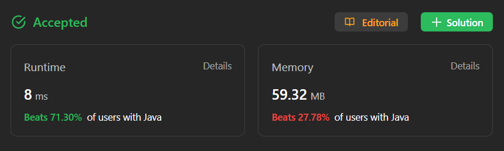

# ✅ Not HARD ✅ Super Simple Approach✅ Two Pointers ✅ Explained with Video

**Author:** millenium103
**Votes:** 42
**Link:** [https://leetcode.com/problems/maximum-score-of-a-good-subarray/solutions/4194454/](https://leetcode.com/problems/maximum-score-of-a-good-subarray/solutions/4194454/)

---

# YouTube Video Explanation:
[https://youtu.be/IPkDv4UiRIo](https://youtu.be/IPkDv4UiRIo)

**\uD83D\uDD25 Please like, share, and subscribe to support our channel's mission of making complex concepts easy to understand.**

Subscribe Link: https://www.youtube.com/@leetlogics/?sub_confirmation=1

*Subscribe Goal: 150 Subscribers*
*Current Subscribers: 104*

# Intuition:

The goal is to find a good subarray, which starts at index `k`. A good subarray is one where `k` is positioned in such a way that it optimizes the minimum value of the subarray while maximizing its length.

# Approach:

1. Initialize the result variable `res` and the minimum variable `mini` to the value at index `k`. The idea is to start with `k` as the midpoint of the subarray.
2. Initialize two pointers, `i` and `j`, both initially set to `k`. These pointers will help expand the subarray.
3. While one of the pointers (`i` or `j`) is not at the boundary of the array:
   - If `i` is at the left boundary (0), increment `j`.
   - If `j` is at the right boundary (`n - 1`), decrement `i`.
   - If the element at `A[i - 1]` is smaller than the element at `A[j + 1]`, increment `j` to expand the subarray to the right.
   - Otherwise, decrement `i` to expand the subarray to the left.
4. Update `mini` with the minimum value between `A[i]` and `A[j]`.
5. Update `res` with the maximum of the current `res` and `mini * (j - i + 1)`. This step is crucial as it calculates the score of the current subarray and keeps track of the maximum score found.
6. Continue the process until one of the pointers reaches a boundary.
7. Finally, return `res` as the maximum score of a good subarray.

# Time Complexity:

- Time Complexity: The time complexity of this approach is `O(n)`, where n is the length of the input array A. This is because we traverse the array from left to right just once.

- Space complexity: The space complexity of this approach is `O(1)`, beacuse we use only few variables.
<!-- Add your space complexity here, e.g. $$O(n)$$ -->

# Code

<iframe src="https://leetcode.com/playground/izNNjWKU/shared" frameBorder="0" width="800" height="400"></iframe>

---

