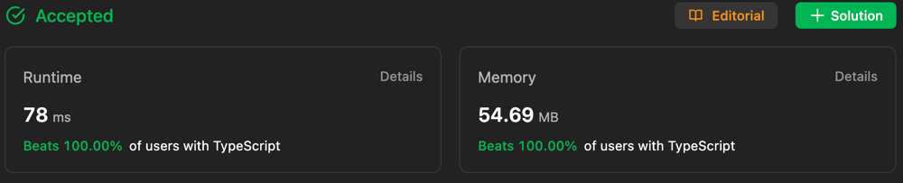
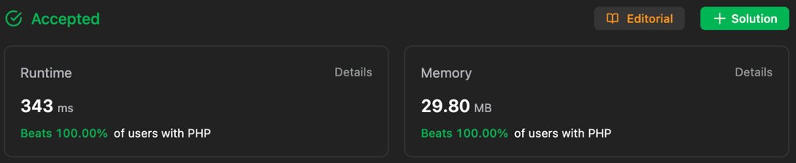
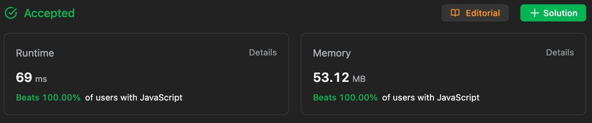

# ✅ Beats 100% 🔥 in 4 Languages || Beginner Friendly Eplanation ||

**Author:** Gourav-2002
**Votes:** 3
**Link:** [https://leetcode.com/problems/maximum-score-of-a-good-subarray/solutions/4194192/](https://leetcode.com/problems/maximum-score-of-a-good-subarray/solutions/4194192/)

---

## TypeScript :


## PHP :



## JavaScript :


## Ruby :


# Intuition : 
##### For each index k, find the maximum length of a subarray with minimum value nums[k]. The answer is the maximum of those values.
<!-- Describe your first thoughts on how to solve this problem. -->
# Explanation :
**For each index k, let us find left and right, the boundaries of this subarray. The minimum of nums[left], nums[left + 1], ..., nums[right] will be the answer for this subarray. We can use two pointers to find left and right. The condition for moving our pointers is as follows: we want to move right whenever min(nums[left], nums[left + 1], ..., nums[right]) < min(nums[left], nums[left + 1], ..., nums[right], nums[right + 1]) and left > 0, and we want to move left whenever min(nums[left - 1], nums[left - 2], ..., nums[right]) >= min(nums[left], nums[left + 1], ..., nums[right]). The first condition means that we want to include more elements in our subarray, and the second condition means that we do not want to exclude any elements from our subarray. The subarray we have found is then [left, left + 1, ..., right]. The length is right - left + 1, and the minimum of the subarray is min(nums[left], nums[left + 1], ..., nums[right]). We multiply these together to get the score of this subarray, which is (right - left + 1) * min(nums[left], nums[left + 1], ..., nums[right]). We take the maximum of all these values to get the answer.**

# Approach : Two Pointers
1. Initialize left = k and right = k.
2. While left > 0 or right < nums.length - 1:
    1. If left == 0, then right += 1.
    2. Else if right == nums.length - 1, then left -= 1.
    3. Else if nums[left - 1] > nums[right + 1], then left -= 1.
    4. Else right += 1.
3. Update the answer as max(answer, (right - left + 1) * min(nums[left], nums[left + 1], ..., nums[right])).
4. Return answer.
<!-- Describe your approach to solving the problem. -->

# Complexity
- Time complexity : ***O(n)***, *where n is the length of nums.*
<!-- Add your time complexity here, e.g. $$O(n)$$ -->

- Space complexity : ***O(1)***
<!-- Add your space complexity here, e.g. $$O(n)$$ -->

### Please UpVote if this helps you :)\uD83D\uDE03

# Code
``` Python []
class Solution:
    def maximumScore(self, nums: List[int], k: int) -> int:
        res=nums[k]
        i=k
        j=k
        min_val=nums[k]

        while i>0 or j<len(nums)-1:
            if i==0:
                j+=1
                min_val=min(min_val,nums[j])
            elif j==len(nums)-1:
                i-=1
                min_val=min(min_val,nums[i])
            elif nums[i-1]>nums[j+1]:
                i-=1
                min_val=min(min_val,nums[i])
            else:
                j+=1
                min_val=min(min_val,nums[j])
            res=max(res,min_val*(j-i+1))
        return res
```
``` C++ []
class Solution {
public:
    int maximumScore(vector<int>& nums, int k) {
        int res = nums[k];
        int i = k;
        int j = k;
        int min_val = nums[k];

        while (i > 0 || j < nums.size() - 1) {
            if (i == 0) {
                j += 1;
                min_val = min(min_val, nums[j]);
            } else if (j == nums.size() - 1) {
                i -= 1;
                min_val = min(min_val, nums[i]);
            } else if (nums[i - 1] > nums[j + 1]) {
                i -= 1;
                min_val = min(min_val, nums[i]);
            } else {
                j += 1;
                min_val = min(min_val, nums[j]);
            }

            res = max(res, min_val * (j - i + 1));
        }

        return res;
    }
};

```
``` Java []
class Solution {
    public int maximumScore(int[] nums, int k) {
        int res = nums[k];
        int i = k;
        int j = k;
        int min_val = nums[k];

        while (i > 0 || j < nums.length - 1) {
            if (i == 0) {
                j += 1;
                min_val = Math.min(min_val, nums[j]);
            } else if (j == nums.length - 1) {
                i -= 1;
                min_val = Math.min(min_val, nums[i]);
            } else if (nums[i - 1] > nums[j + 1]) {
                i -= 1;
                min_val = Math.min(min_val, nums[i]);
            } else {
                j += 1;
                min_val = Math.min(min_val, nums[j]);
            }

            res = Math.max(res, min_val * (j - i + 1));
        }

        return res;
    }
}

```
``` C# []
public class Solution {
    public int MaximumScore(int[] nums, int k) {
        int res = nums[k];
        int i = k;
        int j = k;
        int min_val = nums[k];

        while (i > 0 || j < nums.Length - 1) {
            if (i == 0) {
                j += 1;
                min_val = Math.Min(min_val, nums[j]);
            } else if (j == nums.Length - 1) {
                i -= 1;
                min_val = Math.Min(min_val, nums[i]);
            } else if (nums[i - 1] > nums[j + 1]) {
                i -= 1;
                min_val = Math.Min(min_val, nums[i]);
            } else {
                j += 1;
                min_val = Math.Min(min_val, nums[j]);
            }

            res = Math.Max(res, min_val * (j - i + 1));
        }

        return res;
    }
}

```
``` JavaScript []
/**
 * @param {number[]} nums
 * @param {number} k
 * @return {number}
 */
var maximumScore = function(nums, k) {
    let res = nums[k];
        let i = k;
        let j = k;
        let min_val = nums[k];

        while (i > 0 || j < nums.length - 1) {
            if (i === 0) {
                j += 1;
                min_val = Math.min(min_val, nums[j]);
            } else if (j === nums.length - 1) {
                i -= 1;
                min_val = Math.min(min_val, nums[i]);
            } else if (nums[i - 1] > nums[j + 1]) {
                i -= 1;
                min_val = Math.min(min_val, nums[i]);
            } else {
                j += 1;
                min_val = Math.min(min_val, nums[j]);
            }

            res = Math.max(res, min_val * (j - i + 1));
        }

        return res;
};
```
``` TypeScript []
function maximumScore(nums: number[], k: number): number {
let res = nums[k];
        let i = k;
        let j = k;
        let min_val = nums[k];

        while (i > 0 || j < nums.length - 1) {
            if (i === 0) {
                j += 1;
                min_val = Math.min(min_val, nums[j]);
            } else if (j === nums.length - 1) {
                i -= 1;
                min_val = Math.min(min_val, nums[i]);
            } else if (nums[i - 1] > nums[j + 1]) {
                i -= 1;
                min_val = Math.min(min_val, nums[i]);
            } else {
                j += 1;
                min_val = Math.min(min_val, nums[j]);
            }

            res = Math.max(res, min_val * (j - i + 1));
        }

        return res;
};
```
``` PHP []
class Solution {

    /**
     * @param Integer[] $nums
     * @param Integer $k
     * @return Integer
     */
    function maximumScore($nums, $k) {
        $es = $nums[$k];
    $i = $k;
    $j = $k;
    $min_val = $nums[$k];
    $len = count($nums);
    $res = $min_val * ($j - $i + 1);

    while ($i > 0 || $j < $len - 1) {
        if ($i == 0) {
            $j += 1;
            $min_val = min($min_val, $nums[$j]);
        } elseif ($j == $len - 1) {
            $i -= 1;
            $min_val = min($min_val, $nums[$i]);
        } elseif ($nums[$i - 1] > $nums[$j + 1]) {
            $i -= 1;
            $min_val = min($min_val, $nums[$i]);
        } else {
            $j += 1;
            $min_val = min($min_val, $nums[$j]);
        }

        $res = max($res, $min_val * ($j - $i + 1));
    }

    return $res;
    }
}
```
``` Ruby []
# @param {Integer[]} nums
# @param {Integer} k
# @return {Integer}
def maximum_score(nums, k)
    res = nums[k]
        i = k
        j = k
        min_val = nums[k]

        while i > 0 || j < nums.length - 1
            if i == 0
                j += 1
                min_val = [min_val, nums[j]].min
            elsif j == nums.length - 1
                i -= 1
                min_val = [min_val, nums[i]].min
            elsif nums[i - 1] > nums[j + 1]
                i -= 1
                min_val = [min_val, nums[i]].min
            else
                j += 1
                min_val = [min_val, nums[j]].min
            end

            res = [res, min_val * (j - i + 1)].max
        end

        res
end
```