# Image Explanation🏆- [Fastest + Complete Intuition] - C++/Java/Python

**Author:** aryan_0077
**Votes:** 101
**Link:** [https://leetcode.com/problems/maximize-score-after-n-operations/solutions/3521675/](https://leetcode.com/problems/maximize-score-after-n-operations/solutions/3521675/)

---

# Video Solution (`Aryan Mittal`) - Link in LeetCode Profile
`Maximize Score After N Operations` by `Aryan Mittal`


# Approach & Intution
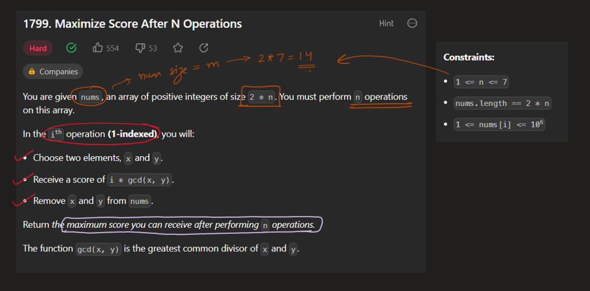
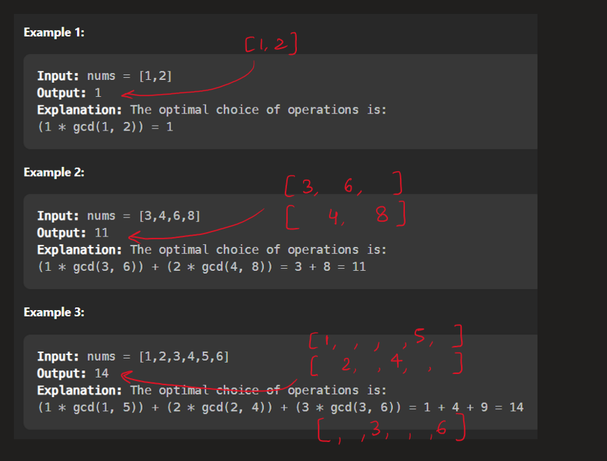
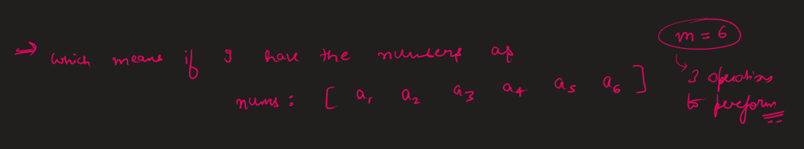
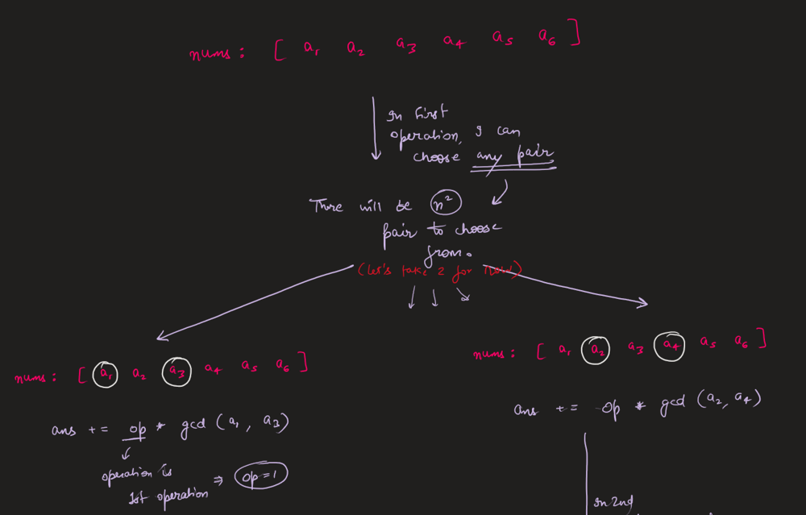
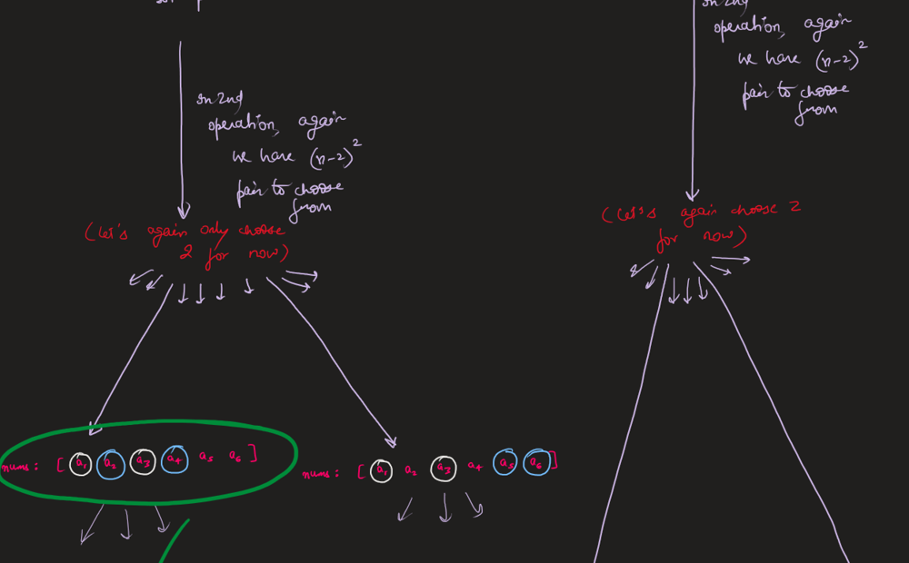
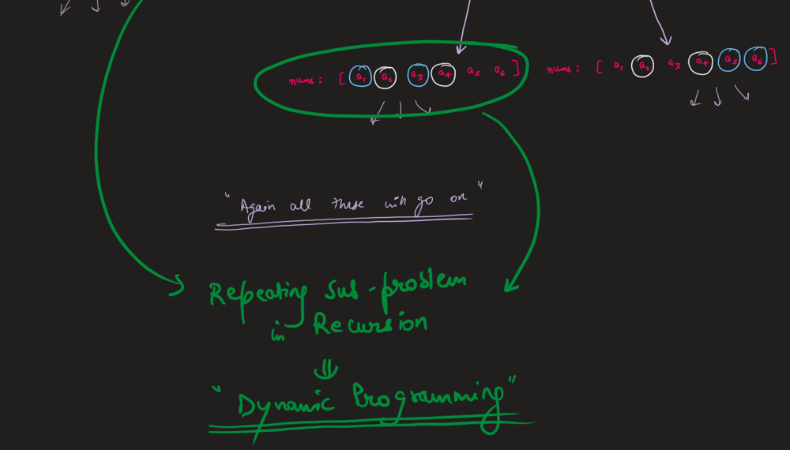
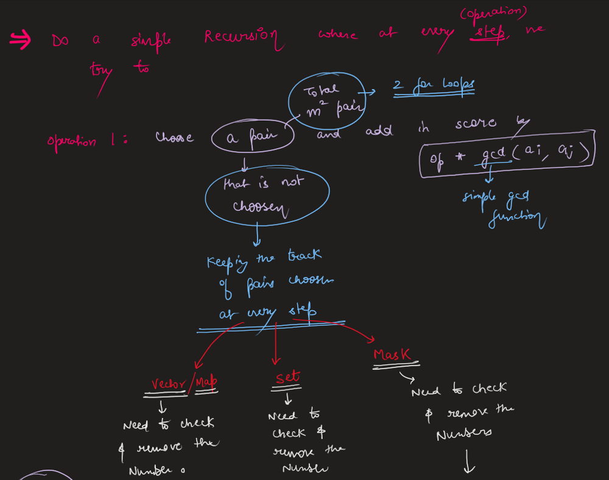
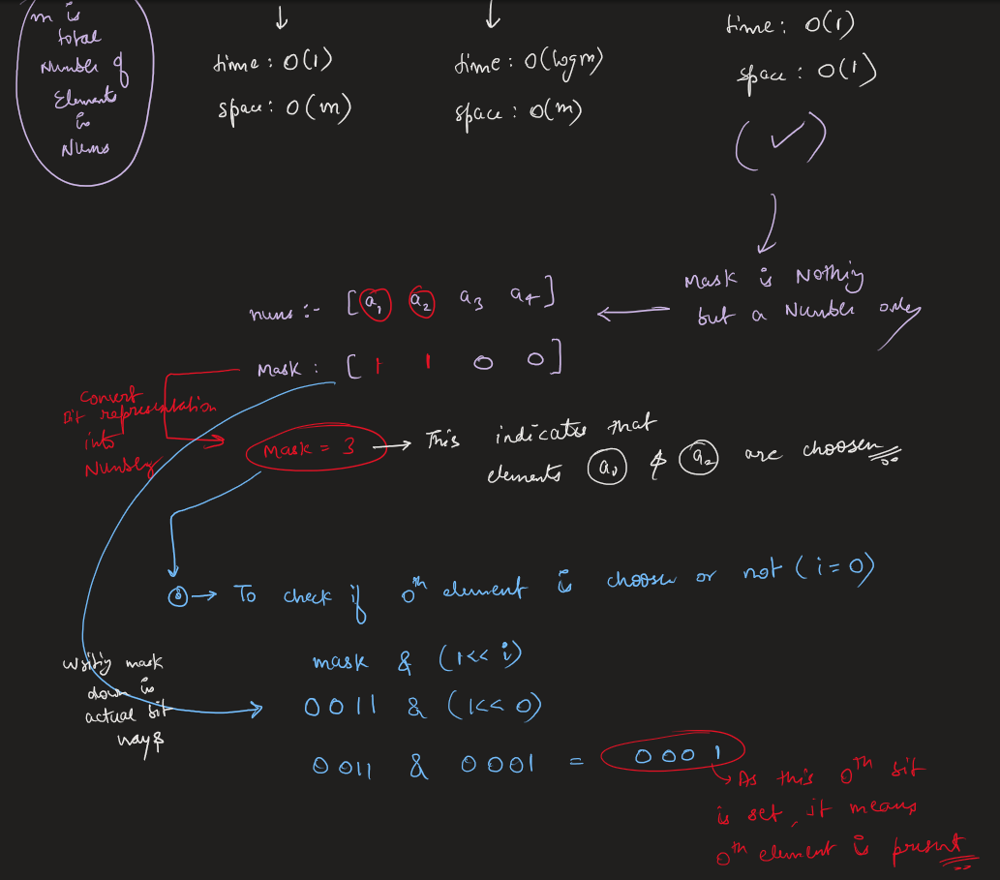
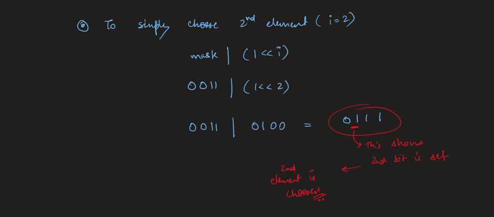
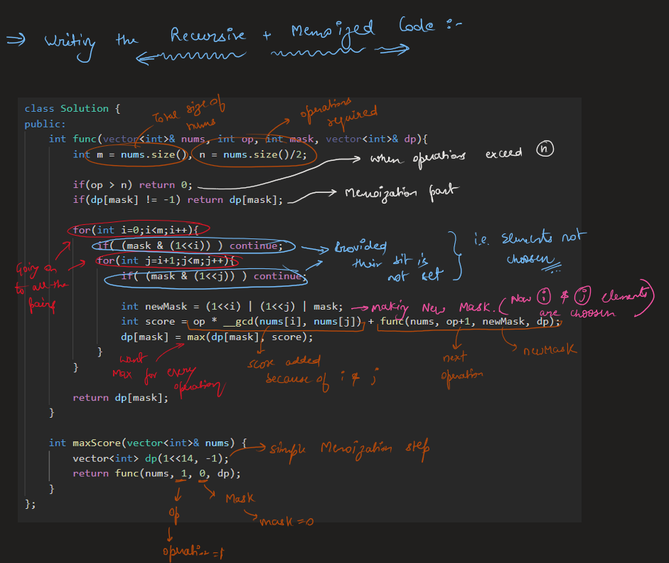
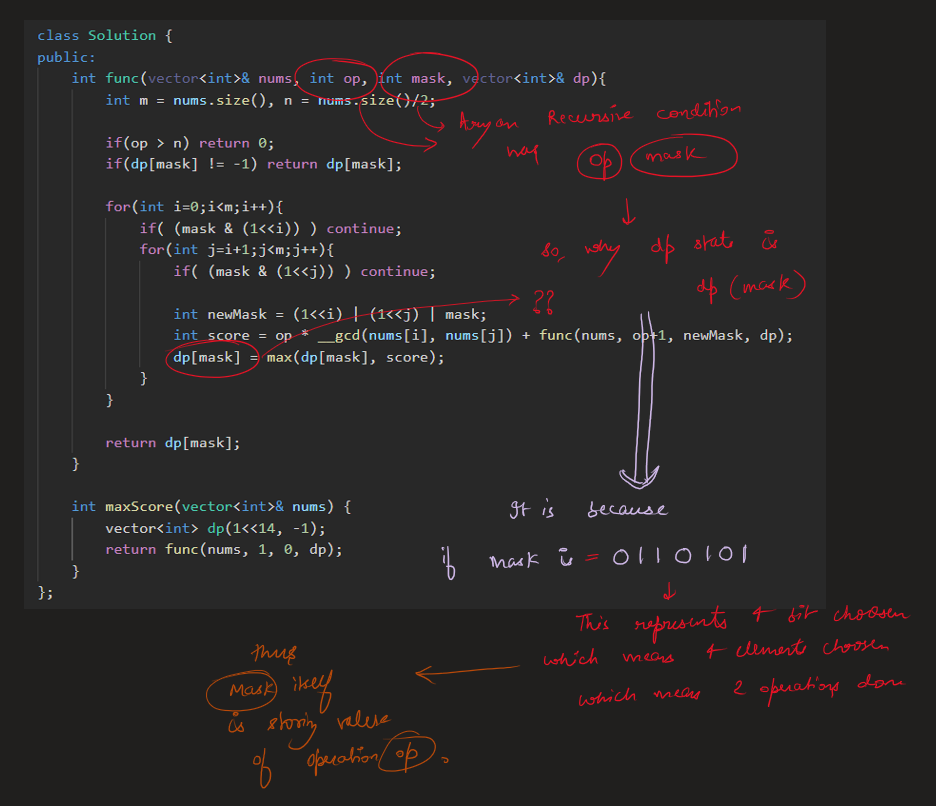
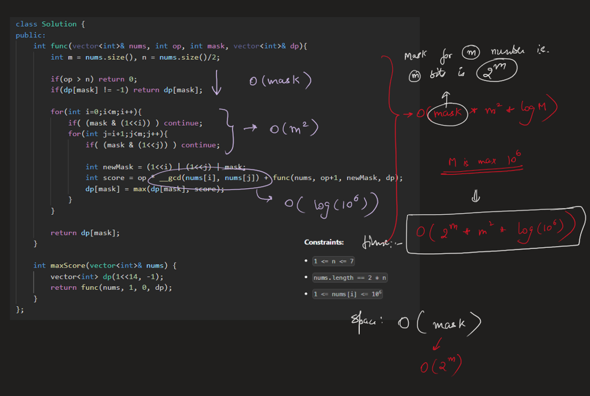

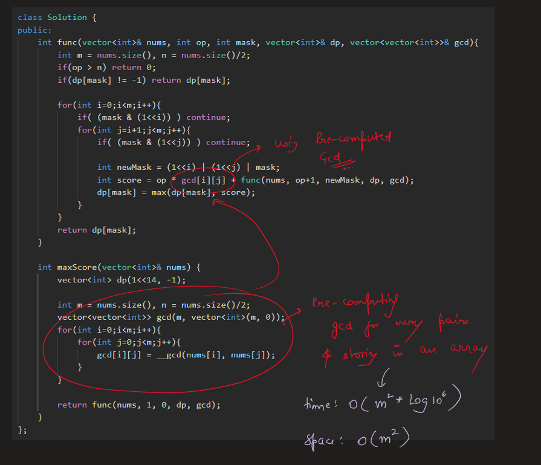
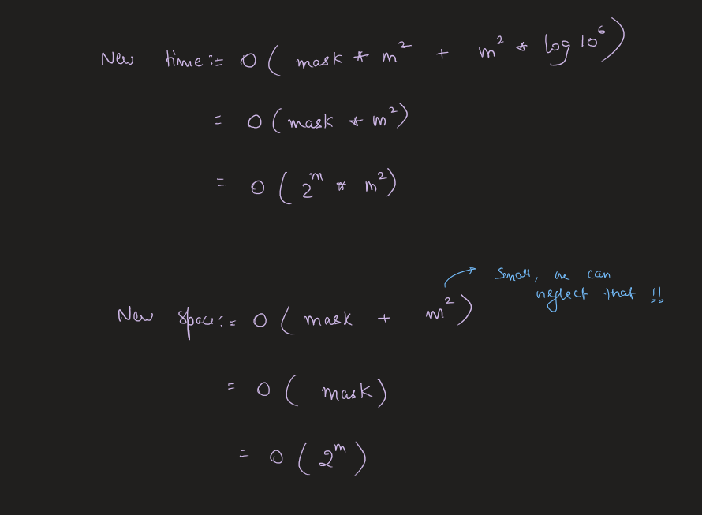


# Code
```C++ []
class Solution {
public:
    int func(vector<int>& nums, int op, int mask, vector<int>& dp, vector<vector<int>>& gcd){
        int m = nums.size(), n = nums.size()/2;
        if(op > n) return 0;
        if(dp[mask] != -1) return dp[mask];

        for(int i=0;i<m;i++){
            if( (mask & (1<<i)) ) continue;
            for(int j=i+1;j<m;j++){
                if( (mask & (1<<j)) ) continue;
                
                int newMask = (1<<i) | (1<<j) | mask;
                int score = op * gcd[i][j] + func(nums, op+1, newMask, dp, gcd);
                dp[mask] = max(dp[mask], score);
            }
        }
        return dp[mask];
    }

    int maxScore(vector<int>& nums) {
        vector<int> dp(1<<14, -1);

        int m = nums.size(), n = nums.size()/2;
        vector<vector<int>> gcd(m, vector<int>(m, 0));
        for(int i=0;i<m;i++){
            for(int j=0;j<m;j++){
                gcd[i][j] = __gcd(nums[i], nums[j]);
            }
        }

        return func(nums, 1, 0, dp, gcd);
    }
};
```
```Java []
class Solution {
    public int func(int[] nums, int op, int mask, int[] dp, int[][] gcd) {
        int m = nums.length, n = nums.length/2;

        if(op > n) return 0;
        if(dp[mask] != -1) return dp[mask];

        for(int i=0; i<m; i++) {
            if( (mask & (1<<i)) != 0 ) continue;
            for(int j=i+1; j<m; j++) {
                if( (mask & (1<<j)) != 0 ) continue;

                int newMask = (1<<i) | (1<<j) | mask;
                int score = op * gcd[i][j] + func(nums, op+1, newMask, dp, gcd);
                dp[mask] = Math.max(dp[mask], score);
            }
        }

        return dp[mask];
    }

    public int maxScore(int[] nums) {
        int[] dp = new int[1<<14];
        Arrays.fill(dp, -1);

        int m = nums.length, n = nums.length/2;
        int[][] gcd = new int[m][m];
        for(int i=0; i<m; i++) {
            for(int j=0; j<m; j++) {
                gcd[i][j] = gcd(nums[i], nums[j]);
            }
        }

        return func(nums, 1, 0, dp, gcd);
    }

    private int gcd(int a, int b) {
        return b == 0 ? a : gcd(b, a % b);
    }
}
```
```Python []
class Solution:
    def maxScore(self, nums: List[int]) -> int:
        @lru_cache(None)
        def gcd(x, y):
            return math.gcd(x, y)

        @lru_cache(None)
        def dp(op, mask):
            if op == n + 1:
                return 0

            ans = 0
            for i in range(m):
                if (mask >> i) & 1: continue 
                for j in range(i + 1, m):
                    if (mask >> j) & 1: continue  
                    newMask = (1 << i) | (1 << j) | mask 
                    score = op * gcd(nums[i], nums[j]) + dp(op + 1, newMask)
                    ans = max(ans, score)
            return ans

        m = len(nums)
        n = m // 2
        return dp(1, 0)
```
