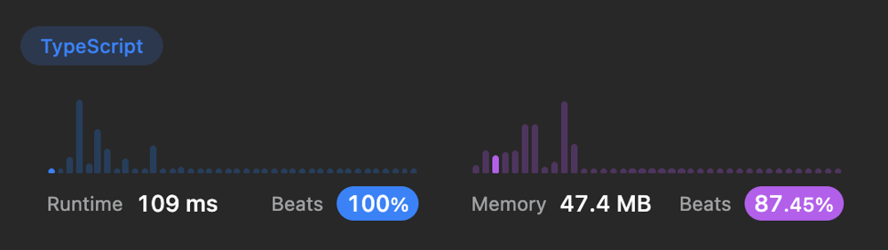
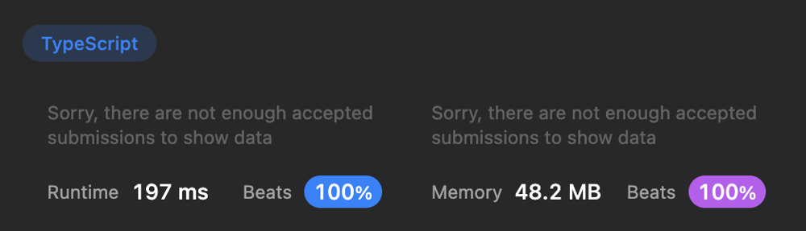

# 🚀 109ms, 100% Beats Runtime. TypeScript, JavaScript

**Author:** ArtMe
**Votes:** 0
**Link:** [https://leetcode.com/problems/maximize-score-after-n-operations/solutions/3523911/](https://leetcode.com/problems/maximize-score-after-n-operations/solutions/3523911/)

---

# Code
``` typescript []
function maxScore(nums: number[]): number {
    const nn = 1 << nums.length;
    const dp = new Array(nn).fill(0);
    const gcds = Array.from(Array(nums.length), () => new Array(nums.length).fill(0));
    let temp = 0, a = 0, b = 0, m = 0, bits = 0;
    for (let i = 0; i < nums.length; i++) {
        for (let j = i; j < nums.length; j++) {
            temp = 0;
            a = nums[i];
            b = nums[j];
            while (b !== 0) {
                temp = b;
                b = a % b;
                a = temp;
            }
            gcds[i][j] = gcds[j][i] = a;
        }
    }
    for (let mask = 0; mask < nn; mask++) {
        m = mask;
        bits = 0;
        while (m) {
            m = m & (m - 1);
            bits++;
        }
        if (bits % 2) {
            continue;
        }
        for (let i = 0; i < nums.length; i++) {
            if (!(mask & (1 << i))) {
                continue;
            }
            for (let j = i + 1; j < nums.length; j++) {
                if (!(mask & (1 << j))) {
                    continue;
                }
                dp[mask] = Math.max(dp[mask], dp[mask ^ (1 << i) ^ (1 << j)] + bits / 2 * gcds[i][j]); 
            } 
        }
    }
    return dp[nn - 1];
};
```
``` javascript []
var maxScore = function(nums) {
    const nn = 1 << nums.length;
    const dp = new Array(nn).fill(0);
    const gcds = Array.from(Array(nums.length), () => new Array(nums.length).fill(0));
    let temp = 0, a = 0, b = 0, m = 0, bits = 0;
    for (let i = 0; i < nums.length; i++) {
        for (let j = i; j < nums.length; j++) {
            temp = 0;
            a = nums[i];
            b = nums[j];
            while (b !== 0) {
                temp = b;
                b = a % b;
                a = temp;
            }
            gcds[i][j] = gcds[j][i] = a;
        }
    }
    for (let mask = 0; mask < nn; mask++) {
        m = mask;
        bits = 0;
        while (m) {
            m = m & (m - 1);
            bits++;
        }
        if (bits % 2) {
            continue;
        }
        for (let i = 0; i < nums.length; i++) {
            if (!(mask & (1 << i))) {
                continue;
            }
            for (let j = i + 1; j < nums.length; j++) {
                if (!(mask & (1 << j))) {
                    continue;
                }
                dp[mask] = Math.max(dp[mask], dp[mask ^ (1 << i) ^ (1 << j)] + bits / 2 * gcds[i][j]); 
            } 
        }
    }
    return dp[nn - 1];
};
```



## Alternative solution (Recursive):
```typescript []
const dp: number[][] = [];

const gcd = (a: number, b: number): number => {
    while (b !== 0) {
        const temp = b;
        b = a % b;
        a = temp;
    }
    return a;
}

const rec = (memo: any, mask: number, step: number): number => {
    if (memo[mask]) {
        return memo[mask];
    }
    let max = 0;
    for (let i = 0; i < dp.length; i++) {
        if ((mask >> i) & 1) {
            continue;
        }
        for (let j = i + 1; j < dp[0].length; j++) {
            if ((mask >> j) & 1) {
                continue;
            }
            max = Math.max(max, step * dp[i][j] + rec(memo, mask | (1 << i) | (1 << j), step + 1));
        }
    }
    memo[mask] = max;
    return max;
}

function maxScore(nums: number[]): number {
    for (let i = 0; i < nums.length - 1; i++) {
        dp[i] = [];
        for (let j= i + 1; j < nums.length; j++) {
            dp[i][j] = gcd(nums[i], nums[j]);
        }
    }
    return rec({}, 0, 1);
};
```
```javascript []
const dp = [];

const gcd = (a, b) => {
    while (b !== 0) {
        const temp = b;
        b = a % b;
        a = temp;
    }
    return a;
}

const rec = (memo, mask, step) => {
    if (memo[mask]) {
        return memo[mask];
    }
    let max = 0;
    for (let i = 0; i < dp.length; i++) {
        if ((mask >> i) & 1) {
            continue;
        }
        for (let j = i + 1; j < dp[0].length; j++) {
            if ((mask >> j) & 1) {
                continue;
            }
            max = Math.max(max, step * dp[i][j] + rec(memo, mask | (1 << i) | (1 << j), step + 1));
        }
    }
    memo[mask] = max;
    return max;
}

function maxScore(nums) {
    for (let i = 0; i < nums.length - 1; i++) {
        dp[i] = [];
        for (let j= i + 1; j < nums.length; j++) {
            dp[i][j] = gcd(nums[i], nums[j]);
        }
    }
    return rec({}, 0, 1);
};
```


## Alternative solution (Iterative):
```
const gcd = (a: number, b: number): number => {
    while (b !== 0) {
        const temp = b;
        b = a % b;
        a = temp;
    }
    return a;
};

const maxScore = (nums: number[]): number => {
  const casesCount = 1 << nums.length;
  const lastMask = casesCount - 1;
  const dp: number[] = new Array(casesCount).fill(0);
  const gcds: number[][] = [];
  for (let i = 0; i < nums.length; i++) {
    gcds.push([]);
    for (let j = i + 1; j < nums.length; j++) {
      gcds[i][j] = gcd(nums[i], nums[j]);
    }
  }
  dp[lastMask] = 0;
  for (let mask = lastMask - 1; mask >= 0; mask--) {
    const numbersUsed = mask.toString(2).split('1').length - 1;
    const step = (numbersUsed >> 1) + 1;
    if (numbersUsed & 1) {
      continue;
    }
    for (let i = 0; i < nums.length; i++) {
      if ((mask >> i) & 1) {
        continue;
      }
      for (let j = i + 1; j < nums.length; j++) {
        if ((mask >> j) & 1) {
          continue;
        }
        const score = step * gcds[i][j];
        const newMask = mask | (1 << i) | (1 << j);
        const nextScore = dp[newMask];
        dp[mask] = Math.max(dp[mask], score + nextScore);
      }
    }
  }
  return dp[0];
};
```

