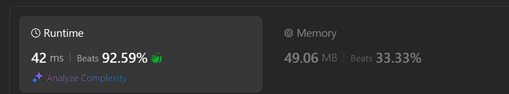
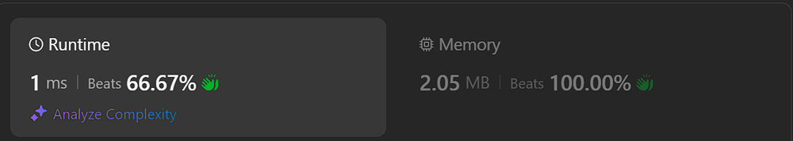

# ✅ Working 06.10.2024 | Explained

**Author:** Piotr_Maminski
**Votes:** 5
**Link:** [https://leetcode.com/problems/sentence-similarity-iii/solutions/5875310/](https://leetcode.com/problems/sentence-similarity-iii/solutions/5875310/)

---


```python3 []
class Solution:
    def areSentencesSimilar(self, sentence1: str, sentence2: str) -> bool:
        # Command 1: Split both input strings into lists of words
        sentence1 = sentence1.split(" ")
        sentence2 = sentence2.split(" ")

        # Command 2: If both sentences are identical, return True immediately
        if sentence1 == sentence2: return True

        # Command 3: Initialize empty lists for common prefixes and suffixes
        # Also get the lengths of both sentences for easier reference
        prefix, suffix = [], []
        n, m = len(sentence1), len(sentence2)

        # Command 4: Find common prefix (matching words from the beginning)
        for i in range(min(n, m)):
            if sentence1[i] == sentence2[i]:
                prefix.append(sentence1[i])
            else:
                break
        
        # Command 5: Find common suffix (matching words from the end)
        for i in range(min(len(sentence1), len(sentence2))):
            if sentence1[n - i - 1] == sentence2[m - i - 1]:
                suffix.append(sentence1[n - i - 1])
            else:
                break

        # Command 6: Reverse the suffix to get correct word order
        suffix.reverse()        

        # Command 7: Handle overlap between prefix and suffix
        # If combined length is greater than shorter sentence,
        # there might be overlap
        while len(suffix) + len(prefix) > min(n, m):
            if suffix[0] == prefix[-1]:
                prefix.pop()

        # Command 8: Combine prefix and suffix into one list
        prefix.extend(suffix)

        # Command 9: Check if the combined prefix+suffix equals either original sentence
        return prefix == sentence1 or prefix == sentence2
```
```cpp []
#include <vector>
#include <string>
#include <sstream>
#include <algorithm>

class Solution {
public:
    bool areSentencesSimilar(std::string sentence1, std::string sentence2) {
        // Command 1: Split both input strings into vectors of words
        std::vector<std::string> words1 = splitString(sentence1);
        std::vector<std::string> words2 = splitString(sentence2);

        // Command 2: If both sentences are identical, return true immediately
        if (words1 == words2) return true;

        // Command 3: Initialize empty vectors for common prefixes and suffixes
        // Also get the lengths of both sentences for easier reference
        std::vector<std::string> prefix, suffix;
        int n = words1.size(), m = words2.size();

        // Command 4: Find common prefix (matching words from the beginning)
        for (int i = 0; i < std::min(n, m); ++i) {
            if (words1[i] == words2[i]) {
                prefix.push_back(words1[i]);
            } else {
                break;
            }
        }

        // Command 5: Find common suffix (matching words from the end)
        for (int i = 0; i < std::min(n, m); ++i) {
            if (words1[n - i - 1] == words2[m - i - 1]) {
                suffix.push_back(words1[n - i - 1]);
            } else {
                break;
            }
        }

        // Command 6: Reverse the suffix to get correct word order
        std::reverse(suffix.begin(), suffix.end());

        // Command 7: Handle overlap between prefix and suffix
        // If combined length is greater than shorter sentence,
        // there might be overlap
        while (suffix.size() + prefix.size() > std::min(n, m)) {
            if (!suffix.empty() && !prefix.empty() && suffix[0] == prefix.back()) {
                prefix.pop_back();
            } else {
                break;
            }
        }

        // Command 8: Combine prefix and suffix into one vector
        prefix.insert(prefix.end(), suffix.begin(), suffix.end());

        // Command 9: Check if the combined prefix+suffix equals either original sentence
        return prefix == words1 || prefix == words2;
    }

private:
    std::vector<std::string> splitString(const std::string& s) {
        std::vector<std::string> result;
        std::istringstream iss(s);
        std::string word;
        while (iss >> word) {
            result.push_back(word);
        }
        return result;
    }
};


```
```java []
import java.util.*;

class Solution {
    public boolean areSentencesSimilar(String sentence1, String sentence2) {
        // Command 1: Split both input strings into arrays of words
        String[] words1 = sentence1.split(" ");
        String[] words2 = sentence2.split(" ");

        // Command 2: If both sentences are identical, return true immediately
        if (Arrays.equals(words1, words2)) return true;

        // Command 3: Initialize empty lists for common prefixes and suffixes
        // Also get the lengths of both sentences for easier reference
        List<String> prefix = new ArrayList<>();
        List<String> suffix = new ArrayList<>();
        int n = words1.length, m = words2.length;

        // Command 4: Find common prefix (matching words from the beginning)
        for (int i = 0; i < Math.min(n, m); i++) {
            if (words1[i].equals(words2[i])) {
                prefix.add(words1[i]);
            } else {
                break;
            }
        }

        // Command 5: Find common suffix (matching words from the end)
        for (int i = 0; i < Math.min(n, m); i++) {
            if (words1[n - i - 1].equals(words2[m - i - 1])) {
                suffix.add(words1[n - i - 1]);
            } else {
                break;
            }
        }

        // Command 6: Reverse the suffix to get correct word order
        Collections.reverse(suffix);

        // Command 7: Handle overlap between prefix and suffix
        // If combined length is greater than shorter sentence,
        // there might be overlap
        while (suffix.size() + prefix.size() > Math.min(n, m)) {
            if (!suffix.isEmpty() && !prefix.isEmpty() && suffix.get(0).equals(prefix.get(prefix.size() - 1))) {
                prefix.remove(prefix.size() - 1);
            } else {
                break;
            }
        }

        // Command 8: Combine prefix and suffix into one list
        prefix.addAll(suffix);

        // Command 9: Check if the combined prefix+suffix equals either original sentence
        return Arrays.asList(words1).equals(prefix) || Arrays.asList(words2).equals(prefix);
    }
}
```
```javascript [JS]
/**
 * @param {string} sentence1
 * @param {string} sentence2
 * @return {boolean}
 */
var areSentencesSimilar = function(sentence1, sentence2) {
    // Command 1: Split both input strings into arrays of words
    sentence1 = sentence1.split(" ");
    sentence2 = sentence2.split(" ");

    // Command 2: If both sentences are identical, return true immediately
    if (JSON.stringify(sentence1) === JSON.stringify(sentence2)) return true;

    // Command 3: Initialize empty arrays for common prefixes and suffixes
    // Also get the lengths of both sentences for easier reference
    let prefix = [], suffix = [];
    let n = sentence1.length, m = sentence2.length;

    // Command 4: Find common prefix (matching words from the beginning)
    for (let i = 0; i < Math.min(n, m); i++) {
        if (sentence1[i] === sentence2[i]) {
            prefix.push(sentence1[i]);
        } else {
            break;
        }
    }

    // Command 5: Find common suffix (matching words from the end)
    for (let i = 0; i < Math.min(n, m); i++) {
        if (sentence1[n - i - 1] === sentence2[m - i - 1]) {
            suffix.push(sentence1[n - i - 1]);
        } else {
            break;
        }
    }

    // Command 6: Reverse the suffix to get correct word order
    suffix.reverse();

    // Command 7: Handle overlap between prefix and suffix
    // If combined length is greater than shorter sentence,
    // there might be overlap
    while (suffix.length + prefix.length > Math.min(n, m)) {
        if (suffix.length > 0 && prefix.length > 0 && suffix[0] === prefix[prefix.length - 1]) {
            prefix.pop();
        } else {
            break;
        }
    }

    // Command 8: Combine prefix and suffix into one array
    prefix.push(...suffix);

    // Command 9: Check if the combined prefix+suffix equals either original sentence
    return JSON.stringify(prefix) === JSON.stringify(sentence1) || 
           JSON.stringify(prefix) === JSON.stringify(sentence2);
};
```
```typescript [TS]
function areSentencesSimilar(sentence1: string, sentence2: string): boolean {
    // Command 1: Split both input strings into arrays of words
    let words1: string[] = sentence1.split(" ");
    let words2: string[] = sentence2.split(" ");

    // Command 2: If both sentences are identical, return true immediately
    if (JSON.stringify(words1) === JSON.stringify(words2)) return true;

    // Command 3: Initialize empty arrays for common prefixes and suffixes
    // Also get the lengths of both sentences for easier reference
    let prefix: string[] = [], suffix: string[] = [];
    let n: number = words1.length, m: number = words2.length;

    // Command 4: Find common prefix (matching words from the beginning)
    for (let i = 0; i < Math.min(n, m); i++) {
        if (words1[i] === words2[i]) {
            prefix.push(words1[i]);
        } else {
            break;
        }
    }

    // Command 5: Find common suffix (matching words from the end)
    for (let i = 0; i < Math.min(n, m); i++) {
        if (words1[n - i - 1] === words2[m - i - 1]) {
            suffix.push(words1[n - i - 1]);
        } else {
            break;
        }
    }

    // Command 6: Reverse the suffix to get correct word order
    suffix.reverse();

    // Command 7: Handle overlap between prefix and suffix
    // If combined length is greater than shorter sentence,
    // there might be overlap
    while (suffix.length + prefix.length > Math.min(n, m)) {
        if (suffix.length > 0 && prefix.length > 0 && suffix[0] === prefix[prefix.length - 1]) {
            prefix.pop();
        } else {
            break;
        }
    }

    // Command 8: Combine prefix and suffix into one array
    prefix.push(...suffix);

    // Command 9: Check if the combined prefix+suffix equals either original sentence
    return JSON.stringify(prefix) === JSON.stringify(words1) || 
           JSON.stringify(prefix) === JSON.stringify(words2);
}
```
```csharp []
public class Solution {
    public bool AreSentencesSimilar(string sentence1, string sentence2) {
        // Command 1: Split both input strings into arrays of words
        string[] words1 = sentence1.Split(' ');
        string[] words2 = sentence2.Split(' ');

        // Command 2: If both sentences are identical, return true immediately
        if (Enumerable.SequenceEqual(words1, words2)) return true;

        // Command 3: Initialize empty lists for common prefixes and suffixes
        // Also get the lengths of both sentences for easier reference
        List<string> prefix = new List<string>();
        List<string> suffix = new List<string>();
        int n = words1.Length, m = words2.Length;

        // Command 4: Find common prefix (matching words from the beginning)
        for (int i = 0; i < Math.Min(n, m); i++) {
            if (words1[i] == words2[i]) {
                prefix.Add(words1[i]);
            } else {
                break;
            }
        }

        // Command 5: Find common suffix (matching words from the end)
        for (int i = 0; i < Math.Min(n, m); i++) {
            if (words1[n - i - 1] == words2[m - i - 1]) {
                suffix.Add(words1[n - i - 1]);
            } else {
                break;
            }
        }

        // Command 6: Reverse the suffix to get correct word order
        suffix.Reverse();

        // Command 7: Handle overlap between prefix and suffix
        // If combined length is greater than shorter sentence,
        // there might be overlap
        while (suffix.Count + prefix.Count > Math.Min(n, m)) {
            if (suffix.Count > 0 && prefix.Count > 0 && suffix[0] == prefix[prefix.Count - 1]) {
                prefix.RemoveAt(prefix.Count - 1);
            } else {
                break;
            }
        }

        // Command 8: Combine prefix and suffix into one list
        prefix.AddRange(suffix);

        // Command 9: Check if the combined prefix+suffix equals either original sentence
        return Enumerable.SequenceEqual(prefix, words1) || Enumerable.SequenceEqual(prefix, words2);
    }
}
```
```rust []
use std::cmp::Ordering;

impl Solution {
    pub fn are_sentences_similar(sentence1: String, sentence2: String) -> bool {
        // Split sentences into words, stored as slices for zero-copy operations
        let words1: Vec<&str> = sentence1.split_whitespace().collect();
        let words2: Vec<&str> = sentence2.split_whitespace().collect();
        
        let (shorter, longer) = match words1.len().cmp(&words2.len()) {
            Ordering::Greater => (&words2, &words1),
            _ => (&words1, &words2),
        };
        
        let shorter_len = shorter.len();
        let longer_len = longer.len();
        
        // If one sentence is empty, check if the other is also empty
        if shorter_len == 0 {
            return longer_len == 0;
        }
        
        // Find matching prefix length
        let prefix_len = shorter.iter()
            .zip(longer.iter())
            .take_while(|(a, b)| a == b)
            .count();
        
        // If prefix covers entire shorter sentence, it's similar
        if prefix_len == shorter_len {
            return true;
        }
        
        // Find matching suffix length
        let suffix_len = shorter.iter().rev()
            .zip(longer.iter().rev())
            .take_while(|(a, b)| a == b)
            .count();
        
        // If suffix covers remaining part after prefix, it's similar
        prefix_len + suffix_len >= shorter_len
    }
}
```
```golang []
package main

import (
	"encoding/json"
	"strings"
)

func areSentencesSimilar(sentence1, sentence2 string) bool {
	// Command 1: Split both input strings into slices of words
	words1 := strings.Fields(sentence1)
	words2 := strings.Fields(sentence2)

	// Command 2: If both sentences are identical, return true immediately
	if jsonEqual(words1, words2) {
		return true
	}

	// Command 3: Initialize empty slices for common prefixes and suffixes
	// Also get the lengths of both sentences for easier reference
	var prefix, suffix []string
	n, m := len(words1), len(words2)

	// Command 4: Find common prefix (matching words from the beginning)
	for i := 0; i < min(n, m); i++ {
		if words1[i] == words2[i] {
			prefix = append(prefix, words1[i])
		} else {
			break
		}
	}

	// Command 5: Find common suffix (matching words from the end)
	for i := 0; i < min(n, m); i++ {
		if words1[n-i-1] == words2[m-i-1] {
			suffix = append(suffix, words1[n-i-1])
		} else {
			break
		}
	}

	// Command 6: Reverse the suffix to get correct word order
	reverseSlice(suffix)

	// Command 7: Handle overlap between prefix and suffix
	// If combined length is greater than shorter sentence,
	// there might be overlap
	for len(suffix)+len(prefix) > min(n, m) {
		if len(suffix) > 0 && len(prefix) > 0 && suffix[0] == prefix[len(prefix)-1] {
			prefix = prefix[:len(prefix)-1]
		} else {
			break
		}
	}

	// Command 8: Combine prefix and suffix into one slice
	prefix = append(prefix, suffix...)

	// Command 9: Check if the combined prefix+suffix equals either original sentence
	return jsonEqual(prefix, words1) || jsonEqual(prefix, words2)
}

// Helper function to compare slices using JSON encoding
func jsonEqual(a, b []string) bool {
	aJSON, _ := json.Marshal(a)
	bJSON, _ := json.Marshal(b)
	return string(aJSON) == string(bJSON)
}

// Helper function to reverse a slice of strings
func reverseSlice(s []string) {
	for i, j := 0, len(s)-1; i < j; i, j = i+1, j-1 {
		s[i], s[j] = s[j], s[i]
	}
}

// Helper function to find the minimum of two integers
func min(a, b int) int {
	if a < b {
		return a
	}
	return b
}
```
```ruby []
def are_sentences_similar(sentence1, sentence2)
  # Command 1: Split both input strings into arrays of words
  words1 = sentence1.split
  words2 = sentence2.split

  # Command 2: If both sentences are identical, return true immediately
  return true if words1 == words2

  # Command 3: Initialize empty arrays for common prefixes and suffixes
  # Also get the lengths of both sentences for easier reference
  prefix = []
  suffix = []
  n = words1.length
  m = words2.length

  # Command 4: Find common prefix (matching words from the beginning)
  [n, m].min.times do |i|
    if words1[i] == words2[i]
      prefix << words1[i]
    else
      break
    end
  end

  # Command 5: Find common suffix (matching words from the end)
  [n, m].min.times do |i|
    if words1[n - i - 1] == words2[m - i - 1]
      suffix << words1[n - i - 1]
    else
      break
    end
  end

  # Command 6: Reverse the suffix to get correct word order
  suffix.reverse!

  # Command 7: Handle overlap between prefix and suffix
  # If combined length is greater than shorter sentence,
  # there might be overlap
  while suffix.length + prefix.length > [n, m].min
    if !suffix.empty? && !prefix.empty? && suffix.first == prefix.last
      prefix.pop
    else
      break
    end
  end

  # Command 8: Combine prefix and suffix into one array
  prefix.concat(suffix)

  # Command 9: Check if the combined prefix+suffix equals either original sentence
  prefix == words1 || prefix == words2
end
```
```swift []
class Solution {
    func areSentencesSimilar(_ sentence1: String, _ sentence2: String) -> Bool {
        // Split sentences into words
        let words1 = sentence1.split(separator: " ")
        let words2 = sentence2.split(separator: " ")
        
        let (shorter, longer): ([Substring], [Substring]) = words1.count <= words2.count ? (words1, words2) : (words2, words1)
        
        let shorterLen = shorter.count
        let longerLen = longer.count
        
        // If one sentence is empty, check if the other is also empty
        if shorterLen == 0 {
            return longerLen == 0
        }
        
        // Find matching prefix length
        let prefixLen = zip(shorter, longer).prefix(while: { $0 == $1 }).count
        
        // If prefix covers entire shorter sentence, it's similar
        if prefixLen == shorterLen {
            return true
        }
        
        // Find matching suffix length
        let suffixLen = zip(shorter.reversed(), longer.reversed()).prefix(while: { $0 == $1 }).count
        
        // If suffix covers remaining part after prefix, it's similar
        return prefixLen + suffixLen >= shorterLen
    }
}
```


### Complexity
- Time complexity: O(min(n, m)) ~ O(n)

- Space complexity: O(n + m) ~ O(n)


JS:
Rust:


