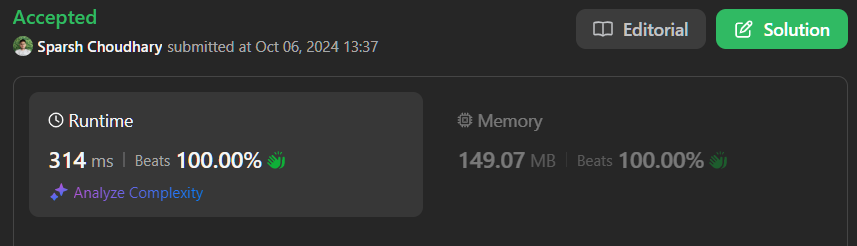

# 🔥BEATS 💯 % 🎯 |✨SUPER EASY BEGINNERS 👏

**Author:** CodeWithSparsh
**Votes:** 2
**Link:** [https://leetcode.com/problems/sentence-similarity-iii/solutions/5876796/](https://leetcode.com/problems/sentence-similarity-iii/solutions/5876796/)

---




---

# Intuition
The goal is to determine whether two sentences can be considered similar by removing some words from the beginning or the end of one sentence such that the remaining parts are identical. We can use two pointers: one for matching words from the start (prefix) and one for matching words from the end (suffix).

---

# Approach
1. Split both sentences into word lists.
2. Ensure the shorter sentence is always the first one to simplify the comparison.
3. Use two pointers to match words:
   - One pointer starts from the beginning to match the prefix.
   - Another pointer starts from the end to match the suffix.
4. The two sentences are similar if the sum of matched prefix and suffix words equals or exceeds the length of the shorter sentence.

---

# Complexity
- **Time Complexity**: \\(O(n)\\), where \\(n\\) is the length of the shorter sentence. We compare each word once for both the prefix and suffix.
- **Space Complexity**: \\(O(n)\\), for storing the split word lists.

---

# Code

```dart []
class Solution {
  bool areSentencesSimilar(String sentence1, String sentence2) {
    List<String> s1 = sentence1.split(" ");
    List<String> s2 = sentence2.split(" ");
    
    if (s2.length < s1.length) {
      List<String> temp = s1;
      s1 = s2;
      s2 = temp;
    }
    
    int i = 0, j = 0;
    int n1 = s1.length, n2 = s2.length;
    
    while (i < n1 && s1[i] == s2[i]) {
      i++;
    }
    
    while (j < n1 && s1[n1 - 1 - j] == s2[n2 - 1 - j]) {
      j++;
    }

    return i + j >= n1;
  }
}
```

```c []
#include <stdio.h>
#include <string.h>
#include <stdbool.h>

bool areSentencesSimilar(char *sentence1, char *sentence2) {
    char *s1[100], *s2[100];
    int n1 = 0, n2 = 0;
    
    char *token = strtok(sentence1, " ");
    while (token != NULL) {
        s1[n1++] = token;
        token = strtok(NULL, " ");
    }
    
    token = strtok(sentence2, " ");
    while (token != NULL) {
        s2[n2++] = token;
        token = strtok(NULL, " ");
    }
    
    if (n2 < n1) {
        char **temp = s1;
        s1 = s2;
        s2 = temp;
        int tmpLen = n1;
        n1 = n2;
        n2 = tmpLen;
    }
    
    int i = 0, j = 0;
    
    while (i < n1 && strcmp(s1[i], s2[i]) == 0) {
        i++;
    }
    
    while (j < n1 && strcmp(s1[n1 - 1 - j], s2[n2 - 1 - j]) == 0) {
        j++;
    }

    return i + j >= n1;
}
```

```cpp []
#include <iostream>
#include <sstream>
#include <vector>
#include <string>

class Solution {
public:
    bool areSentencesSimilar(std::string sentence1, std::string sentence2) {
        std::vector<std::string> s1 = split(sentence1);
        std::vector<std::string> s2 = split(sentence2);
        
        if (s2.size() < s1.size()) std::swap(s1, s2);
        
        int i = 0, j = 0;
        int n1 = s1.size(), n2 = s2.size();
        
        while (i < n1 && s1[i] == s2[i]) i++;
        while (j < n1 && s1[n1 - 1 - j] == s2[n2 - 1 - j]) j++;
        
        return i + j >= n1;
    }

private:
    std::vector<std::string> split(const std::string& str) {
        std::istringstream iss(str);
        std::vector<std::string> result;
        std::string word;
        while (iss >> word) result.push_back(word);
        return result;
    }
};
```
```java []
import java.util.*;

class Solution {
    public boolean areSentencesSimilar(String sentence1, String sentence2) {
        List<String> s1 = Arrays.asList(sentence1.split(" "));
        List<String> s2 = Arrays.asList(sentence2.split(" "));
        
        if (s2.size() < s1.size()) {
            List<String> temp = s1;
            s1 = s2;
            s2 = temp;
        }
        
        int i = 0, j = 0;
        int n1 = s1.size(), n2 = s2.size();
        
        while (i < n1 && s1.get(i).equals(s2.get(i))) {
            i++;
        }
        
        while (j < n1 && s1.get(n1 - 1 - j).equals(s2.get(n2 - 1 - j))) {
            j++;
        }

        return i + j >= n1;
    }
}
```

```javascript []
var areSentencesSimilar = function(sentence1, sentence2) {
    let s1 = sentence1.split(' ');
    let s2 = sentence2.split(' ');
    
    if (s2.length < s1.length) [s1, s2] = [s2, s1];
    
    let i = 0, j = 0;
    let n1 = s1.length, n2 = s2.length;
    
    while (i < n1 && s1[i] === s2[i]) i++;
    while (j < n1 && s1[n1 - 1 - j] === s2[n2 - 1 - j]) j++;
    
    return i + j >= n1;
};
```

```python []
class Solution:
    def areSentencesSimilar(self, sentence1: str, sentence2: str) -> bool:
        s1 = sentence1.split()
        s2 = sentence2.split()
        
        if len(s2) < len(s1):
            s1, s2 = s2, s1
        
        i, j = 0, 0
        n1, n2 = len(s1), len(s2)
        
        while i < n1 and s1[i] == s2[i]:
            i += 1
        
        while j < n1 and s1[n1 - 1 - j] == s2[n2 - 1 - j]:
            j += 1
        
        return i + j >= n1
```


```go []
import "strings"

func areSentencesSimilar(sentence1 string, sentence2 string) bool {
    s1 := strings.Split(sentence1, " ")
    s2 := strings.Split(sentence2, " ")
    
    if len(s2) < len(s1) {
        s1, s2 = s2, s1
    }
    
    i, j := 0, 0
    n1, n2 := len(s1), len(s2)
    
    for i < n1 && s1[i] == s2[i] {
        i++
    }
    
    for j < n1 && s1[n1 - 1 - j] == s2[n2 - 1 - j] {
        j++
    }
    
    return i + j >= n1
}
```

 {:style='width:250px'}