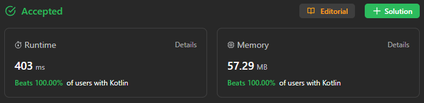

# ✅ 100% 🎻 HashMap & reverse function || simple & fun

**Author:** sunnoca
**Votes:** 3
**Link:** [https://leetcode.com/problems/count-nice-pairs-in-an-array/solutions/4312820/](https://leetcode.com/problems/count-nice-pairs-in-an-array/solutions/4312820/)

---

# Please Upvote \uD83D\uDD1D Appreciations!


# Complexity
- Time complexity: **O(** n **)**
- Space complexity: **O(** 1 **)**
# Code
``` Kotlin []
class Solution {  // first
    fun countNicePairs(nums: IntArray): Int {
        val map = HashMap<Int, Int>()
        var res: Long = 0

        for (n in nums) {
            val diff = n - n.reverse()
            val count = map.getOrDefault(diff, 0)
            res += count
            map[diff] = count + 1
        }

        return (res % 1_000_000_007).toInt()
    }

    private fun Int.reverse(): Int {
        var num = this
        var rev = 0

        while (num > 0) {
            rev = rev * 10 + num % 10
            num /= 10
        }

        return rev
    }
}
```
``` Kotlin []
class Solution {  // second
    fun countNicePairs(nums: IntArray): Int {
        val map = HashMap<Int, Int>()

        for (n in nums) {
            val diff = n - n.reverse()
            map[diff] = map.getOrDefault(diff, 0) + 1
        }

        val res = map.values.sumOf { arithmeticSeqSum(0, end = it - 1, step = 1) }
        return (res % 1_000_000_007).toInt()
    }

    private fun arithmeticSeqSum(start: Int, end: Int, step: Int): Long {
        val count = (end - start) / step + 1
        return (start + end) * count.toLong() shr 1
    }

    private fun Int.reverse(): Int {
        var num = this
        var rev = 0

        while (num > 0) {
            rev = rev * 10 + num % 10
            num /= 10
        }

        return rev
    }
}
```
``` Kotlin []
class Solution {  // third
    fun countNicePairs(nums: IntArray): Int {
        fun Int.reverse(): Int = toString().reversed().toInt()
        
        val map = HashMap<Int, Int>()
        var res: Long = 0

        for (n in nums) {
            val diff = n - n.reverse()
            val count = map.getOrDefault(diff, 0)
            res += count
            map[diff] = count + 1
        }

        return (res % 1_000_000_007).toInt()
    }
}
```