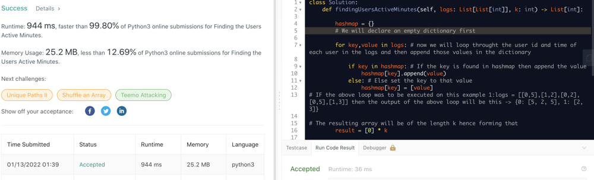

# Simple and Faster(99.80%)Python solution with explanation using Dictionary 944 ms,

**Author:** vamosssss
**Votes:** 5
**Link:** [https://leetcode.com/problems/finding-the-users-active-minutes/solutions/1687089/](https://leetcode.com/problems/finding-the-users-active-minutes/solutions/1687089/)

---

	def findingUsersActiveMinutes(self, logs: List[List[int]], k: int) -> List[int]:
        
        hashmap = {}
        # We will declare an empty dictionary first
        
        for key,value in logs: # now we will loop throught the user id and time of each user in the logs and then append those values in the dictionary
            
            if key in hashmap: # If the key is found in hashmap then append the value
                hashmap[key].append(value)
            else: # Else set the key to that value
                hashmap[key] = [value]
	# IF the above loop was to be executed on this example 1:logs = [[0,5],[1,2],[0,2],[0,5],[1,3]] then the output of the above loop will be this -> {0: [5, 2, 5], 1: [2, 3]}

	# The resulting array will be of the length k hence forming that
        result = [0] * k
        
        # Now we need to find how many user are active for how many minutes
        # In our example we can say that the user 0 is active for 2 minutes (2,5) and user 1 is also active for 2 minutes (2,3)
        # This means that 2 users are active for 2 minutes hence the resulting array will be such [0,2,0,0,0] for the example taken
        
        # To put this into code we just need to remove the duplicate minutes for active user and then take the length of those minutes and subtract 1 from the lenght because in this case the minutes will be 1,2,3,4,5 for the array [0,2,0,0,0]. This means that 2 users are active for 2 mintues. Users are 0 and 1
        for users in hashmap.keys():
            
            result[len(set(hashmap[users])) - 1] += 1
            
        return result

