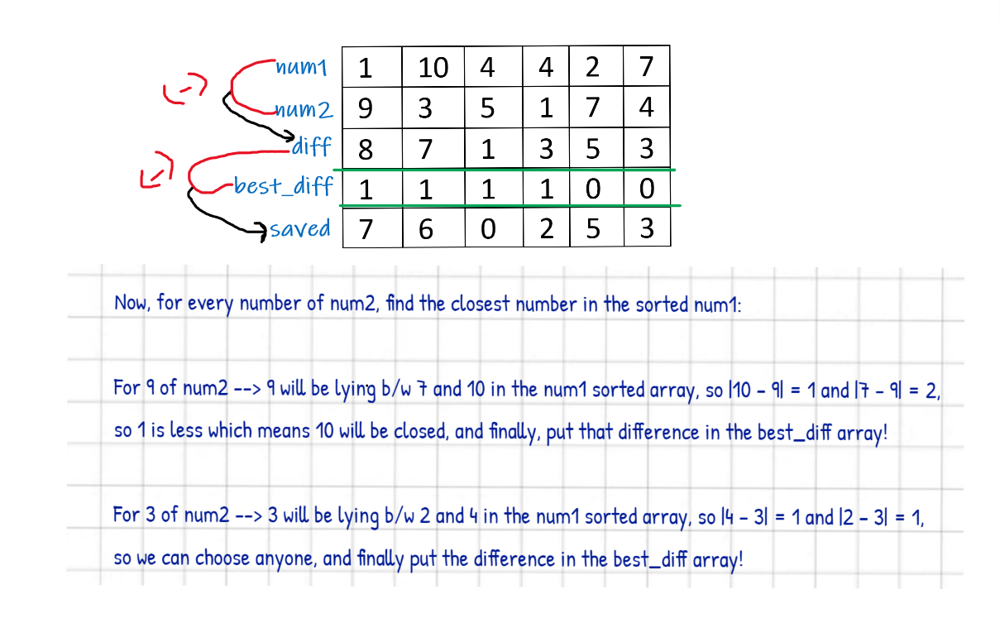

# [Python] + Fully Explained + Best Solution ✔

**Author:** triposat
**Votes:** 14
**Link:** [https://leetcode.com/problems/minimum-absolute-sum-difference/solutions/1715575/](https://leetcode.com/problems/minimum-absolute-sum-difference/solutions/1715575/)

---

	class Solution:
		def minAbsoluteSumDiff(self, nums1: List[int], nums2: List[int]) -> int:
			n = len(nums1)
			diff = []
			sum = 0
			for i in range(n):
				temp = abs(nums1[i]-nums2[i])
				diff.append(temp)
				sum += temp
			nums1.sort()
			best_diff = []
			for i in range(n):
				idx = bisect.bisect_left(nums1, nums2[i])
				if idx != 0 and idx != n:
					best_diff.append(
						min(abs(nums2[i]-nums1[idx]), abs(nums2[i]-nums1[idx-1])))
				elif idx == 0:
					best_diff.append(abs(nums2[i]-nums1[idx]))
				else:
					best_diff.append(abs(nums2[i]-nums1[idx-1]))
			saved = 0
			for i in range(n):
				saved = max(saved, diff[i]-best_diff[i])
			return (sum-saved) % ((10**9)+(7))
If you have any questions, please ask me, and if you like this approach, please **vote it up**!