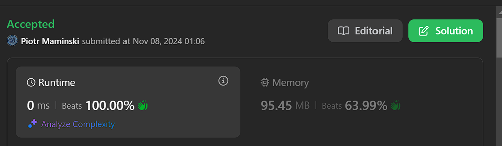

# ✅Beats 100% | Very Short & Simple Solution

**Author:** Piotr_Maminski
**Votes:** 19
**Link:** [https://leetcode.com/problems/maximum-xor-for-each-query/solutions/6021112/](https://leetcode.com/problems/maximum-xor-for-each-query/solutions/6021112/)

---


```python3 []
class Solution:
    def getMaximumXor(self, nums: List[int], maximumBit: int) -> List[int]:
        mask = (1 << maximumBit) - 1
        n = len(nums)
        res = [0] * n
        curr = 0
        
        for i in range(n):
            curr ^= nums[i]
            res[n-i-1] = ~curr & mask
            
        return res

```
```cpp []
class Solution {
public:
    vector<int> getMaximumXor(vector<int>& nums, int maximumBit) {
        int mask = (1LL << maximumBit) - 1, n = nums.size();
        vector<int> res(n);
        for(int i = 0, curr = 0; i < n; i++) {
            curr ^= nums[i];
            res[n-i-1] = ~curr & mask;
        }
        return res;
    }
};
```
```java []
class Solution {
    public int[] getMaximumXor(int[] nums, int maximumBit) {
        int mask = (1 << maximumBit) - 1;
        int n = nums.length;
        int[] res = new int[n];
        int curr = 0;
        
        for(int i = 0; i < n; i++) {
            curr ^= nums[i];
            res[n-i-1] = ~curr & mask;
        }
        
        return res;
    }
}

```
```csharp []
public class Solution {
    public int[] GetMaximumXor(int[] nums, int maximumBit) {
        int mask = (1 << maximumBit) - 1;
        int n = nums.Length;
        int[] res = new int[n];
        int curr = 0;
        
        for(int i = 0; i < n; i++) {
            curr ^= nums[i];
            res[n-i-1] = ~curr & mask;
        }
        
        return res;
    }
}

```
```golang []
func getMaximumXor(nums []int, maximumBit int) []int {
    mask := (1 << maximumBit) - 1
    n := len(nums)
    res := make([]int, n)
    curr := 0
    
    for i := 0; i < n; i++ {
        curr ^= nums[i]
        res[n-i-1] = ^curr & mask
    }
    
    return res
}

```
```swift []
class Solution {
    func getMaximumXor(_ nums: [Int], _ maximumBit: Int) -> [Int] {
        let mask = (1 << maximumBit) - 1
        let n = nums.count
        var res = Array(repeating: 0, count: n)
        var curr = 0
        
        for i in 0..<n {
            curr ^= nums[i]
            res[n-i-1] = ~curr & mask
        }
        
        return res
    }
}

```
```javascript [JS]
// JavaScript

var getMaximumXor = function(nums, maximumBit) {
    const mask = (1 << maximumBit) - 1;
    const n = nums.length;
    const res = new Array(n);
    let curr = 0;
    
    for(let i = 0; i < n; i++) {
        curr ^= nums[i];
        res[n-i-1] = (~curr & mask);
    }
    
    return res;
};
```
```typescript [TS]
// TypeScript

function getMaximumXor(nums: number[], maximumBit: number): number[] {
    const mask: number = (1 << maximumBit) - 1;
    const n: number = nums.length;
    const res: number[] = new Array(n);
    let curr: number = 0;
    
    for(let i = 0; i < n; i++) {
        curr ^= nums[i];
        res[n-i-1] = (~curr & mask);
    }
    
    return res;
}
```
```rust []
impl Solution {
    pub fn get_maximum_xor(nums: Vec<i32>, maximum_bit: i32) -> Vec<i32> {
        let mask = (1 << maximum_bit) - 1;
        let n = nums.len();
        let mut res = vec![0; n];
        let mut curr = 0;
        
        for i in 0..n {
            curr ^= nums[i];
            res[n-i-1] = !curr & mask;
        }
        
        res
    }
}

```
```ruby []
def get_maximum_xor(nums, maximum_bit)
    mask = (1 << maximum_bit) - 1
    n = nums.length
    res = Array.new(n)
    curr = 0
    
    n.times do |i|
        curr ^= nums[i]
        res[n-i-1] = ~curr & mask
    end
    
    res
end
```
### Complexity
- Time complexity: O(n)


- Space complexity: O(n)


# Explanation
---

## Intuition
Find the maximum XOR value for each prefix of an array by using a bit manipulation approach. 


## Aproach
1. First, it creates a mask of 1s based on maximumBit. For example, if maximumBit is 3, mask becomes 7 (111 in binary)

2. It creates a result array (res) of the same length as the input array

3. Then it goes through each number in the array and:
    - Keeps track of running XOR in 'curr'
    - For each position, finds a number that would give maximum XOR with current running XOR
    - Stores results in reverse order (that's why we use n-i-1)
4. The magic happens with ~curr & mask:

    - ~curr flips all bits
    - mask keeps only the relevant bits (up to maximumBit)
    - This combination gives us the number that produces maximum XOR

For example:

- If curr = 101 and maximumBit = 3
- ~curr = 010 (after masking with 111)
- This 010 will give maximum XOR with 101

Works bcs uses the fact that to get maximum XOR, you want opposite bits wherever possible within your bit limit.

Simple

---

# Most common Array Interview Problems
List based on my research (interviews, reddit, github) Probably not 100% accurate but very close to my recruitments. Leetcode Premium is probably more accurate [I don't have]


**Easy:** [[1. Two Sum]](https://leetcode.com/problems/two-sum/solutions/5999466/beats-100-explained-step-by-step-list-most-common-array-inverview) **(common warm-up)** [[121. Best Time to Buy and Sell Stock]](https://leetcode.com/problems/best-time-to-buy-and-sell-stock/description/?envType=problem-list-v2&envId=atbyk0mj) [[88. Merge Sorted Array]](https://leetcode.com/problems/merge-sorted-array/description/) [[27. Remove Element]](https://leetcode.com/problems/remove-element/description/) [[929. Unique Email Addresses]](https://leetcode.com/problems/unique-email-addresses/description/) [[482. License Key Formatting]](https://leetcode.com/problems/license-key-formatting/description/)


**Medium/Hard:** [[15. 3Sum]](https://leetcode.com/problems/3sum/description/) [[42. Trapping Rain Water]](https://leetcode.com/problems/trapping-rain-water/?envType=problem-list-v2&envId=atbyk0mj) [[56. Merge Intervals]](https://leetcode.com/problems/merge-intervals/description/) [[57. Insert Interval]](https://leetcode.com/problems/insert-interval/description/) [[46. Permutations]](https://leetcode.com/problems/permutations/description/) [[53. Maximum Subarray]](https://leetcode.com/problems/maximum-subarray/description/) [[73. Set Matrix Zeroes]](https://leetcode.com/problems/set-matrix-zeroes/description/) [[284. Peeking Iterator]](https://leetcode.com/problems/peeking-iterator/description/)


####  [Interview Questions and Answers Repository](https://github.com/RooTinfinite/Interview-questions-and-answers)



