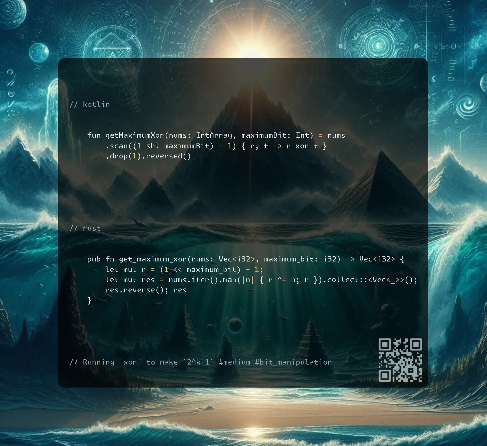

# Kotlin | Rust

**Author:** SamoylenkoDmitry
**Votes:** 3
**Link:** [https://leetcode.com/problems/maximum-xor-for-each-query/solutions/6022237/](https://leetcode.com/problems/maximum-xor-for-each-query/solutions/6022237/)

---



https://youtu.be/yoKp2xrbnk4

#### Join me on Telegram

https://t.me/leetcode_daily_unstoppable/794

#### Problem TLDR

Running `xor` to make `2^k-1` #medium #bit_manipulation

#### Intuition

Let's observe what's happening:

```j

    //     n  xor[..i]    k < 2^mb(=b100)
    // b00  0  00          00^x = 11  11 = 3
    // b01  1  01          01^x = 11  10 = 2
    // b01  1  00          00^x = 11  11 = 3
    // b11  3  11          11^x = 11  00 = 0
    // 100                              ans = [ 0 3 2 3 ]

```
For `k=2` we have to make maximum `2^k-1 = b011`. Consider each column of bits independently: we can count them and `even` would give `0`, odd `1`. So, one way to solve is to count `k` bits and set all that happend to be `even` to `1`.
On a second thought, all this equalized into a `xor` operation: `xor[0..i] ^ res[i] = 0b11`.

#### Approach

* we don't have to do `xor 2^k-1` on each item, just start with it
* let's use `scan` iterator in Kotlin
* Rust also has a `scan` but it is more verbose

#### Complexity

- Time complexity:
$$O(n)$$

- Space complexity:
$$O(n)$$

#### Code

```kotlin []

    fun getMaximumXor(nums: IntArray, maximumBit: Int) = nums
        .scan((1 shl maximumBit) - 1) { r, t -> r xor t }
        .drop(1).reversed()

```
```rust []

    pub fn get_maximum_xor(nums: Vec<i32>, maximum_bit: i32) -> Vec<i32> {
        let mut r = (1 << maximum_bit) - 1;
        let mut res = nums.iter().map(|n| { r ^= n; r }).collect::<Vec<_>>();
        res.reverse(); res
    }

```
```c++ []

    vector<int> getMaximumXor(vector<int>& nums, int maximumBit) {
        int x = (1 << maximumBit) - 1, i = nums.size(); vector<int> res(i); 
        for (;i;i--) res[i - 1] = x ^= nums[nums.size() - i];
        return res;
    }

```