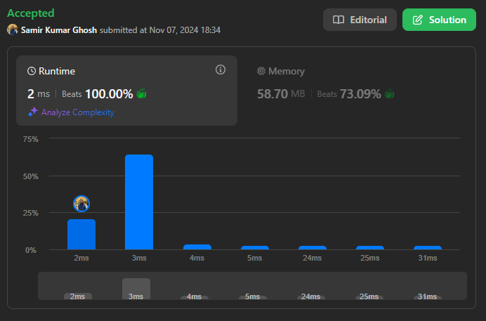
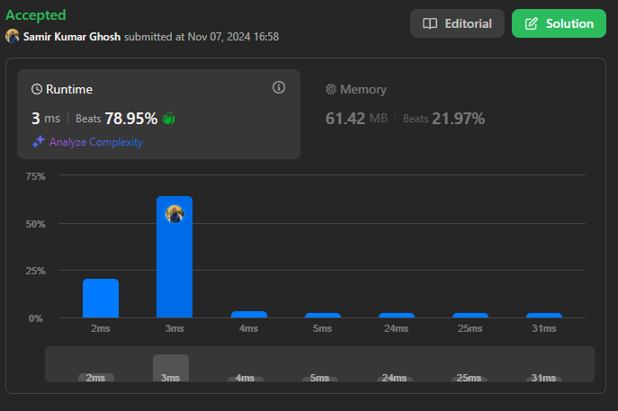

# Very Simple | Beats 100% | Java, C++, Go, Python | Solution for LeetCode#1829

**Author:** samir023041
**Votes:** 13
**Link:** [https://leetcode.com/problems/maximum-xor-for-each-query/solutions/6021314/](https://leetcode.com/problems/maximum-xor-for-each-query/solutions/6021314/)

---

# Approach-01


# Intuition
<!-- Describe your first thoughts on how to solve this problem. -->
The problem requires us to use cumulative XOR operations while considering a constraint on the maximum possible value determined by maximumBit. The goal is to maximize the XOR results by leveraging the bit representation efficiently.

# Approach
<!-- Describe your approach to solving the problem. -->
1. Calculate the Maximum Bit Value:
	- Compute the highest value that can be represented with maximumBit bits, which is 
(pow(2,maximumBit)\u22121). This value is used to maximize the XOR operation.
2. Compute the Cumulative XOR:
	- Start by calculating the XOR of all elements in nums. This gives the initial cumulative XOR value for the entire array.
3. Generate Results in Reverse:
	- Iterate through the array from the last element to the first, computing the XOR of xorVal with numBitVal to get the maximum possible XOR.
	- Update xorVal by XORing it with the current element to reflect the cumulative XOR for the remaining elements.
4. Return the Answer:
	- The results are collected in ans and returned.
	
# Complexity
- Time complexity: O(n)
<!-- Add your time complexity here, e.g. $$O(n)$$ -->

- Space complexity: O(n)
<!-- Add your space complexity here, e.g. $$O(n)$$ -->

# Code
```Java []
class Solution {
    public int[] getMaximumXor(int[] nums, int maximumBit) {
        int n=nums.length;
        int[] ans=new int[n];
        int val=(int)Math.pow(2, maximumBit)-1;
        
        int k=n-1;
        int curr=0;
        for(int i=0; i<n; i++){
            curr ^=nums[i];
            ans[k--]=curr^val;            
        }
        
        return ans;
    }
}
```
```Cpp []
class Solution {
public:
    vector<int> getMaximumXor(vector<int>& nums, int maximumBit) {
        int n = nums.size();
        vector<int> ans(n);
        int val = (1 << maximumBit) - 1; // Equivalent to pow(2, maximumBit) - 1
        
        int k = n - 1;
        int curr = 0;
        
        for (int i = 0; i < n; i++) {
            curr ^= nums[i];
            ans[k--] = curr ^ val;
        }
        
        return ans;
    }
};
```
```Python []
class Solution:
    def getMaximumXor(self, nums, maximumBit):
        n = len(nums)
        ans = [0] * n
        val = (1 << maximumBit) - 1  # Equivalent to 2^maximumBit - 1
        
        curr = 0
        for num in nums:
            curr ^= num

        for i in range(n):
            ans[i] = curr ^ val
            curr ^= nums[n - 1 - i]

        return ans

```
```C# []
public class Solution {
    public int[] GetMaximumXor(int[] nums, int maximumBit) {
        int n = nums.Length;
        int[] ans = new int[n];
        int val = (1 << maximumBit) - 1;  // Equivalent to 2^maximumBit - 1

        int curr = 0;
        foreach (int num in nums) {
            curr ^= num;
        }

        for (int i = 0; i < n; i++) {
            ans[i] = curr ^ val;
            curr ^= nums[n - 1 - i];
        }

        return ans;
    }
}
```
```Go []
func getMaximumXor(nums []int, maximumBit int) []int {
    n := len(nums)
    ans := make([]int, n)
    val := (1 << maximumBit) - 1 // Equivalent to 2^maximumBit - 1

    curr := 0
    for _, num := range nums {
        curr ^= num
    }

    for i := 0; i < n; i++ {
        ans[i] = curr ^ val
        curr ^= nums[n-1-i]
    }

    return ans
}
```
# ------------------------------------------------------

# Approach-02


# Intuition
<!-- Describe your first thoughts on how to solve this problem. -->
The problem involves finding the maximum possible XOR for each element in an array when all elements are XORed cumulatively from left to right. We then need to generate results in a reversed manner using a specified bit constraint, maximumBit.

# Approach
<!-- Describe your approach to solving the problem. -->
1. Cumulative XOR Calculation:
	- Compute the cumulative XOR of all elements from left to right and store the results in an array arr. This will keep track of the XOR value for each prefix of the input array nums.
2. Maximum XOR Value:
	- Calculate the maximum possible XOR value given maximumBit. This value is calculated as 
(pow(2,maximumBit)\u22121), which ensures all bits are set to 1 within the limit of maximumBit.
3. Reverse and XOR:
	- Traverse arr in reverse and compute the XOR of each element with the maximum possible value obtained in the previous step. This yields the desired result in a reversed order.
	
# Complexity
- Time complexity: O(n)
<!-- Add your time complexity here, e.g. $$O(n)$$ -->

- Space complexity: O(n)
<!-- Add your space complexity here, e.g. $$O(n)$$ -->

# Code
```java []
class Solution {
    public int[] getMaximumXor(int[] nums, int maximumBit) {
        int n=nums.length;
        int[] arr=new int[n];
        int[] ans=new int[n];

        arr[0]=nums[0];
        for(int i=1; i<n; i++){
            arr[i] = arr[i-1]^nums[i];
        }

        int val=(int)Math.pow(2, maximumBit)-1;
        int k=0;
        for(int i=n-1; i>=0; i--){
            ans[k++] = arr[i]^val;
        }

        return ans;
    }
}
```