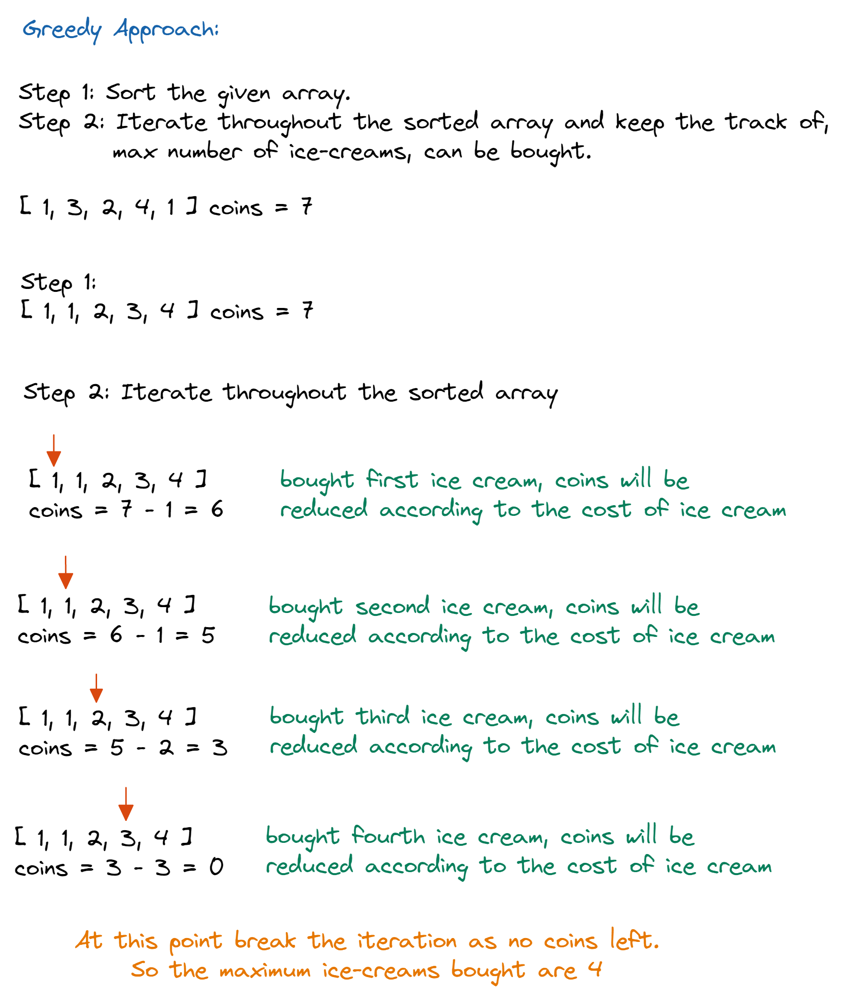
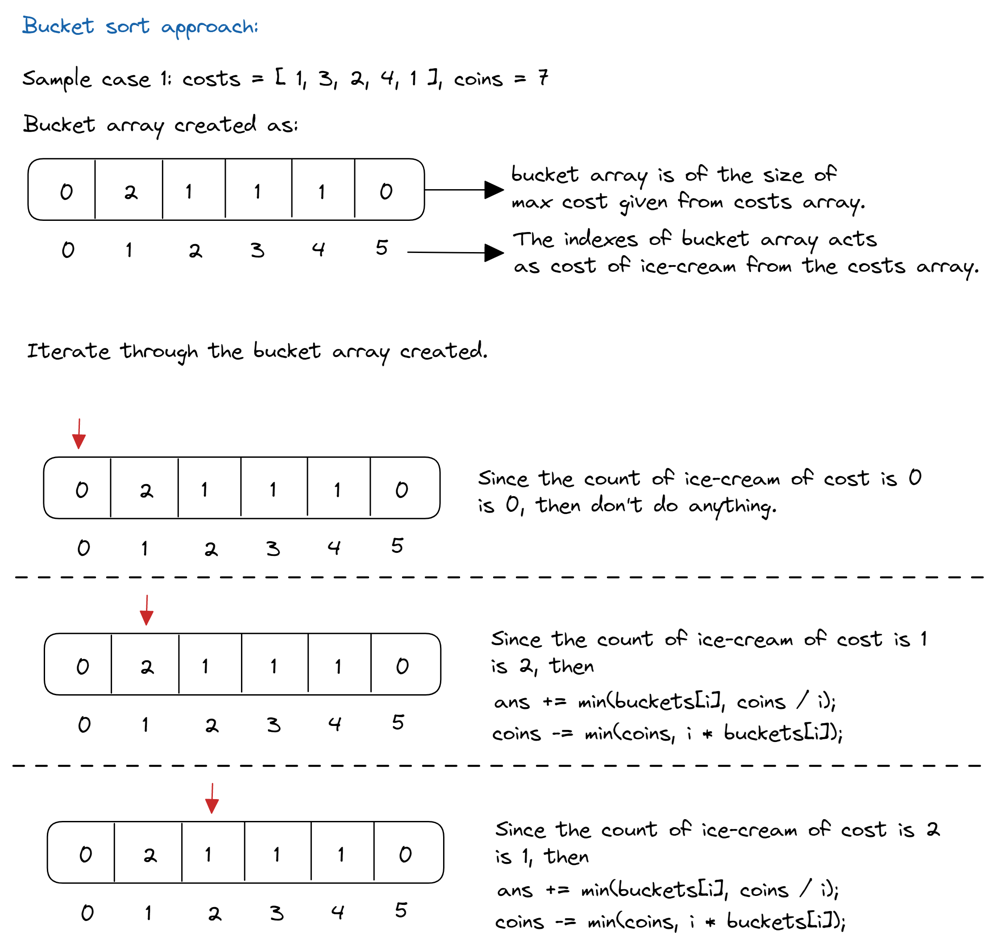

# 🚀 3 Java Codes with Explanation ! 🚀

**Author:** sam02202001
**Votes:** 140
**Link:** [https://leetcode.com/problems/maximum-ice-cream-bars/solutions/3006299/](https://leetcode.com/problems/maximum-ice-cream-bars/solutions/3006299/)

---

## ******If you find it useful please upvote it means a lot to me \uD83D\uDE0A******
# Approach 1 (Greedy)



# Code 
```
class Solution {
    public int maxIceCream(int[] costs, int coins) {
        // Store ice cream costs in increasing order.
        Arrays.sort(costs);
        int n = costs.length;
        int answer = 0;
        // Pick ice creams till we can.
        while (answer < n && costs[answer] <= coins) {
            // We can buy this icecream, reduce the cost from the coins. 
            coins -= costs[answer];
            answer += 1;
        }
        return answer;
    }
}
```

# Approach 2 (Bucket Sort)

# Code 
```
class Solution {
    public int maxIceCream(int[] costs, int coins) {
        
        // get the maximum cost available
        int max = costs[0];
        for (int i = 0; i < costs.length; i++) {
            max = Math.max(costs[i], max);
        }
        // create the bucket array of size of maximum_cost + 1
            // and keep the frequencies of the cost
        int[] buckets = new int[max + 1];
        for (int p : costs) {
            buckets[p]++;
        }

        // keep the track of maximum ice-creams can be bought
        int ans = 0;
        for (int i = 0; i < buckets.length; i++) {
            if (coins < i) {
                break;
            }
            if (buckets[i] > 0) {
                ans += Math.min(buckets[i], coins/i);
                coins -= Math.min(coins, i * buckets[i]);
            }
        }
        return ans;
    }
}
```
# Approach 3 (DP)
```
class Solution {
    public int maxIceCream(int[] costs, int coins) {
        int maxc = 0;

        for(int i = 0; i < costs.length; i++){
            if(costs[i] > maxc){
                maxc = costs[i];
            }
        }

        int[] cc = new int[maxc + 1];

        for(int i = 0; i < costs.length; i++){
            cc[costs[i]]++;
        }

        int c = 0;

        for(int i = 1; i <= maxc; i++){
            if(cc[i] == 0){
                continue;
            }
            if(coins < i){
                break;
            }

            for(int j = 0; j < cc[i]; j++){
                if(coins >= i){
                    coins -= i;
                    c++;
                }
            }
        }
        return c;
    }
}
```
Photo Explanation Credit : Aditya Shidlyali
Make sure to Vote up to keep me motivated
