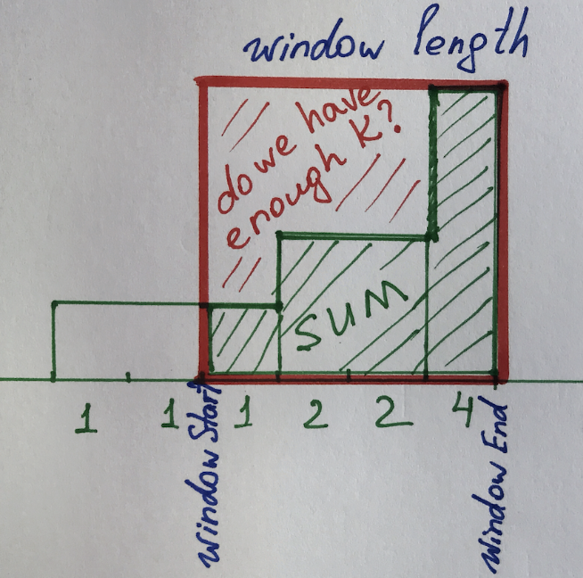

# [Go] sliding window

**Author:** _panther_
**Votes:** 2
**Link:** [https://leetcode.com/problems/frequency-of-the-most-frequent-element/solutions/2705302/](https://leetcode.com/problems/frequency-of-the-most-frequent-element/solutions/2705302/)

---



```
func maxFrequency(nums []int, k int) int {
    sort.Ints(nums)
    
    windowStart := 0
    result, sum := 1,0 
    for windowEnd := 0; windowEnd < len(nums); windowEnd++ {
        sum  += nums[windowEnd]
		
        // do we have enough K to fill in the square?
        if nums[windowEnd] * (windowEnd-windowStart+1)  > sum + k {
			// no we don't and we move the left side
            sum -= nums[windowStart]
            windowStart++ 
        }  
        
        result = max(result, windowEnd-windowStart+1)         
    }
    return result
}

func max(a int, b int) int {
    if a > b {
        return a
    }
    return b
}
