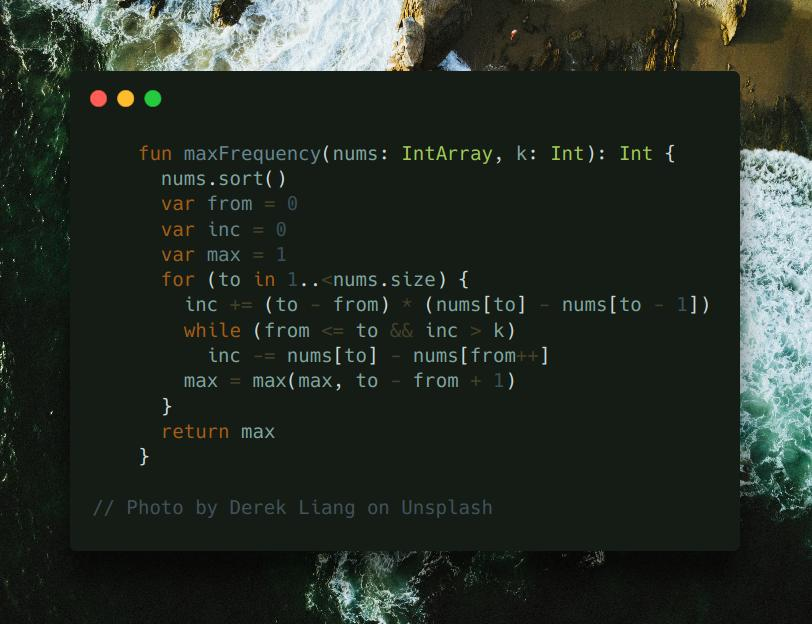

# Kotlin | two pointers

**Author:** SamoylenkoDmitry
**Votes:** 2
**Link:** [https://leetcode.com/problems/frequency-of-the-most-frequent-element/solutions/4301306/](https://leetcode.com/problems/frequency-of-the-most-frequent-element/solutions/4301306/)

---



#### Join me on Telegram

https://t.me/leetcode_daily_unstoppable/408

#### Problem TLDR

Max count of equal numbers if increment `arr[i]` `k` times

#### Intuition

Let's sort the array and scan numbers from small to hi. As we're doing only the increment operations, only the left part of the current position matters. Let's see how much items we can make equal to the current `arr[i]`:

```
    // 1 4 8 13  inc
    // 4 4 8 13  3
    //   ^
    // 8 8 ^     3 + 2 * (8 - 4) = 8 + 3 = 12
    // 1 8 ^     12 - (8 - 1) = 4
```

When taking a new element `8`, our total increment operations `inc` grows by the difference between two previous `4 4` and the current `8`.
If `inc` becomes bigger than `k`, we can move the `from` position, returning `nums[i] - nums[from]` operations back.

#### Approach

* use inclusive `from` and `to`
* always compute the `max`
* make initial conditions from the `0` element position, and iterate from `1` to avoid overthinking

#### Complexity

- Time complexity:
$$O(nlog(n))$$

- Space complexity:
$$O(1)$$

#### Code

```kotlin

    fun maxFrequency(nums: IntArray, k: Int): Int {
      nums.sort()
      var from = 0
      var inc = 0
      var max = 1
      for (to in 1..<nums.size) {
        inc += (to - from) * (nums[to] - nums[to - 1])
        while (from <= to && inc > k)
          inc -= nums[to] - nums[from++]
        max = max(max, to - from + 1)
      }
      return max
    }

```