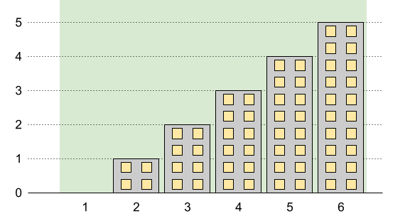
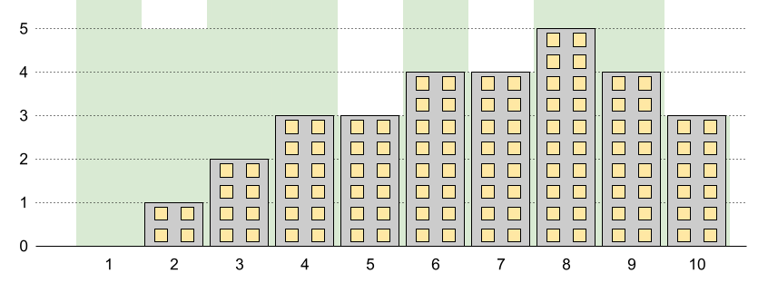

# [1840. Maximum Building Height](https://leetcode.com/problems/maximum-building-height/)

| Category | Difficulty | Likes | Dislikes |
| :------: | :--------: | :---: | :------: |
| Algorithms | Hard | 389 | 22 |

**Tags:** [`array`](https://leetcode.com/tag/array), [`math`](https://leetcode.com/tag/math), [`sorting`](https://leetcode.com/tag/sorting)

**Companies:** `dataminr`

## Description

You want to build `n` new buildings in a city. The new buildings will be built in a line and are labeled from `1` to `n`.

However, there are city restrictions on the heights of the new buildings:

	- The height of each building must be a non-negative integer.

	- The height of the first building **must** be `0`.

	- The height difference between any two adjacent buildings **cannot exceed** `1`.

Additionally, there are city restrictions on the maximum height of specific buildings. These restrictions are given as a 2D integer array `restrictions` where `restrictions[i] = [id_i, maxHeight_i]` indicates that building `id_i` must have a height **less than or equal to** `maxHeight_i`.

It is guaranteed that each building will appear **at most once** in `restrictions`, and building `1` will **not** be in `restrictions`.

Return *the **maximum possible height** of the **tallest** building*.

 

**Example 1:**


```

Input: n = 5, restrictions = [[2,1],[4,1]]
Output: 2
Explanation: The green area in the image indicates the maximum allowed height for each building.
We can build the buildings with heights [0,1,2,1,2], and the tallest building has a height of 2.
```

**Example 2:**


```

Input: n = 6, restrictions = []
Output: 5
Explanation: The green area in the image indicates the maximum allowed height for each building.
We can build the buildings with heights [0,1,2,3,4,5], and the tallest building has a height of 5.

```

**Example 3:**


```

Input: n = 10, restrictions = [[5,3],[2,5],[7,4],[10,3]]
Output: 5
Explanation: The green area in the image indicates the maximum allowed height for each building.
We can build the buildings with heights [0,1,2,3,3,4,4,5,4,3], and the tallest building has a height of 5.

```

 

**Constraints:**

	- `2 <= n <= 10^9`

	- `0 <= restrictions.length <= min(n - 1, 10^5)`

	- `2 <= id_i <= n`

	- `id_i` is **unique**.

	- `0 <= maxHeight_i <= 10^9`

---

**Links:** [Submissions](https://leetcode.com/problems/maximum-building-height/) | [Solutions](https://leetcode.com/problems/maximum-building-height/)
