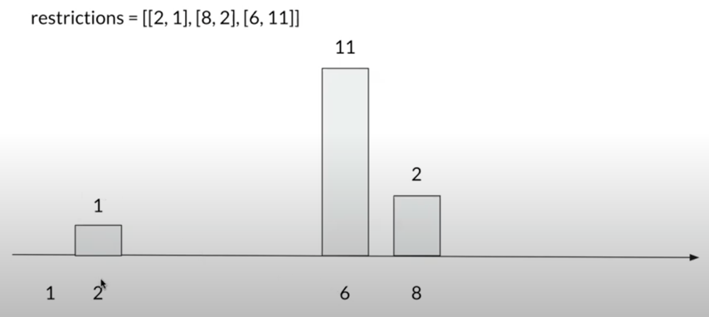
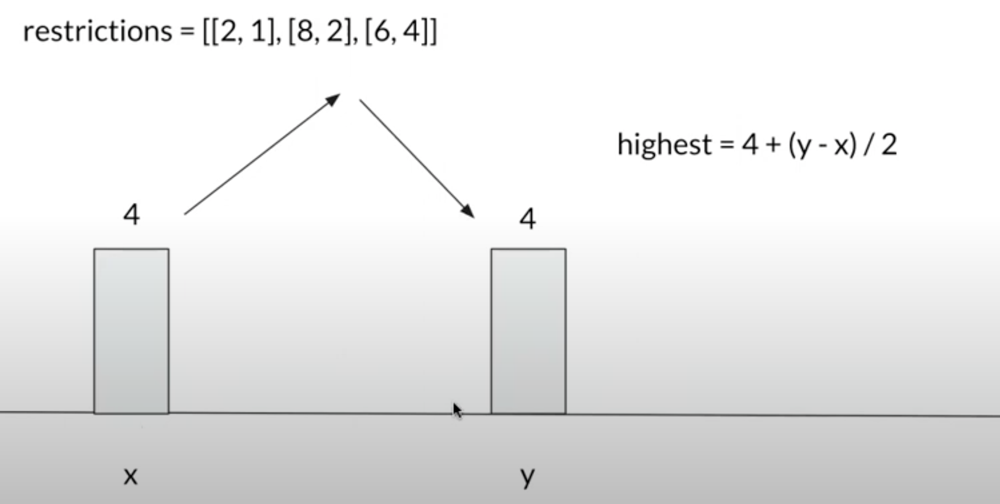
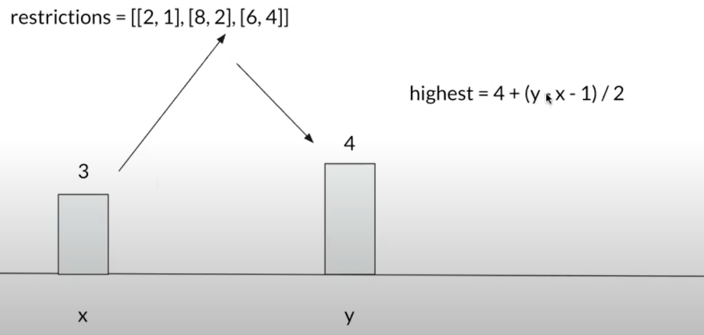

# JAVA Solution

**Author:** HIMANSHUCHHIKARA
**Votes:** 4
**Link:** [https://leetcode.com/problems/maximum-building-height/solutions/1175688/](https://leetcode.com/problems/maximum-building-height/solutions/1175688/)

---

**EXPLANATION:**

you can see in the given example first we need to reduce height of 11 from left i.e to 5 . then from right i.e  to 4. So we need two iteration one from left and then one from right.
And I have added 1st id(to set the heigth through iterations) and last id also(heighest height) . 


If x and y have same height  maximum heigth will lie in between can find that by h + (x-y)/2 

But if height are unequal then  Math.max(h1,h2) + (x-y - (Math.abs(h1-h2))/2;

And check for every height .

**CODE:**
```
class Solution {
    public int maxBuilding(int n, int[][] restrictions) {
        List<int[]> list=new ArrayList<>();
        list.add(new int[]{1,0});
        for(int[] restriction:restrictions){
            list.add(restriction);
        }
        Collections.sort(list,new IDSorter());
        
        if(list.get(list.size()-1)[0]!=n){
            list.add(new int[]{n,n-1});
        }
            
       for(int i=1;i<list.size();i++){
           list.get(i)[1]=Math.min(list.get(i)[1],list.get(i-1)[1] + list.get(i)[0]-list.get(i-1)[0]);
       }
        
       for(int i=list.size()-2;i>=0;i--){
           list.get(i)[1]=Math.min(list.get(i)[1],list.get(i+1)[1] + list.get(i+1)[0] - list.get(i)[0]);
       } 
        
       int result=0;
       for(int i=1;i<list.size();i++){
           int h1=list.get(i-1)[1];  // heigth of previous restriction
           int h2=list.get(i)[1];   // height of current restriction
           int x=list.get(i-1)[0]; // id of previous restriction
           int y=list.get(i)[0];   // id of current restriction
       
          result=Math.max(result,Math.max(h1,h2) + (y-x-Math.abs(h1-h2))/2);
       } 
        return result;
    }
    
    public class IDSorter implements Comparator<int[]>{
        @Override
        public int compare(int[] myself,int[] other){
            return myself[0]-other[0];
        } 
    }
}
```

**Complexity :**
`Time:O(nlogn) and Space:O(n)`

I have understood it from [here](https://leetcode.com/problems/maximum-building-height/discuss/1175343/C%2B%2B-Step-by-step-video-explanation-in-and-English) and its a best possible explanation for this. All credit to that guy I have just wrote the java version of that for java coders.

Please **UPVOTE** if you found it helpful and feel free to reach out to me or comment down if you have any doubt.