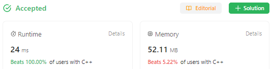
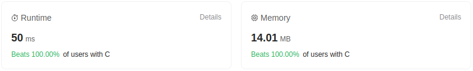

# Count Sorting. Blazing Fast: 100% in C++ (24 ms) and Java (1 ms).

**Author:** sergei99
**Votes:** 7
**Link:** [https://leetcode.com/problems/maximum-element-after-decreasing-and-rearranging/solutions/4290671/](https://leetcode.com/problems/maximum-element-after-decreasing-and-rearranging/solutions/4290671/)

---

# Intuition
The task is to find the maximum element of the array after applying certain transformations so that elements span a contiguous range starting from 1. The allowed transformation is decreasing any element by any positive value.

The array length may not be zero or exceed $10^5$, and the element value may not exceed $10^9$.

From this task statement it is clear that we are not interested in element values above the array length, and as such we can use a count sorting of time complexity $O(n + r)$ which in our case reduces to $O(n)$, since $r \\le n$ ($r$ is the element value range).

Why use Count Sorting instead of just placing a standard library $O(n \	imes log(n))$ `sort` call in the first line of the function code?

Here is why:
**C++**

**C**

**Java**

**Scala**


# Approach

## Count Sort

Allocate an array of counters of the maximum anticipated value range (saturated at $n$, of course).

As usually with the Count Sort, traverse the array once and for each element increment a counter corresponding to the element's value. Values larger than $n$ can be either ignored or saturated at $n$, whichever way is faster. Looking ahead, avoiding an extra array access seems to be strongly influencing execution time in Java and Scala (which control the array bounds) and give almost no effect in C and C++, therefore solutions slightly differ across these languages.

Once we have the element frequency statistics, we go through the counters and calculate the maximum possible post-transformation element. How do we do that?

A straightforward way is to compute a formula like this on each iteration:
`max_elem = min(max_elem + freqs[curr_elem], curr_elem + 1)`
Remember that the maximum element can not exceed $n$, and if there is a hole between sorted elements, then higher elements can "lend" themselves to cover it, but not too many.
Consider e.g. the following sorted array:
||
|-|
| `1 2 2 2 5 6 7 7 7` |

We have a hole of size $2$ between `2` and `5`. However, when we reach `7`, we see that there are $3$ of them, so we can spare $2$ to cover the missing `3` and `4` elements, and the max number would still be `7`.
||
|-|
| `1 2 2 2 3 4 5 6 7` |

But if we had less `7`-s, then the max number would be smaller.
So this seems to be a barely working approach.

However, do we always need to iterate till the `n`-th counter? Apparently not. In the example above, we see that there are $3$ `2`-s in the array, and all but one of them are redundant (i.e. not covering any holes in preceding range). There would be no compensation for $2$ redundant `2`-s further in the array, so now we know that the max value may not exceed `n - 2`. This may greatly reduce the number of iterations in case we have lots of duplicate numbers across the input array.

## Radix Sort

As a bonus track, we are providing an in-place Radix Sort solution intended to address the memory expenses.

A Radix Sort exists in two variants, MSD and LSD (it's a programming topic, not chemistry, folks). The Most Significant Digit approach is what we are going to use here.

We split the numbers' bit representation in equal-size chunks called digits. E.g. if our numbers can be up to 17 significant bits (covering the range up to $131071$), we can use 9-bit "digits", so the radix would be $2^9=512$.

At the first iteration we group all array elements into $512$ (or fewer) buckets based on their bits from $9$ to $17$ (actually to $16$ because bit $17$ is not populated within our range). We are utilizing a Count Sort for this, so we need $512$ counters. Since we are trying to sort in place, we also need another array of $512$ bucket boundaries within our array.
Consider the following example. Say, we have 10 numbers whose upper 512-bit "digits" are distributed as follows.
|||||||||||
|-|-|-|-|-|-|-|-|-|-|
|20|17|2|5|99|20|24|5|2|5|

The counter array would contain the following data:
| Index | Value |
|-|-|
| 2 | 2 |
| 5 | 3 |
| 17 | 1 |
| 20 | 2 |
| 24 | 1 |
| 99 | 1 |

All other elements would be zero.
Now we know the bucket boundaries: 0, 2, 5, 6, etc. So we iterate through the original array and swap each element with the element occupying its place in its target bucket. It's more convenient to start from higher indexes in the array and advance to lower ones, populating buckets from higher addresses as well. E.g. we pick `5`, which is the last number. The target bucket for it is `5`, occupying 3 array slots from `2` to `4` inclusive. So we exchange `5` with `99` occupying `4`-th slot and move the upper bound of the bucket 1 step backwards.
|||||||||||
|-|-|-|-|-|-|-|-|-|-|
|20|17|2|5|**5**|20|24|5|2|**99**|

Then we pick `2` which should go to the bucket `2` in slots `0` and `1`. So we exchange it with `17`.
|||||||||||
|-|-|-|-|-|-|-|-|-|-|
|20|**2**|2|5|5|20|24|5|**17**|99|

As we progress through the array, we avoid elements which are already in the buckets, so we have to keep the current range of every bucket. This is why we use 2 arrays.

The traversal logic may also lead to situations where the target index for a current element is behind it (i.e. is greater). Since we have passed that index range, that element would remain unsorted. So we repeat the pass until all elements take place in their buckets, and this part converges quickly.

Once done with the top-level bucket partitioning, we go to each bucket and sort elements according to their lower-order "digit" (and for this task we have only two "digits"). The algorithm is not stable, but since each bucket is sorted separately, we get the right order after sorting the last "digit" position.

The Least Significant Digit variant operates slightly differently, shuffling the entire array in each iteration.

# Complexity

## Count Sort
- Time complexity: $O(n)$
- Space complexity: $O(n)$

## Radix Sort
- Time complexity: $O(n \	imes log_d(n))$
- Space complexity: $O(d)$
where $d$ is the chosen radix.

Note that the space complexity for Radix Sort is specified for a proper implementation of the algorithm. The recursive version provided below would use an $O(d \	imes log_d(n))$ space because it allocates digit arrays on stack.

If $d = n$, then the algorithm becomes a linear-time Count Sort. If $d = 2$, then we have an algorithm close to Hoare Quicksort, Heapsort and such. With bigger $d$ the algorithm gets faster, but at the cost of greater memory expense.

# Micro-optimizations

As LC will surely give us extremum test cases of $10^5$ elements and values of $10^5$, we can allocate the array to the max possible size only once and avoid extra memory management for it. This comes at a price - we have to clean the array up after every test. But since we have to initialize counters to zero anyway, this doesn't really add any time costs.

In C++ the optimization level is set to O3, and `stdio` sync disabled (not included here for code brevity).

# Measurements

| Language | Algorithm | Time | Beating | Memory | Beating |
|-|-|-|-|-|-|
| C++ | Count Sort | 24 ms | 100% | 52.11 Mb | 5.22% |
| C++ | Radix Sort | 36 ms | 100% | 51.5 Mb | 96.27% |
| C | Count Sort | 50 ms | 100% | 14.01 Mb | 100% |
| Java | Count Sort | 1 ms | 100% | 56.91 Mb | 10.71% |
| Scala | Count Sort | 810 ms | 100% | 73.28 Mb | 100% |

We see that the Count Sort approach is a bit memory expensive (using extra $4 \	imes 10^5 = 400 Kb$ of memory + test environment overhead like sanitizer and such), compared to regular sorting. This is most obviously reflected in C++ code execution statistics and less obviously in Java, perhaps because most of its developers waste a lot of memory anyway. Actually there are not enough submissions in C and Scala section at the moment, that's why it always shows 100%.

But in terms of execution speed the Count Sort leaves all classic $O(n \	imes log(n))$ sorting stuff far behind.
Let's compare e.g. the C++ best attempt statistics:
| Algorithm | Time | Memory |
|-|-|-|
|Classic $O(n \	imes log_2(n))$ Sort| 57 ms | 51.4 Mb |
|Radix 9-bit $O(n \	imes log_{512}(n))$ Sort| 36 ms | 51.5 Mb |
|Count $O(n)$ Sort| 24 ms | 52.11 Mb |

So we see how much time is spent in sorting arrays of $10^5$ of same element $10^9$ (TC 45 if I remember it correctly).

As for the Radix Sort with 9-bit "digits", it has a better memory footprint than a Count Sort, but yields in speed. Yet it's still faster than Quicksort, Heapsort and other algorithms giving $log_2(n)$ multiplier to $n$.

# Code
## Count Sort
``` C++ []
class Solution {
private:
    typedef unsigned freq_t;
    static constexpr unsigned MAXN = 100000u;
    static freq_t freqs[MAXN];

public:
    int maximumElementAfterDecrementingAndRearranging(const vector<int>& arr) {
        const unsigned n = arr.size();
        if (n == 1u) return 1;
        for (unsigned v : arr)
            freqs[min(v, n) - 1u]++;
        unsigned maxe = n, c = -1u;
        for (unsigned v = 0; v < maxe; v++) {
            c += freqs[v];
            if (c > v) {
                maxe -= c - v;
                c = v;
            }
            freqs[v] = 0u;
        }
        fill(freqs + maxe, freqs + n, 0u);
        return maxe;
    }
};

Solution::freq_t Solution::freqs[MAXN];
```
``` C []
typedef unsigned freq_t;
#define MAXN 100000u
static freq_t freqs[MAXN];

inline __attribute__((always_inline)) static unsigned min(const unsigned a, const unsigned b) {
    return a < b ? a : b;
}

int maximumElementAfterDecrementingAndRearranging(const int *const arr, const unsigned n) {
    if (n == 1u) return 1;
    for (unsigned i = 0; i < n; i++)
        freqs[min(arr[i], n) - 1u]++;
    unsigned maxe = n, c = -1u;
    for (unsigned v = 0; v < maxe; v++) {
        c += freqs[v];
        if (c > v) {
            maxe -= c - v;
            c = v;
        }
        freqs[v] = 0u;
    }
    memset(freqs + maxe, 0, (n - maxe) * sizeof freqs[0]);
    return maxe;
}
```
``` Java []
class Solution {
    private static final int MAXN = 100000;
    private static int[] freqs = new int[MAXN];

    public int maximumElementAfterDecrementingAndRearranging(int[] arr) {
        final int n = arr.length;
        if (n == 1) return 1;
        for (int v : arr) {
            if (v <= n) freqs[v - 1]++;
        }
        int maxe = n, c = -1;
        for (int v = 0; v < maxe; v++) {
            c += freqs[v];
            if (c > v) {
                maxe -= c - v;
                c = v;
            }
            freqs[v] = 0;
        }
        Arrays.fill(freqs, maxe, n, 0);
        return maxe;
    }
}
```
``` Scala []
object Solution {
    private[this] val MAXN = 100000
    private[this] val freqs = Array.fill[Int](MAXN)(0)

    def maximumElementAfterDecrementingAndRearranging(arr: Array[Int]): Int = if (arr.length == 1) 1 else {
        val n = arr.length
        for (v <- arr)
            if (v <= n)
                freqs(v - 1) += 1
        var maxe = n
        var c = -1
        var v = 0
        while (v < maxe) {
            c += freqs(v)
            if (c > v) {
                maxe -= c - v
                c = v
            }
            freqs(v) = 0
            v += 1
        }
        java.util.Arrays.fill(freqs, maxe, n, 0)
        maxe
    }
}
```

## Radix Sort
``` C++ []
class Solution {
private:
    typedef unsigned freq_t;
    static constexpr unsigned char RBITS = 9u;
    static constexpr unsigned short RADIX = 1u << RBITS;
    static constexpr unsigned short RMASK = RADIX - 1u;

    template <class It>
    static void radix_sort(const It begin, const It end, const unsigned shift = RBITS) {
        freq_t freqs[RADIX] = {};
        for (It curr = begin; curr < end; curr++)
            freqs[(*curr >> shift) & RMASK]++;
        for (unsigned i = 1u; i < RADIX; i++)
            freqs[i] += freqs[i-1u];
        freq_t bounds[RADIX + 1u];
        bounds[0] = 0u;
        copy_n(freqs, RADIX, bounds + 1u);
        for (bool backswap = true; backswap; ) {
            unsigned f = RADIX - 1u;
            backswap = false;
            for (It curr = end - 1; curr >= begin; curr--) {
                while (curr < begin + bounds[f])
                    f--;
                if (curr >= begin + freqs[f])
                    continue;
                const unsigned i = (*curr >> shift) & RMASK;
                const It target = begin + --freqs[i];
                if (target != curr)
                    swap(*target, *curr);
                if (target > curr)
                    backswap = true;
            }
        }
        if (!shift) return;
        for (unsigned i = 1; i < RADIX; i++)
            if (freqs[i] > freqs[i - 1u])
                radix_sort(begin + freqs[i - 1u], begin + freqs[i], 0u);
        radix_sort(begin + freqs[RADIX - 1u], end, 0u);
    }

public:
    int maximumElementAfterDecrementingAndRearranging(vector<int>& arr) {
        const unsigned n = arr.size();
        if (n == 1u) return 1;
        radix_sort(arr.begin(), arr.end());
        unsigned maxe = 1u;
        for (unsigned i = 1u; i < n; i++)
            if (arr[i] > maxe) maxe++;
        return maxe;
    }
};
```