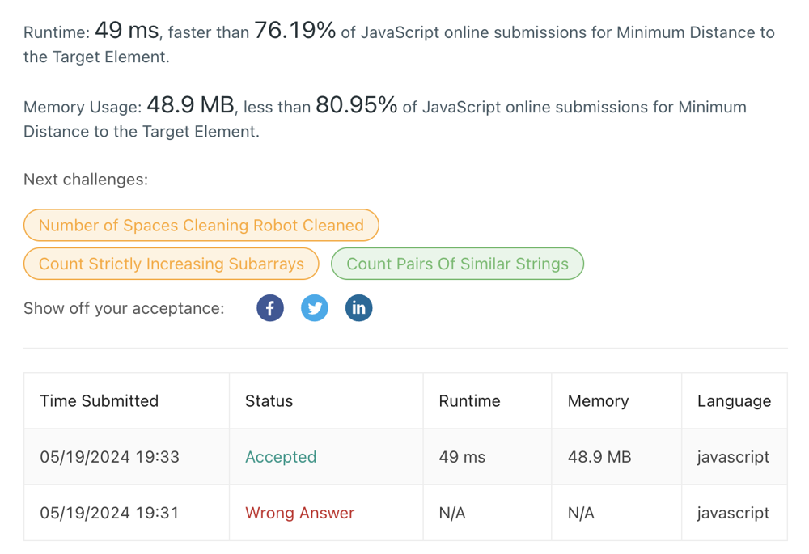

# ❇ minimum-distance-to-the-target-element👌 🏆O(N)❤️ Javascript🎯 Memory👀80.95%🕕 ++Explanation✍️

**Author:** anurag-sindhu
**Votes:** 2
**Link:** [https://leetcode.com/problems/minimum-distance-to-the-target-element/solutions/5179666/](https://leetcode.com/problems/minimum-distance-to-the-target-element/solutions/5179666/)

---

Time Complexity: O(N)
Space Complexity: O(1)


```
var getMinDistance = function (nums, target, start) {
    let output = Infinity;
    for (let index = 0; index < nums.length; index++) {
        if (nums[index] === target) {
            output = Math.min(output, Math.abs(index - start));
        }
    }
    return output;
};
```