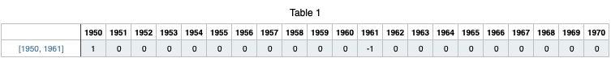
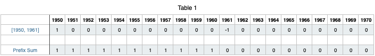
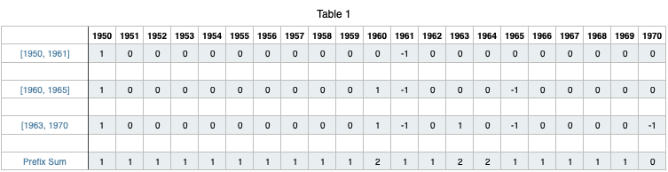

# JAVA || O(n) solution With Explanation || Range Addition

**Author:** Vishal_Sherawat
**Votes:** 392
**Link:** [https://leetcode.com/problems/maximum-population-year/solutions/1198978/](https://leetcode.com/problems/maximum-population-year/solutions/1198978/)

---

Let's understand with an example
Suppose we are given the log [1950, 1961]
This means birth year is 1950 and death year is 1961
Therefore, years from 1950 to 1960 will be incremented by 1.

We can do it by iterating from 1950 to 1960 but that will increase time complexity if we have to do it for every query in logs array.

To do this in O(1), we increment year[1950] by 1 and decrement year[1961] by 1.
We can reapeat this for every query in logs array.

What will this do ?

For the case [1950, 1961], let's look at how the array will look like




But this is not the desired result ?

To get the answer,
After iterating through all the queries, take prefix sum of the array(year)
This is how the array will look like



You can see that the Prefix Sum row will give the desired result as we have incremented the values of array from index 1950 to 1960.

Let's try for the test case, logs = [[1950,1961],[1960,1965],[1963,1970]] for a better understanding



Looking at the Prefix Sum, we can clearly see that the maximum value is 2 and its first occurence is at 1960. Hence, 1960 is the answer.

```
class Solution {
    public int maximumPopulation(int[][] logs) {
        
        int[] year = new int[2051];
        
		// O(n) -> n is log.length
		
        for(int[] log : logs){
            
            year[log[0]] += 1;
            year[log[1]] -= 1;
        }
        
        int maxNum = year[1950], maxYear = 1950;
        
		// O(100) -> 2050 - 1950 = 100

        for(int i = 1951; i < year.length; i++){
            year[i] += year[i - 1];  // Generating Prefix Sum
            
            if(year[i] > maxNum){
                maxNum = year[i];
                maxYear = i;
            }
        }
        
        return maxYear;
    }
}
```
Total time complexity will be O(n + 100) -> O(n)
In a general case we can write it as O(n + Range of Year)

You can also improve the space complexity by taking array of size 101 and not of 2051 because we only consider years from 1950 to 2050.