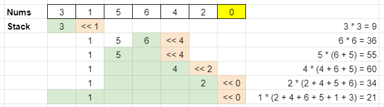

# O(n) Monostack with picture

**Author:** votrubac
**Votes:** 151
**Link:** [https://leetcode.com/problems/maximum-subarray-min-product/solutions/1198896/](https://leetcode.com/problems/maximum-subarray-min-product/solutions/1198896/)

---

I came up with 3 different solutions for this problem, but they did not work (WA or TLE). I got the intuition that we need a monostack, but somehow it was hard for me to comprehend.

We store elements in a stack `st` in a non-decreasing order. When we need to remove an element `j` from the stack, it means:
- Elements from `j` to `i - 1` are all greater than `j`.
- Elements after the new top of the stack iare all greater than `j`.

Therefore, we can multiply the current element `j` to the sum of all elements between the new top of the stack and `i`. In the example shown on the following picture, you can see that when we remove element `4` from the stack, we sum numbers between `1` (new top of the stack) and `2` (which is `i`).



Finally, we use a partial sum array `dp` to efficiently compute sum between elements `j` and `i`.

**C++**
To make it simple, we will store indexes of elements, as we can get their values from the original array. Note that we remove all remaining elements from the stack when `i = n.size()` in the second loop.

```cpp
int maxSumMinProduct(vector<int>& n) {
    long res = 0;
    vector<long> dp(n.size() + 1), st;
    for (int i = 0; i < n.size(); ++i)
       dp[i + 1] = dp[i] + n[i];
    for (int i = 0; i <= n.size(); ++i) {
        while (!st.empty() && (i == n.size() || n[st.back()] > n[i])) {
            int j = st.back();
            st.pop_back();
            res = max(res, n[j] * (dp[i] - dp[st.empty() ? 0 : st.back() + 1]));
        }
        st.push_back(i);
    }
    return res % 1000000007;
}
```
**Java**
```java
public int maxSumMinProduct(int[] n) {
    Stack<Integer> st = new Stack<>();
    long dp[] = new long[n.length + 1], res = 0;
    for (int i = 0; i < n.length; ++i)
       dp[i + 1] = dp[i] + n[i];
    for (int i = 0; i <= n.length; ++i) {
        while (!st.empty() && (i == n.length || n[st.peek()] > n[i])) {
            int j = st.pop();
            res = Math.max(res, (dp[i] - dp[st.empty() ? 0 : st.peek() + 1]) * n[j]);
        }
        st.push(i);
    }
    return (int)(res % 1000000007);
}
```