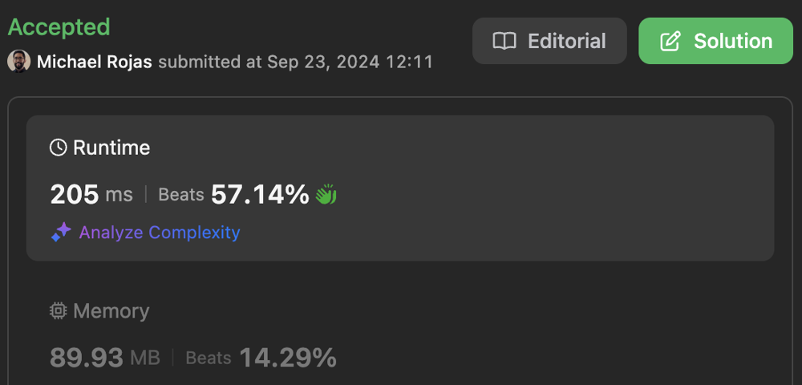
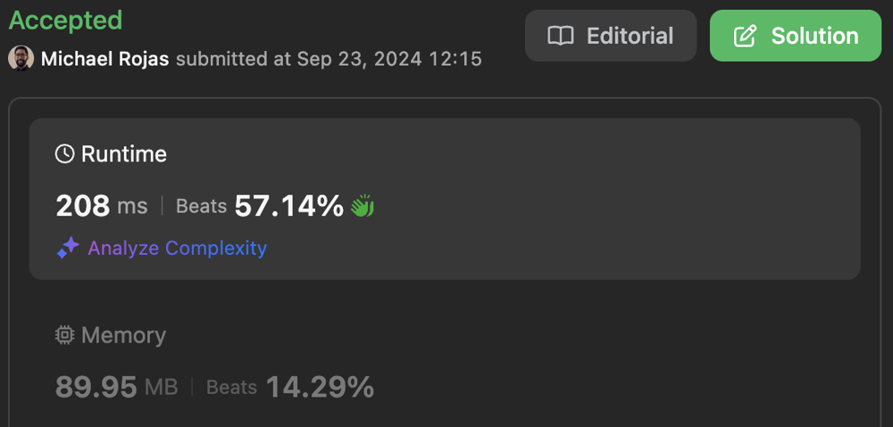
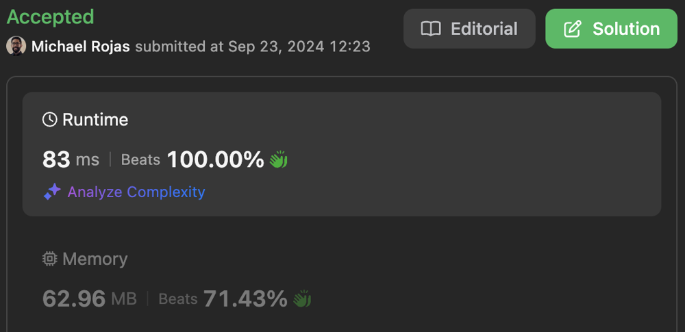

# Trie Solutions

**Author:** rojas
**Votes:** 0
**Link:** [https://leetcode.com/problems/longest-word-with-all-prefixes/solutions/5824431/](https://leetcode.com/problems/longest-word-with-all-prefixes/solutions/5824431/)

---

[toc]

# Trie + DFS

- Time complexity: $$O(NM)$$

- Space complexity: $$O(NM)$$

```typescript []
const LOWER_A = "a".charCodeAt(0);

class TrieNode<T> {
    value?: T;
    children: TrieNode<T>[];

    constructor(value?: T) {
        this.value = value;
        this.children = new Array(26);
    }

    add(s: string): TrieNode<T> {
        let node = this as TrieNode<T>;
        for (let i = 0; i < s.length; ++i) {
            const code = s.charCodeAt(i) - LOWER_A;
            let next = node.children[code];
            if (next == null) {
                next = new TrieNode();
                node.children[code] = next;
            }
            node = next;
        }
        return node;
    }
}

function longestWord(words: string[]): string {
    const trie = new TrieNode<number>();
    for (let i = 0; i < words.length; ++i) {
        trie.add(words[i]).value = i;
    }

    let max = 0;
    let maxI = -1;
    const stack: [TrieNode<number>, number][] = [[trie, 0]];
    do {
        const [node, len] = stack.pop();
        if (max < len) {
            max = len;
            maxI = node.value!;
        }
        for (let i = 25; i >= 0; --i) {
            if (node.children[i]?.value >= 0) {
                stack.push([node.children[i], len + 1]);
            }
        }
    } while (stack.length > 0);

    return maxI >= 0 ? words[maxI] : "";
};
```

```javascript []
const LOWER_A = "a".charCodeAt(0);

class TrieNode {

    /**
    * @param {T} value
    */
    constructor(value) {
        this.value = value;
        this.children = new Array(26);
    }

    /**
    * @param {string} s
    * @return {TrieNode}
    */
    add(s) {
        let node = this;
        for (let i = 0; i < s.length; ++i) {
            const code = s.charCodeAt(i) - LOWER_A;
            let next = node.children[code];
            if (next == null) {
                next = new TrieNode();
                node.children[code] = next;
            }
            node = next;
        }
        return node;
    }
}

/**
 * @param {string[]} words
 * @return {string}
 */
function longestWord(words) {
    const trie = new TrieNode();
    for (let i = 0; i < words.length; ++i) {
        trie.add(words[i]).value = i;
    }

    let max = 0;
    let maxI = -1;
    const stack = [[trie, 0]];
    do {
        const [node, len] = stack.pop();
        if (max < len) {
            max = len;
            maxI = node.value;
        }
        for (let i = 25; i >= 0; --i) {
            if (node.children[i]?.value >= 0) {
                stack.push([node.children[i], len + 1]);
            }
        }
    } while (stack.length > 0);

    return maxI >= 0 ? words[maxI] : "";
};
```

[Javascript Submission](https://leetcode.com/problems/longest-word-with-all-prefixes/submissions/1399758351/)



# Trie + BFS

- Time complexity: $$O(NM)$$

- Space complexity: $$O(NM)$$

```typescript []
const LOWER_A = "a".charCodeAt(0);

class TrieNode<T> {
    value?: T;
    children: TrieNode<T>[];

    constructor(value?: T) {
        this.value = value;
        this.children = new Array(26);
    }

    add(s: string): TrieNode<T> {
        let node = this as TrieNode<T>;
        for (let i = 0; i < s.length; ++i) {
            const code = s.charCodeAt(i) - LOWER_A;
            let next = node.children[code];
            if (next == null) {
                next = new TrieNode();
                node.children[code] = next;
            }
            node = next;
        }
        return node;
    }
}

function longestWord(words: string[]): string {
    const trie = new TrieNode<number>(-1);
    for (let i = 0; i < words.length; ++i) {
        trie.add(words[i]).value = i;
    }

    let maxI = -1;
    const queue: TrieNode<number>[] = [trie];
    do {
        maxI = queue[0].value!;
        const Q = queue.length;
        for (let q = 0; q < Q; ++q) {
            const node = queue[q];
            for (let i = 0; i < 26; ++i) {
                if (node.children[i]?.value >= 0) {
                    queue.push(node.children[i]);
                }
            }
        }
        queue.splice(0, Q);
    } while (queue.length > 0);

    return maxI >= 0 ? words[maxI] : "";
};
```

```javascript []
const LOWER_A = "a".charCodeAt(0);

class TrieNode {

    /**
    * @param {T} value
    */
    constructor(value) {
        this.value = value;
        this.children = new Array(26);
    }

    /**
    * @param {string} s
    * @return {TrieNode}
    */
    add(s) {
        let node = this;
        for (let i = 0; i < s.length; ++i) {
            const code = s.charCodeAt(i) - LOWER_A;
            let next = node.children[code];
            if (next == null) {
                next = new TrieNode();
                node.children[code] = next;
            }
            node = next;
        }
        return node;
    }
}

/**
 * @param {string[]} words
 * @return {string}
 */
function longestWord(words) {
    const trie = new TrieNode();
    for (let i = 0; i < words.length; ++i) {
        trie.add(words[i]).value = i;
    }

    let maxI = -1;
    const queue = [trie];
    do {
        maxI = queue[0].value;
        const Q = queue.length;
        for (let q = 0; q < Q; ++q) {
            const node = queue[q];
            for (let i = 0; i < 26; ++i) {
                if (node.children[i]?.value >= 0) {
                    queue.push(node.children[i]);
                }
            }
        }
        queue.splice(0, Q);
    } while (queue.length > 0);

    return maxI >= 0 ? words[maxI] : "";
};
```

[Javascript Submission](https://leetcode.com/problems/longest-word-with-all-prefixes/submissions/1399762741/)



# Sort + Trie

- Time complexity: $$O(N\\log{N} + NM)$$

- Space complexity: $$O(NM)$$

```typescript []
const LOWER_A = "a".charCodeAt(0);

class TrieNode {
    children: TrieNode[];

    constructor() {
        this.children = new Array(26);
    }

    add(s: string, min = 0, max = s.length): TrieNode {
        let node = this as TrieNode;
        while (min < max) {
            const code = s.charCodeAt(min++) - LOWER_A;
            let next = node.children[code];
            if (next == null) {
                next = new TrieNode();
                node.children[code] = next;
            }
            node = next;
        }
        return node;
    }

    get(s: string, min = 0, max = s.length): TrieNode | undefined {
        let node = this as TrieNode;
        while (min < max) {
            const code = s.charCodeAt(min++) - LOWER_A;
            if (node.children[code] == null) {
                return undefined;
            }
            node = node.children[code];
        }
        return node;
    }
}

function longestWord(words: string[]): string {
    // Sort length ASC, reverse lexographical
    words.sort((wordA, wordB) => {
        return (wordA.length - wordB.length) || wordB.localeCompare(wordA);
    });

    let max = 0;
    let maxI = -1;
    const trie = new TrieNode();
    for (let i = 0; i < words.length; ++i) {
        if (max + 1 < words[i].length) {
            break;
        }
        const tail = trie.get(words[i], 0, words[i].length - 1);
        if (tail != null) {
            tail.add(words[i], words[i].length - 1);
            max = words[i].length;
            maxI = i;
        }
    }

    return maxI >= 0 ? words[maxI] : "";
};
```

```javascript []
const LOWER_A = "a".charCodeAt(0);

class TrieNode {
    constructor() {
        this.children = new Array(26);
    }

    /**
    * @param {string} s
    * @param {number} min
    * @param {number} max
    * @return {TrieNode}
    */
    add(s, min = 0, max = s.length) {
        let node = this;
        while (min < max) {
            const code = s.charCodeAt(min++) - LOWER_A;
            let next = node.children[code];
            if (next == null) {
                next = new TrieNode();
                node.children[code] = next;
            }
            node = next;
        }
        return node;
    }

    /**
    * @param {string} s
    * @param {number} min
    * @param {number} max
    * @return {TrieNode | undefined}
    */
    get(s, min = 0, max = s.length) {
        let node = this;
        while (min < max) {
            const code = s.charCodeAt(min++) - LOWER_A;
            if (node.children[code] == null) {
                return undefined;
            }
            node = node.children[code];
        }
        return node;
    }
}

/**
 * @param {string[]} words
 * @return {string}
 */
function longestWord(words) {
    // Sort length ASC, reverse lexographical
    words.sort((wordA, wordB) => {
        return (wordA.length - wordB.length) || wordB.localeCompare(wordA);
    });

    let max = 0;
    let maxI = -1;
    const trie = new TrieNode();
    for (let i = 0; i < words.length; ++i) {
        if (max + 1 < words[i].length) {
            break;
        }
        const tail = trie.get(words[i], 0, words[i].length - 1);
        if (tail != null) {
            tail.add(words[i], words[i].length - 1);
            max = words[i].length;
            maxI = i;
        }
    }

    return maxI >= 0 ? words[maxI] : "";
};
```

[Javascript Submission](https://leetcode.com/problems/longest-word-with-all-prefixes/submissions/1399772246/)



