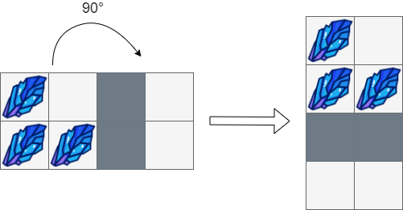

# [1861. Rotating the Box](https://leetcode.com/problems/rotating-the-box/)

| Category | Difficulty | Likes | Dislikes |
| :------: | :--------: | :---: | :------: |
| Algorithms | Medium | 1614 | 82 |

**Tags:** [`array`](https://leetcode.com/tag/array), [`two-pointers`](https://leetcode.com/tag/two-pointers), [`matrix`](https://leetcode.com/tag/matrix)

**Companies:** `visa`, `uber`, `capital-one`, `roblox`, `square`, `google`, `amazon`

## Description

You are given an `m x n` matrix of characters `boxGrid` representing a side-view of a box. Each cell of the box is one of the following:

	- A stone `'#'`

	- A stationary obstacle `'*'`

	- Empty `'.'`

The box is rotated **90 degrees clockwise**, causing some of the stones to fall due to gravity. Each stone falls down until it lands on an obstacle, another stone, or the bottom of the box. Gravity **does not** affect the obstacles' positions, and the inertia from the box's rotation **does not **affect the stones' horizontal positions.

It is **guaranteed** that each stone in `boxGrid` rests on an obstacle, another stone, or the bottom of the box.

Return *an *`n x m`* matrix representing the box after the rotation described above*.

 

**Example 1:**


```

Input: boxGrid = [[&quot;#&quot;,&quot;.&quot;,&quot;#&quot;]]
Output: [[&quot;.&quot;],
&nbsp;        [&quot;#&quot;],
&nbsp;        [&quot;#&quot;]]

```

**Example 2:**



```

Input: boxGrid = [[&quot;#&quot;,&quot;.&quot;,&quot;*&quot;,&quot;.&quot;],
&nbsp;             [&quot;#&quot;,&quot;#&quot;,&quot;*&quot;,&quot;.&quot;]]
Output: [[&quot;#&quot;,&quot;.&quot;],
&nbsp;        [&quot;#&quot;,&quot;#&quot;],
&nbsp;        [&quot;*&quot;,&quot;*&quot;],
&nbsp;        [&quot;.&quot;,&quot;.&quot;]]

```

**Example 3:**


```

Input: boxGrid = [[&quot;#&quot;,&quot;#&quot;,&quot;*&quot;,&quot;.&quot;,&quot;*&quot;,&quot;.&quot;],
&nbsp;             [&quot;#&quot;,&quot;#&quot;,&quot;#&quot;,&quot;*&quot;,&quot;.&quot;,&quot;.&quot;],
&nbsp;             [&quot;#&quot;,&quot;#&quot;,&quot;#&quot;,&quot;.&quot;,&quot;#&quot;,&quot;.&quot;]]
Output: [[&quot;.&quot;,&quot;#&quot;,&quot;#&quot;],
&nbsp;        [&quot;.&quot;,&quot;#&quot;,&quot;#&quot;],
&nbsp;        [&quot;#&quot;,&quot;#&quot;,&quot;*&quot;],
&nbsp;        [&quot;#&quot;,&quot;*&quot;,&quot;.&quot;],
&nbsp;        [&quot;#&quot;,&quot;.&quot;,&quot;*&quot;],
&nbsp;        [&quot;#&quot;,&quot;.&quot;,&quot;.&quot;]]

```

 

**Constraints:**

	- `m == boxGrid.length`

	- `n == boxGrid[i].length`

	- `1 <= m, n <= 500`

	- `boxGrid[i][j]` is either `'#'`, `'*'`, or `'.'`.

---

**Links:** [Submissions](https://leetcode.com/problems/rotating-the-box/) | [Solutions](https://leetcode.com/problems/rotating-the-box/)
