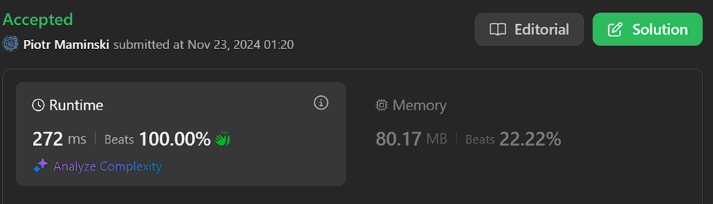
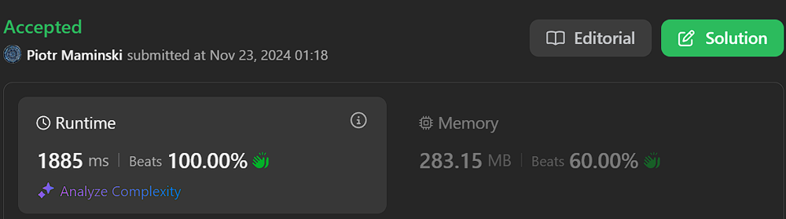

# ✅ Video | Short and Simple

**Author:** Piotr_Maminski
**Votes:** 52
**Link:** [https://leetcode.com/problems/rotating-the-box/solutions/6073397/](https://leetcode.com/problems/rotating-the-box/solutions/6073397/)

---

https://youtu.be/LZr1w0LVzFw?si=2AZkoOp_fMXa81Ck

# #1 NeetCode Solution From Video (2nd)


```python3 []
class Solution:
    def rotateTheBox(self, box: List[List[str]]) -> List[List[str]]:
        ROWS, COLS = len(box), len(box[0])

        res = [["."] * ROWS for _ in range(COLS)]

        for r in range(ROWS):
            i = COLS - 1
            for c in reversed(range(COLS)):
                if box[r][c] == "#":
                    res[i][ROWS - r - 1] = "#"
                    i -= 1
                elif box[r][c] == "*":
                    res[c][ROWS - r - 1] = "*"
                    i = c - 1

        return res
```
```cpp []
class Solution {
public:
    vector<vector<char>> rotateTheBox(vector<vector<char>>& box) {
        int ROWS = box.size();
        int COLS = box[0].size();
        
        vector<vector<char>> res(COLS, vector<char>(ROWS, '.'));
        
        for (int r = 0; r < ROWS; r++) {
            int i = COLS - 1;
            for (int c = COLS - 1; c >= 0; c--) {
                if (box[r][c] == '#') {
                    res[i][ROWS - r - 1] = '#';
                    i--;
                }
                else if (box[r][c] == '*') {
                    res[c][ROWS - r - 1] = '*';
                    i = c - 1;
                }
            }
        }
        
        return res;
    }
};
```
```java []
class Solution {
    public char[][] rotateTheBox(char[][] box) {
        int ROWS = box.length;
        int COLS = box[0].length;
        
        char[][] res = new char[COLS][ROWS];
        for(char[] row : res) {
            Arrays.fill(row, '.');
        }
        
        for (int r = 0; r < ROWS; r++) {
            int i = COLS - 1;
            for (int c = COLS - 1; c >= 0; c--) {
                if (box[r][c] == '#') {
                    res[i][ROWS - r - 1] = '#';
                    i--;
                } else if (box[r][c] == '*') {
                    res[c][ROWS - r - 1] = '*';
                    i = c - 1;
                }
            }
        }
        return res;
    }
}
```
```csharp []
public class Solution {
    public char[][] RotateTheBox(char[][] box) {
        int ROWS = box.Length;
        int COLS = box[0].Length;
        
        char[][] res = new char[COLS][];
        for(int i = 0; i < COLS; i++) {
            res[i] = new char[ROWS];
            Array.Fill(res[i], '.');
        }
        
        for (int r = 0; r < ROWS; r++) {
            int i = COLS - 1;
            for (int c = COLS - 1; c >= 0; c--) {
                if (box[r][c] == '#') {
                    res[i][ROWS - r - 1] = '#';
                    i--;
                } else if (box[r][c] == '*') {
                    res[c][ROWS - r - 1] = '*';
                    i = c - 1;
                }
            }
        }
        return res;
    }
}
```
```golang []
func rotateTheBox(box [][]byte) [][]byte {
    ROWS := len(box)
    COLS := len(box[0])
    
    res := make([][]byte, COLS)
    for i := range res {
        res[i] = make([]byte, ROWS)
        for j := range res[i] {
            res[i][j] = '.'
        }
    }
    
    for r := 0; r < ROWS; r++ {
        i := COLS - 1
        for c := COLS - 1; c >= 0; c-- {
            if box[r][c] == '#' {
                res[i][ROWS - r - 1] = '#'
                i--
            } else if box[r][c] == '*' {
                res[c][ROWS - r - 1] = '*'
                i = c - 1
            }
        }
    }
    return res
}
```
```swift []
class Solution {
    func rotateTheBox(_ box: [[Character]]) -> [[Character]] {
        let ROWS = box.count
        let COLS = box[0].count
        
        var res = Array(repeating: Array(repeating: Character("."), count: ROWS), count: COLS)
        
        for r in 0..<ROWS {
            var i = COLS - 1
            for c in stride(from: COLS - 1, through: 0, by: -1) {
                if box[r][c] == "#" {
                    res[i][ROWS - r - 1] = "#"
                    i -= 1
                } else if box[r][c] == "*" {
                    res[c][ROWS - r - 1] = "*"
                    i = c - 1
                }
            }
        }
        return res
    }
}
```
```javascript [JS]
// JavaScript

function rotateTheBox(box) {
    const ROWS = box.length;
    const COLS = box[0].length;
    
    const res = Array(COLS).fill(0)
        .map(() => Array(ROWS).fill('.'));
    
    for (let r = 0; r < ROWS; r++) {
        let i = COLS - 1;
        for (let c = COLS - 1; c >= 0; c--) {
            if (box[r][c] === '#') {
                res[i][ROWS - r - 1] = '#';
                i--;
            } else if (box[r][c] === '*') {
                res[c][ROWS - r - 1] = '*';
                i = c - 1;
            }
        }
    }
    return res;
}
```
```typescript [TS]
// TypeScript

function rotateTheBox(box: string[][]): string[][] {
    const ROWS = box.length;
    const COLS = box[0].length;
    
    const res: string[][] = Array(COLS).fill(0)
        .map(() => Array(ROWS).fill('.'));
    
    for (let r = 0; r < ROWS; r++) {
        let i = COLS - 1;
        for (let c = COLS - 1; c >= 0; c--) {
            if (box[r][c] === '#') {
                res[i][ROWS - r - 1] = '#';
                i--;
            } else if (box[r][c] === '*') {
                res[c][ROWS - r - 1] = '*';
                i = c - 1;
            }
        }
    }
    return res;
}
```
```rust []
impl Solution {
    pub fn rotate_the_box(grid: Vec<Vec<char>>) -> Vec<Vec<char>> {
        let rows = grid.len();
        let cols = grid[0].len();
        
        let mut res = vec![vec!['.'; rows]; cols];
        
        for r in 0..rows {
            let mut i = cols - 1;
            for c in (0..cols).rev() {
                if grid[r][c] == '#' {
                    res[i][rows - r - 1] = '#';
                    i = i.saturating_sub(1);
                } else if grid[r][c] == '*' {
                    res[c][rows - r - 1] = '*';
                    i = c.saturating_sub(1);
                }
            }
        }
        res
    }
}
```
```ruby []
def rotate_the_box(box)
    rows = box.length
    cols = box[0].length
    
    res = Array.new(cols) { Array.new(rows, '.') }
    
    (0...rows).each do |r|
        i = cols - 1
        (cols-1).downto(0) do |c|
            if box[r][c] == '#'
                res[i][rows - r - 1] = '#'
                i -= 1
            elsif box[r][c] == '*'
                res[c][rows - r - 1] = '*'
                i = c - 1
            end
        end
    end
    res
end
```

- Complexy: Time O(m * n) & Space O(m * n)


# #2 Simple approach 
```python3 []
class Solution:
    def rotateTheBox(self, box: List[List[str]]) -> List[List[str]]:
        for row in box:
            dropPos = len(row) - 1  
            
            for currPos in range(len(row)-1, -1, -1):
                if row[currPos] == "*":  
                    dropPos = currPos - 1
                elif row[currPos] == "#":  
                    row[dropPos], row[currPos] = row[currPos], row[dropPos]
                    dropPos -= 1

        rotatedBox = zip(*box[::-1])
        return rotatedBox
```
```cpp []
class Solution {
public:
    vector<vector<char>> rotateTheBox(vector<vector<char>>& box) {
        int m = box.size();
        int n = box[0].size();
        
        for (auto& row : box) {
            int dropPos = n - 1;
            
            for (int currPos = n - 1; currPos >= 0; currPos--) {
                if (row[currPos] == '*') {
                    dropPos = currPos - 1;
                }
                else if (row[currPos] == '#') {
                    swap(row[dropPos], row[currPos]);
                    dropPos--;
                }
            }
        }
        
        vector<vector<char>> rotatedBox(n, vector<char>(m));
        for (int i = 0; i < m; i++) {
            for (int j = 0; j < n; j++) {
                rotatedBox[j][m - 1 - i] = box[i][j];
            }
        }
        
        return rotatedBox;
    }
};
```
```java []
class Solution {
    public char[][] rotateTheBox(char[][] box) {
        int m = box.length;
        int n = box[0].length;
        
        for (char[] row : box) {
            int dropPos = n - 1;
            
            for (int currPos = n - 1; currPos >= 0; currPos--) {
                if (row[currPos] == '*') {
                    dropPos = currPos - 1;
                }
                else if (row[currPos] == '#') {
                    char temp = row[dropPos];
                    row[dropPos] = row[currPos];
                    row[currPos] = temp;
                    dropPos--;
                }
            }
        }
        
        char[][] rotatedBox = new char[n][m];
        for (int i = 0; i < m; i++) {
            for (int j = 0; j < n; j++) {
                rotatedBox[j][m - 1 - i] = box[i][j];
            }
        }
        
        return rotatedBox;
    }
}
```
```csharp []
public class Solution {
    public char[][] RotateTheBox(char[][] box) {
        int m = box.Length;
        int n = box[0].Length;
        
        foreach (char[] row in box) {
            int dropPos = n - 1;
            
            for (int currPos = n - 1; currPos >= 0; currPos--) {
                if (row[currPos] == '*') {
                    dropPos = currPos - 1;
                }
                else if (row[currPos] == '#') {
                    char temp = row[dropPos];
                    row[dropPos] = row[currPos];
                    row[currPos] = temp;
                    dropPos--;
                }
            }
        }
        
        char[][] rotatedBox = new char[n][];
        for (int i = 0; i < n; i++) {
            rotatedBox[i] = new char[m];
        }
        
        for (int i = 0; i < m; i++) {
            for (int j = 0; j < n; j++) {
                rotatedBox[j][m - 1 - i] = box[i][j];
            }
        }
        
        return rotatedBox;
    }
}
```
```golang []
func rotateTheBox(box [][]byte) [][]byte {
    m, n := len(box), len(box[0])
    
    for _, row := range box {
        dropPos := n - 1
        
        for currPos := n - 1; currPos >= 0; currPos-- {
            if row[currPos] == '*' {
                dropPos = currPos - 1
            } else if row[currPos] == '#' {
                row[dropPos], row[currPos] = row[currPos], row[dropPos]
                dropPos--
            }
        }
    }
    
    rotatedBox := make([][]byte, n)
    for i := range rotatedBox {
        rotatedBox[i] = make([]byte, m)
    }
    
    for i := 0; i < m; i++ {
        for j := 0; j < n; j++ {
            rotatedBox[j][m-1-i] = box[i][j]
        }
    }
    
    return rotatedBox
}
```
```swift []
class Solution {
    func rotateTheBox(_ box: [[Character]]) -> [[Character]] {
        let m = box.count
        let n = box[0].count
        var mutableBox = box
        
        for i in 0..<m {
            var dropPos = n - 1
            
            for currPos in stride(from: n-1, through: 0, by: -1) {
                if mutableBox[i][currPos] == "*" {
                    dropPos = currPos - 1
                } else if mutableBox[i][currPos] == "#" {
                    let temp = mutableBox[i][dropPos]
                    mutableBox[i][dropPos] = mutableBox[i][currPos]
                    mutableBox[i][currPos] = temp
                    dropPos -= 1
                }
            }
        }
        
        var rotatedBox = Array(repeating: Array(repeating: Character("."), count: m), count: n)
        for i in 0..<m {
            for j in 0..<n {
                rotatedBox[j][m-1-i] = mutableBox[i][j]
            }
        }
        
        return rotatedBox
    }
}
```
```javascript [JS]
// JavaScript

var rotateTheBox = function(box) {
    for (let row of box) {
        let start = row.length - 1;
        for (let i = row.length - 1; i >= 0; i--) {
            if (row[i] === '*') {
                start = i - 1;
            } else if (row[i] === '#') {
                [row[start], row[i]] = [row[i], row[start]];
                start--;
            }
        }
    }
    
    const result = Array(box[0].length).fill()
        .map(() => Array(box.length).fill('.'));
    
    for (let i = 0; i < box.length; i++) {
        for (let j = 0; j < box[0].length; j++) {
            result[j][box.length - 1 - i] = box[i][j];
        }
    }
    
    return result;
};
```
```typescript [TS]
// TypeScript

function rotateTheBox(box: string[][]): string[][] {
    const m = box.length;
    const n = box[0].length;
    
    for (const row of box) {
        let dropPos = n - 1;
        
        for (let currPos = n - 1; currPos >= 0; currPos--) {
            if (row[currPos] === '*') {
                dropPos = currPos - 1;
            } else if (row[currPos] === '#') {
                [row[dropPos], row[currPos]] = [row[currPos], row[dropPos]];
                dropPos--;
            }
        }
    }
    
    const rotatedBox: string[][] = Array(n).fill(0).map(() => Array(m).fill('.'));
    
    for (let i = 0; i < m; i++) {
        for (let j = 0; j < n; j++) {
            rotatedBox[j][m-1-i] = box[i][j];
        }
    }
    
    return rotatedBox;
}
```
```rust []
impl Solution {
    pub fn rotate_the_box(box_: Vec<Vec<char>>) -> Vec<Vec<char>> {
        let mut box_ = box_;
        for row in box_.iter_mut() {
            let mut drop_pos = row.len() - 1;
            for curr_pos in (0..row.len()).rev() {
                if row[curr_pos] == '*' {
                    drop_pos = curr_pos.saturating_sub(1);
                } else if row[curr_pos] == '#' {
                    row.swap(drop_pos, curr_pos);
                    drop_pos = drop_pos.saturating_sub(1);
                }
            }
        }
        
        let mut rotated_box = vec![vec!['.'; box_.len()]; box_[0].len()];
        for i in 0..box_.len() {
            for j in 0..box_[0].len() {
                rotated_box[j][box_.len() - 1 - i] = box_[i][j];
            }
        }
        rotated_box
    }
}
```
```ruby []
def rotate_the_box(box)
    m, n = box.length, box[0].length
    
    box.each do |row|
        drop_pos = n - 1
        
        (n-1).downto(0) do |curr_pos|
            if row[curr_pos] == '*'
                drop_pos = curr_pos - 1
            elsif row[curr_pos] == '#'
                row[drop_pos], row[curr_pos] = row[curr_pos], row[drop_pos]
                drop_pos -= 1
            end
        end
    end
    
    rotated_box = Array.new(n) { Array.new(m, '.') }
    
    m.times do |i|
        n.times do |j|
            rotated_box[j][m-1-i] = box[i][j]
        end
    end
    
    rotated_box
end
```
- Complexy: Time O(m * n) & Space O(m * n)


## #2 approach step by step

---

1. Gravity: Start on the right, For each row, 
```
for row in box:
    dropPos = len(row) - 1  
```

2. Stone movement, scan from right to left

```
for currPos in range(len(row)-1, -1, -1):
```

3. Stone Movement, when hit some opstacle > reset position

```
if row[currPos] == "*":
    dropPos = currPos - 1
```

4. faind stone  "#" > swap to drop position > Update drop pos for next stone

```
elif row[currPos] == "#":
    row[dropPos], row[currPos] = row[currPos], row[dropPos]
    dropPos -= 1
```


5. 90' clock rotation, reverse rows

```
rotatedBox = zip(*box[::-1])
```

Done.


---





