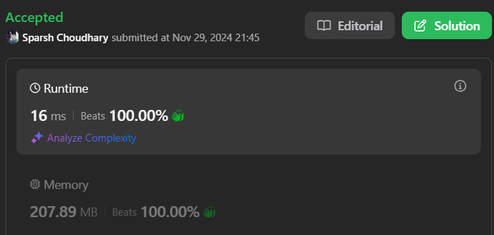

# 🔥BEATS 💯 % 🎯 |✨SUPER EASY BEGINNERS 👏

**Author:** CodeWithSparsh
**Votes:** 2
**Link:** [https://leetcode.com/problems/rotating-the-box/solutions/6095017/](https://leetcode.com/problems/rotating-the-box/solutions/6095017/)

---



---


## Intuition
The problem involves two main tasks:
1. **Rotating a 2D grid**: Rotating the box 90 degrees clockwise allows us to reorient the box for simulating gravity.
2. **Simulating gravity**: After the rotation, stones (`#`) in each column need to fall to their lowest possible positions, stopping when blocked by obstacles (`*`).

---

## Approach
1. **Rotate the grid**:
   - A 90-degree clockwise rotation of a grid is achieved by transposing the matrix and then reversing each row.
2. **Apply gravity**:
   - Iterate through each column of the rotated grid.
   - Move stones (`#`) downward while avoiding obstacles (`*`).

---

## Complexity
- **Time Complexity**:  
   \\(O(m \\cdot n)\\), where \\(m\\) is the number of rows and \\(n\\) is the number of columns in the box.  
   - \\(O(m \\cdot n)\\) for rotating the box.  
   - \\(O(m \\cdot n)\\) for applying gravity.
- **Space Complexity**:  
   \\(O(m \\cdot n)\\) for storing the rotated grid.

---


```java []
public class Solution {
    public char[][] rotateTheBox(char[][] box) {
        int m = box.length;
        int n = box[0].length;
        
        // Step 1: Rotate the matrix 90 degrees clockwise
        char[][] rotated = new char[n][m];
        for (int i = 0; i < m; i++) {
            for (int j = 0; j < n; j++) {
                rotated[j][m - 1 - i] = box[i][j];
            }
        }
        
        // Step 2: Simulate gravity for stones
        for (int col = 0; col < n; col++) {
            int ind = m - 1;
            for (int row = m - 1; row >= 0; row--) {
                if (rotated[col][row] == '#') {
                    rotated[col][row] = '.';
                    rotated[col][ind] = '#';
                    ind--;
                } else if (rotated[col][row] == '*') {
                    ind = row - 1;
                }
            }
        }
        
        return rotated;
    }
}
```


```dart []
class Solution {
  List<List<String>> rotateTheBox(List<List<String>> box) {
    int m = box.length;
    int n = box[0].length;

    // Step 1: Rotate the matrix 90 degrees clockwise
    List<List<String>> rotated = List.generate(n, (_) => List.filled(m, '.'));

    for (int i = 0; i < m; i++) {
      for (int j = 0; j < n; j++) {
        rotated[j][m - 1 - i] = box[i][j];
      }
    }

    // Step 2: Simulate gravity for stones
    for (int col = 0; col < m; col++) {
      int ind = n - 1;
      for (int row = n - 1; row >= 0; row--) {
        if (rotated[row][col] == '#') {
          rotated[row][col] = '.';
          rotated[ind][col] = '#';
          ind--;
        } else if (rotated[row][col] == '*') {
          ind = row - 1;
        }
      }
    }

    return rotated;
  }
}
```


```javascript []
var rotateTheBox = function(box) {
    const m = box.length, n = box[0].length;

    // Step 1: Rotate the matrix 90 degrees clockwise
    const rotated = Array.from({ length: n }, () => Array(m).fill('.'));
    for (let i = 0; i < m; i++) {
        for (let j = 0; j < n; j++) {
            rotated[j][m - 1 - i] = box[i][j];
        }
    }

    // Step 2: Simulate gravity
    for (let col = 0; col < n; col++) {
        let ind = m - 1;
        for (let row = m - 1; row >= 0; row--) {
            if (rotated[col][row] === '#') {
                rotated[col][row] = '.';
                rotated[col][ind--] = '#';
            } else if (rotated[col][row] === '*') {
                ind = row - 1;
            }
        }
    }

    return rotated;
};
```


```python []
class Solution:
    def rotateTheBox(self, box: List[List[str]]) -> List[List[str]]:
        m, n = len(box), len(box[0])
        
        # Step 1: Rotate the box 90 degrees clockwise
        rotated = [[box[i][j] for i in range(m)] for j in range(n - 1, -1, -1)]
        
        # Step 2: Apply gravity
        for col in range(m):
            ind = n - 1
            for row in range(n - 1, -1, -1):
                if rotated[row][col] == '#':
                    rotated[row][col] = '.'
                    rotated[ind][col] = '#'
                    ind -= 1
                elif rotated[row][col] == '*':
                    ind = row - 1
        
        return rotated
```


```cpp []
class Solution {
public:
    vector<vector<char>> rotateTheBox(vector<vector<char>>& box) {
        int m = box.size(), n = box[0].size();
        
        // Step 1: Rotate the box 90 degrees clockwise
        vector<vector<char>> rotated(n, vector<char>(m, '.'));
        for (int i = 0; i < m; i++) {
            for (int j = 0; j < n; j++) {
                rotated[j][m - 1 - i] = box[i][j];
            }
        }
        
        // Step 2: Simulate gravity
        for (int col = 0; col < n; col++) {
            int ind = m - 1;
            for (int row = m - 1; row >= 0; row--) {
                if (rotated[col][row] == '#') {
                    rotated[col][row] = '.';
                    rotated[col][ind--] = '#';
                } else if (rotated[col][row] == '*') {
                    ind = row - 1;
                }
            }
        }
        
        return rotated;
    }
};
```


```go []
func rotateTheBox(box [][]byte) [][]byte {
    m, n := len(box), len(box[0])

    // Step 1: Rotate the matrix 90 degrees clockwise
    rotated := make([][]byte, n)
    for i := 0; i < n; i++ {
        rotated[i] = make([]byte, m)
        for j := 0; j < m; j++ {
            rotated[i][j] = box[m-1-j][i]
        }
    }

    // Step 2: Apply gravity
    for col := 0; col < m; col++ {
        ind := n - 1
        for row := n - 1; row >= 0; row-- {
            if rotated[row][col] == '#' {
                rotated[row][col] = '.'
                rotated[ind][col] = '#'
                ind--
            } else if rotated[row][col] == '*' {
                ind = row - 1
            }
        }
    }

    return rotated
}
```

---

 {:style='width:250px'}