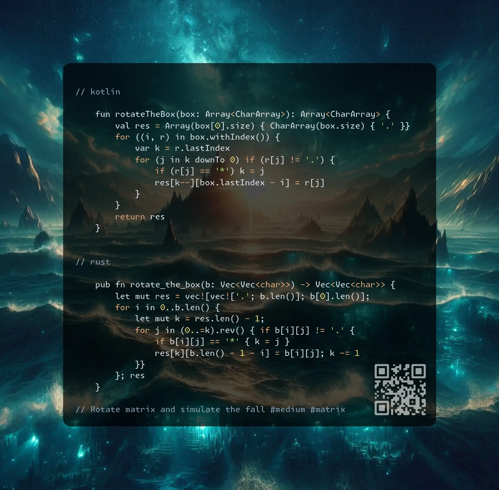

# Kotlin | Rust

**Author:** SamoylenkoDmitry
**Votes:** 2
**Link:** [https://leetcode.com/problems/rotating-the-box/solutions/6074620/](https://leetcode.com/problems/rotating-the-box/solutions/6074620/)

---



https://youtu.be/ICOKxq-rEUM

#### Join me on Telegram

https://t.me/leetcode_daily_unstoppable/809

#### Problem TLDR

Rotate matrix and simulate the fall #medium #matrix

#### Intuition

This problem is all about careful implementation.
We can simulate fall first, then rotate result, or do this in a single step.

#### Approach

* it is simpler to simulate fall by only writing `*` and `#` in a new object with an explicit pointer `k` instead of doing this in-place
* `y` coordinate will change the direction
* a joke solution with converting to string and sorting possible

#### Complexity

- Time complexity:
$$O(nm)$$

- Space complexity:
$$O(nm)$$

#### Code

```kotlin []

    fun rotateTheBox(box: Array<CharArray>): Array<CharArray> {
        val res = Array(box[0].size) { CharArray(box.size) { '.' }}
        for ((i, r) in box.withIndex()) {
            var k = r.lastIndex
            for (j in k downTo 0) if (r[j] != '.') {
                if (r[j] == '*') k = j
                res[k--][box.lastIndex - i] = r[j]
            }
        }
        return res
    }

```
```rust []

    pub fn rotate_the_box(b: Vec<Vec<char>>) -> Vec<Vec<char>> {
        let mut res = vec![vec!['.'; b.len()]; b[0].len()];
        for i in 0..b.len() {
            let mut k = res.len() - 1;
            for j in (0..=k).rev() { if b[i][j] != '.' {
                if b[i][j] == '*' { k = j }
                res[k][b.len() - 1 - i] = b[i][j]; k -= 1
            }}
        }; res
    }

```
```c++ []

    vector<vector<char>> rotateTheBox(vector<vector<char>>& b) {
        vector<vector<char>> r(b[0].size(), vector<char>(b.size(), '.'));
        for (int i = 0, n = b.size(), m = r.size(); i < n; ++i) 
            for (int k = m - 1, j = k; j >= 0; --j) if (b[i][j] != '.')
                r[(k = b[i][j] == '*' ? j : k)--][n - 1 - i] = b[i][j];
        return r;
    }

```
```kotlin []

    fun rotateTheBox(box: Array<CharArray>) =
        box.map { r ->
            r.joinToString("").split('*')
            .map { it.toCharArray().sorted().reversed().joinToString("") }
            .joinToString("*").toCharArray()
        }.run { List(box[0].size) { x -> List(box.size) { this[box.lastIndex - it][x] }}}


```