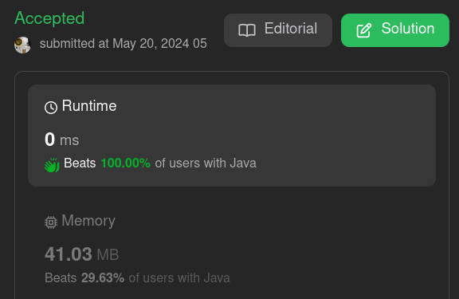

# 🚀🚀🚀Beats 100% - Easily explained ✅✅✅ C++, Java, Python, Go, Rust, C#, Ruby, Js

**Author:** prodonik
**Votes:** 7
**Link:** [https://leetcode.com/problems/sum-of-all-subset-xor-totals/solutions/5181804/](https://leetcode.com/problems/sum-of-all-subset-xor-totals/solutions/5181804/)

---




# Intuition
To solve the problem of finding the sum of XORs of all subsets of an array, we can use a recursive approach. By systematically including and excluding each element of the array in subsets, we can compute the XOR of each subset and sum them up.

# Approach
1. **Recursive Method**:
    - Create a helper function that will take the current index and the current XOR value.
    - For each element at the current index, we have two choices: include it in the current subset or exclude it.
    - Recursively call the helper function for both choices and sum the results.
    - The base case for recursion is when the index reaches the end of the array, at which point we return the current XOR value.
2. **Initiate the Recursive Process**:
    - Start the recursion with the initial index as 0 and the initial XOR value as 0.
3. **Combine Results**:
    - The result for each recursive call is the sum of the XOR values from including and excluding the current element.

# Complexity
- **Time complexity**:
    - The time complexity is \\(O(2^n)\\), where \\(n\\) is the number of elements in the input array. This is because each element has two choices (include or exclude), leading to \\(2^n\\) possible subsets.

- **Space complexity**:
    - The space complexity is \\(O(n)\\) due to the recursive call stack depth, which is proportional to the number of elements in the array.

# Code
```java []
class Solution {
    // Public method to initiate the recursive helper function
    public int subsetXORSum(int[] nums) {
        return helper(nums, 0, 0);
    }

    // Recursive helper function to compute the subset XOR sum
    private int helper(int[] nums, int index, int currValue) {
        // Base case: if index reaches the length of nums, return the current XOR value
        if (index == nums.length) return currValue;

        // Recur by including the current element in the XOR (index+1, currValue^nums[index])
        // and by excluding the current element (index+1, currValue)
        return helper(nums, index + 1, currValue ^ nums[index]) + helper(nums, index + 1, currValue);
    }

    public static void main(String[] args) {
        Solution solution = new Solution();
        int[] nums = {1, 3, 5};
        System.out.println(solution.subsetXORSum(nums)); // Output the result
    }
}
```
```C++ []
class Solution {
public:
    int subsetXORSum(vector<int>& nums) {
        return helper(nums, 0, 0);
    }

private:
    int helper(vector<int>& nums, int index, int currValue) {
        if (index == nums.size()) return currValue;
        return helper(nums, index + 1, currValue ^ nums[index]) + helper(nums, index + 1, currValue);
    }
};

```
```Python []
class Solution:
    def subsetXORSum(self, nums: List[int]) -> int:
        return self.helper(nums, 0, 0)

    def helper(self, nums: List[int], index: int, currValue: int) -> int:
        if index == len(nums):
            return currValue
        return self.helper(nums, index + 1, currValue ^ nums[index]) + self.helper(nums, index + 1, currValue)
```
```C# []
public class Solution {
    public int SubsetXORSum(int[] nums) {
        return Helper(nums, 0, 0);
    }

    private int Helper(int[] nums, int index, int currValue) {
        if (index == nums.Length) return currValue;
        return Helper(nums, index + 1, currValue ^ nums[index]) + Helper(nums, index + 1, currValue);
    }
}
```
```Rust []
struct Solution;

impl Solution {
    pub fn subset_xor_sum(nums: Vec<i32>) -> i32 {
        Self::helper(&nums, 0, 0)
    }

    fn helper(nums: &Vec<i32>, index: usize, curr_value: i32) -> i32 {
        if index == nums.len() {
            return curr_value;
        }
        Self::helper(nums, index + 1, curr_value ^ nums[index]) + Self::helper(nums, index + 1, curr_value)
    }
}
```
```Go []
func SubsetXORSum(nums []int) int {
    return helper(nums, 0, 0)
}

func helper(nums []int, index, currValue int) int {
    if index == len(nums) {
        return currValue
    }
    return helper(nums, index+1, currValue^nums[index]) + helper(nums, index+1, currValue)
}
```
```Ruby []
class Solution
  def subset_xor_sum(nums)
    helper(nums, 0, 0)
  end

  private

  def helper(nums, index, curr_value)
    return curr_value if index == nums.length

    helper(nums, index + 1, curr_value ^ nums[index]) + helper(nums, index + 1, curr_value)
  end
end
```
```Js []
class Solution {
    subsetXORSum(nums) {
        return this.helper(nums, 0, 0);
    }

    helper(nums, index, currValue) {
        if (index === nums.length) return currValue;
        return this.helper(nums, index + 1, currValue ^ nums[index]) + this.helper(nums, index + 1, currValue);
    }
}
```