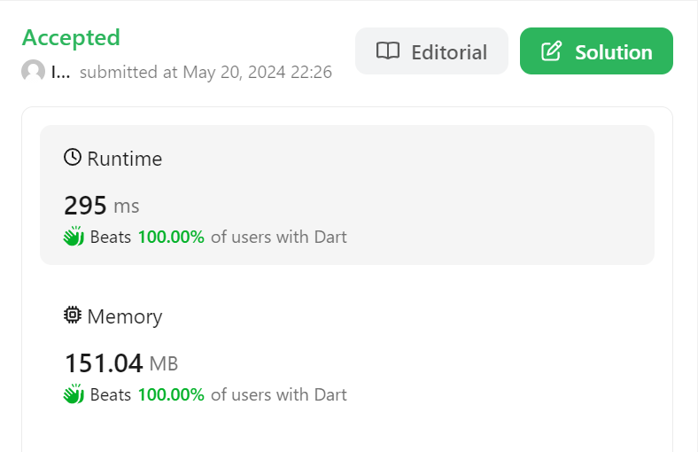

# Dart Solution || Beats 100% || Simple approach

**Author:** IsaacKingsleyD
**Votes:** 1
**Link:** [https://leetcode.com/problems/sum-of-all-subset-xor-totals/solutions/5185302/](https://leetcode.com/problems/sum-of-all-subset-xor-totals/solutions/5185302/)

---




# Approach
<!-- Describe your first thoughts on how to solve this problem. -->
Very Simple and looping approch 

This Involves calculating the xor initial value of nums storing it using it to find xor values of future generated subsets adding the value to ans storing values using them to generate all the subset xor value and calculating the sum in ans and returning it

# 
<!-- Describe your approach to solving the problem. -->

# Complexity
- Time complexity: O(2^n)
<!-- Add your time complexity here, e.g. $$O(n)$$ -->

- Space complexity:O(2^n)
<!-- Add your space complexity here, e.g. $$O(n)$$ -->


```Dart []
class Solution {
  int subsetXORSum(List<int> nums) {
    int ans = 0,l,val;
    List<int> store = [0];
    for(int n in nums){
        l = store.length;
        for(int i = 0;i<l;i++){
            val = store[i] ^ n;
            ans += val;
            store.add(val);
        }
    }
    return ans;
  }
}
```
```python []
class Solution:
    def subsetXORSum(self, nums: List[int]) -> int:
        ans = 0
        store =[0]
        for n in nums:
            l = len(store)
            for i in range(l):
                val = store[i] ^ n
                ans += val
                store.append(val)

        return ans
```
