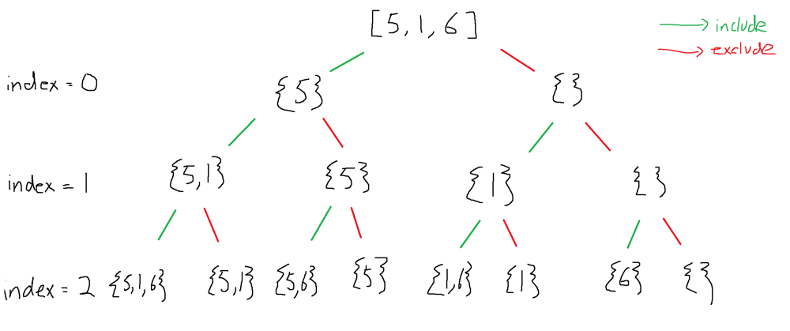

# Java - Backtracking approach with explanation

**Author:** jkwee
**Votes:** 220
**Link:** [https://leetcode.com/problems/sum-of-all-subset-xor-totals/solutions/1242073/](https://leetcode.com/problems/sum-of-all-subset-xor-totals/solutions/1242073/)

---

*Why use Backtracking?*

One of the indicators from the description to use backtracking are the words "All subset". Looking at the constraints, the length of the input array is relatively small, so we can approach this question using brute force.

*General Approach*

1.  Firstly, we need to generate all the possible subsets from the input array.
2.  Then, for all calculated subsets, calculate the XOR of all elements in each subset.
3.  Return the sum of all calculated XORs.

*Detailed Approach*
1. Generate all possible subsets:
We can recursively generate all possible subsets given an array. For each element in the array, you will have two choices: Include the current element in the array in the generated subset, or withhold the current element from the generated subset. 
Visualization: 


2. If we are going the step by step approach, we would store all the subsets in a list and calculate their XORs. However, this is not necessary as we can calculate the ongoing XOR total while generating the subsets. The trick is to be able to remember the state of the current xor that is calculated for each recursive step.

3. As we are not explicitly storing the subsets in a list, we just need to return the sum of the calculated xor when the current element is considered + the calculated xor when the current element is not considered.

*Code*
```
	public int subsetXORSum(int[] nums) {
        return helper(nums, 0, 0);
    }
    
    private int helper(int[] nums, int index, int currentXor) {
        // return currentXor when all elements in nums are already considered
        if (index == nums.length) return currentXor;
        
        // calculate sum of xor with current element
        int withElement = helper(nums, index + 1, currentXor ^ nums[index]);
        
        // calculate sum of xor without current element
        int withoutElement = helper(nums, index + 1, currentXor);
        
        // return sum of xors from recursion
        return withElement + withoutElement;
    }
```