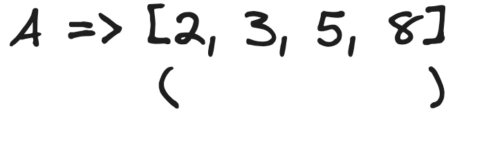
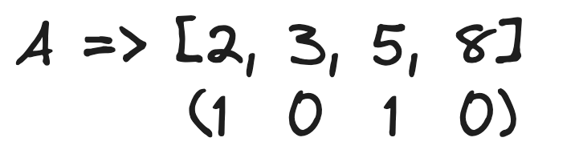

# 2 Approaches | Step-By-Step Explanation!! No one will give you!! But I did 😉

**Author:** hi-malik
**Votes:** 67
**Link:** [https://leetcode.com/problems/sum-of-all-subset-xor-totals/solutions/5181921/](https://leetcode.com/problems/sum-of-all-subset-xor-totals/solutions/5181921/)

---

The question is not so tricky. let's take one example to understand this problem.

**Approach - 1**
```
Input: nums = [5,1,6]
Output: 28
```
So, to solve this problem, we going to use the help of **a method I invented** \uD83D\uDE0E, *just kidding*. In which there will be things either we **include (I)** or we **exclude (e)**
What it means is : 
> One time we will include the number from the array, 
> > and the same time we going to exclude it from the array

```
                         [5, 1, 6]
```
First we going to **include** one number from the array i.e. **5**
```
                         [5, 1, 6]
						i/
					   [5]
```
Same time we going to **exclude** this from the array
```
                         [5, 1, 6]
						i/      \\e
					   [5]      []
```
Now let's focus on the **included array** and **include** one more value into our array i.e. **1**
```
                         [5, 1, 6]
						i/      \\e
					   [5]      []
					  i/
				  [5, 1]
```
In this branch, we going to **exclude** and the value **5** will remain in the array as the same
```
                         [5, 1, 6]
						i/      \\e
					   [5]      []
					  i/  \\e
				  [5, 1]  [5]
```
Let's go back to the **exclude branch** we created in starting. In this again we going to create 2 possiblities, **include (i)** and **exclude (e)**. First we **include** value **1** into our array
```
                         [5, 1, 6]
						i/      \\e
					   [5]      []
					  i/  \\e   i/
				  [5, 1]  [5] [1]
```
If we **exclude**, the array will remain empty
```
                         [5, 1, 6]
						i/      \\e
					   [5]      []
					  i/  \\e   i/ \\e
				  [5, 1]  [5] [1] []
```
Again the similar thing happen for this array **`[5, 1]`**, **include** - **exclude**. So, let's **include** first the value **6** into the array
```
                         [5, 1, 6]
						i/      \\e
					   [5]      []
					  i/  \\e   i/ \\e
				  [5, 1]  [5] [1] []
				 i/
		  [5, 1, 6]
```
If we are **ecluding** it from the array **`[5, 1]`**, the array will remain the same!
```
                         [5, 1, 6]
						i/      \\e
					   [5]      []
					  i/  \\e   i/ \\e
				  [5, 1]  [5] [1] []
				 i/   \\e
		  [5, 1, 6] [5,1]
```
Again for this array **`[5]`**, **include** - **exclude**. So, let's **include** first the value **6** into the array
```
                         [5, 1, 6]
						i/      \\e
					   [5]      []
					  i/  \\e   i/ \\e
				  [5, 1]  [5] [1] []
				 i/   \\e  i/
		  [5, 1, 6] [5,1][5,6]
```
If we are **ecluding** it from the array **`[5]`**, the array will remain the same!
```
                         [5, 1, 6]
						i/      \\e
					   [5]      []
					  i/  \\e   i/ \\e
				  [5, 1]  [5] [1] []
				 i/   \\e  i/ \\e
		   [5,1,6] [5,1][5,6][5]
```
Let's go back Again to this array **`[1]`**, **include** - **exclude**. So, let's **include** first the value **6** into the array
```
                         [5, 1, 6]
						i/      \\e
					   [5]      []
					  i/  \\e   i/ \\e
				  [5, 1]  [5] [1] []
				 i/   \\e  i/ \\e \\i
		   [5,1,6] [5,1][5,6][5] [1,6]
```
If we are **ecluding** it from the array **`[1]`**, the array will remain the same!
```
                         [5, 1, 6]
						i/      \\e
					   [5]      []
					  i/  \\e   i/ \\e
				  [5, 1]  [5] [1] []
				 i/   \\e  i/ \\e \\i\\e---|
		   [5,1,6] [5,1][5,6][5] [1,6][1]
```
Let's go back Again to this array **`[]`**, **include** - **exclude**. So, let's **include** first the value **6** into the array
```
                         [5, 1, 6]
						i/      \\e
					   [5]      []
					  i/  \\e   i/ \\e
				  [5, 1]  [5] [1] []--------|
				 i/   \\e  i/ \\e \\i\\e---|   i|
		   [5,1,6] [5,1][5,6][5] [1,6][1]  [6]
```
If we are **ecluding** it from the array **`[]`**, the array will remain the same!
```
                         [5, 1, 6]
						i/      \\e
					   [5]      []
					  i/  \\e   i/ \\e
				  [5, 1]  [5] [1] []--------|---|
				 i/   \\e  i/ \\e \\i\\e---|   i|  e|
		   [5,1,6] [5,1][5,6][5] [1,6][1]  [6] []
```
So, if you carefully look at this, we are going **LEVEL** by **LEVEL** 
*(level sabke niklenge) meme, if you know you know*
Anyways back to the question,
First we have let's say **`Level=0`**
```
                         [5, 1, 6]
						i/      \\e
Level = 0		       [5]      []
					  i/  \\e   i/ \\e
				  [5, 1]  [5] [1] []--------|---|
				 i/   \\e  i/ \\e \\i\\e---|   i|  e|
		   [5,1,6] [5,1][5,6][5] [1,6][1]  [6] []
```
Then, **`Level=1`** and **`Level=2`**
```
                         [5, 1, 6]
						i/      \\e
Level = 0		       [5]      []
					  i/  \\e   i/ \\e
Level = 1		  [5, 1]  [5] [1] []--------|---|
				 i/   \\e  i/ \\e \\i\\e---|   i|  e|
Level = 2  [5,1,6] [5,1][5,6][5] [1,6][1]  [6] []
```
So, what these level's are doing they are assigning an limit to the array! As, in level = 0, the array can have only 1 element.

If you still don't understand, don't worry. Let's look at the code and will understand while writing the code!

**PSEUDO CODE**
```
function subsetXORSum(nums):
    # First create helper function, this function will help us to calculate
    # when i'm including, when i'm not. The XOR of that array
    return helper(nums, 0, 0) # array, level, current XOR

function helper(nums, level, currentXOR):
    # Base condition: if level reaches the length of nums
    if level == length(nums):
        return currentXOR

    # Calculate the XOR sum when including the current element
    include = helper(nums, level + 1, currentXOR XOR nums[level])

    # Calculate the XOR sum when excluding the current element
    exclude = helper(nums, level + 1, currentXOR)

    # Return the sum of include and exclude results
    return include + exclude
```

Let's code it up in our **favourite language**

**JAVA**
```
class Solution {
    public int subsetXORSum(int[] nums) {
        // First create helper function, this function will help us to calculate
        // when i'm including, when i'm not. The XOR of that array
        return helper(nums, 0, 0); // nums, level, current XOR
    }
    public int helper(int nums[], int level, int currentXOR){
        // base condition
        if(level == nums.length) return currentXOR;
        // creating include 
        int include = helper(nums, level + 1, currentXOR^nums[level]);
        // creating exclude
        int exclude = helper(nums, level + 1, currentXOR);
        
        return include + exclude;
    }
}
```
**C++**
```
class Solution {
public:
    int subsetXORSum(vector<int>& nums) {
        // First create helper function, this function will help us to calculate
        // when I'm including, when I'm not. The XOR of that array
        return helper(nums, 0, 0); // nums, level, current XOR
    }

private:
    int helper(vector<int>& nums, int level, int currentXOR) {
        // base condition
        if (level == nums.size()) return currentXOR;
        // creating include 
        int include = helper(nums, level + 1, currentXOR ^ nums[level]);
        // creating exclude
        int exclude = helper(nums, level + 1, currentXOR);
        
        return include + exclude;
    }
};
```
**PYTHON**
```
class Solution:
    def subsetXORSum(self, nums: List[int]) -> int:
        # First create helper function, this function will help us to calculate
        # when I'm including, when I'm not. The XOR of that array
        return self.helper(nums, 0, 0)  # nums, level, current XOR

    def helper(self, nums: List[int], level: int, currentXOR: int) -> int:
        # base condition
        if level == len(nums):
            return currentXOR
        # creating include 
        include = self.helper(nums, level + 1, currentXOR ^ nums[level])
        # creating exclude
        exclude = self.helper(nums, level + 1, currentXOR)
        
        return include + exclude
```

---
Complexity Analysis

---
* **Time Complexity :-** BigO(2^N) We traverse through each of the 2^N subsets to calculate the result.


* **Space Complexity :-** BigO(N)

---
---

**Approach - 2**
Let's say you have an array of size 4. example : **`[2,3,5,8]`**, now to find the subset we will make the mast of it. What I mean is that, we will make a number that represent this array!

Now if we want to take let's say 2 and 5 as a subset

To find it all the possible subsets, we will iterate from **`1 ---> 2^4`**, if we iterate over all the numbers. It will form a **4 bit** number and it will iterate over all the possible combinations like:
```
0001
0010
0011
```
So these are the bit mask for these array. And using this bit mask, we will find all the different subsets and while building the subsets we will find out the XOR also and just add the xor upon the subset and that's it.

Let's code this now,

**C++**
```
class Solution {
public:
    int subsetXORSum(vector<int>& nums) {
        int n = nums.size();
        int total = 0;
        for(int i = 1; i < (1 << n); i++) {
            int curr_total = 0;
            for(int j = 0; j < n; j++) {
                if(i & (1 << j)) curr_total ^= nums[j];
            }
            total += curr_total;
        }
        return total;
    }
};
```
**JAVA**
```
class Solution {
    public int subsetXORSum(int[] nums) {
        int n = nums.length;
        int total = 0;
        for (int i = 1; i < (1 << n); i++) {
            int currTotal = 0;
            for (int j = 0; j < n; j++) {
                if ((i & (1 << j)) != 0) {
                    currTotal ^= nums[j];
                }
            }
            total += currTotal;
        }
        return total;
    }
}
```
**PYTHON**
```
class Solution:
    def subsetXORSum(self, nums):
        n = len(nums)
        total = 0
        for i in range(1, 1 << n):
            curr_total = 0
            for j in range(n):
                if i & (1 << j):
                    curr_total ^= nums[j]
            total += curr_total
        return total
```
---
Complexity Analysis

---
* **Time Complexity :-** BigO(Nx2^N) 

* **Space Complexity :-** BigO(N)