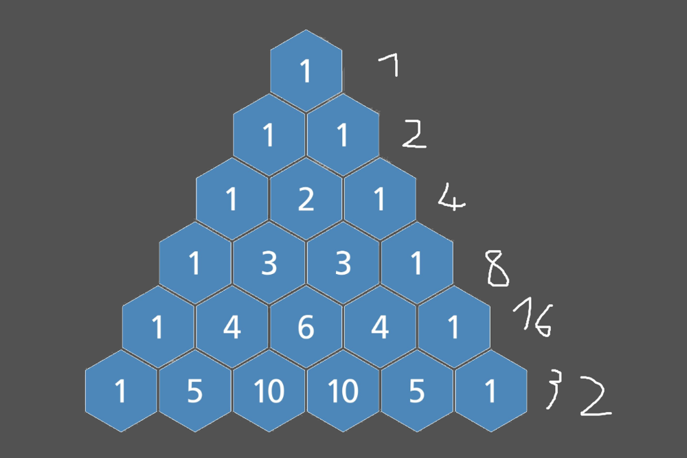

# Optimal solution || C++ with explanation

**Author:** Cubk0
**Votes:** 6
**Link:** [https://leetcode.com/problems/sum-of-all-subset-xor-totals/solutions/4019874/](https://leetcode.com/problems/sum-of-all-subset-xor-totals/solutions/4019874/)

---

# Intuition
<!-- Describe your first thoughts on how to solve this problem. -->
I started by counting how many combinations there are for each number or how many times a number will be in subset I calculated this using combinations 
for example  $\\binom{2}{0}+\\binom{2}{1}+\\binom{2}{2}$ for size 3, so I figured that if a number has a bit in it that other numbers don't the bit will be added exacly that many times because XOR doesnt affect it for this example with number 3 it is 4 times 
then I noticed it works even if other numbers have the same bit because XORing same bits cancels out all the additional combinations. In the exaple with 3 numbers lets say two of the numbers are 1 each will have 4 combinations but $\\frac{4}{2}$ or $\\binom{1}{0}+\\binom{1}{1} $(using 1 as $n$ because we have 2 known numbers from 3 so $3-2$)common combinations which will cancel 2 of them for each resulting in 4 again(more complicated if all 3 are the same but still works).
So we just need to multiply number with all the used bits by sum of all the combinations 
sum of all combinations are powers of 2 as you can see in this Pascals triangle 

so we can achieve this by bitshifting
# Approach
<!-- Describe your approach to solving the problem. -->
If a bit apears in any number at least once it will be used in addition exacly $2^{n-1}$ times so we just need to get all used bits in a number and bit shift them $n-1$ times to the left 
# Complexity
- Time complexity: $O(N)$
<!-- Add your time complexity here, e.g. $$O(n)$$ -->

- Space complexity: $O(1)$
<!-- Add your space complexity here, e.g. $$O(n)$$ -->

# Code
```C++ []
class Solution {
public:
    int subsetXORSum(vector<int>& nums) {
       int res = 0;
       for(int n :nums){
           res|=n;
       } 
       return res<<(nums.size()-1);
    }
};
```
```C []
int subsetXORSum(int* nums, int numsSize){
    int res=0;
    for(int i =0;i<numsSize;i++){
        res|=nums[i];
    }
    return res<<(numsSize-1);
}
```
```Rust []
impl Solution {
    pub fn subset_xor_sum(nums: Vec<i32>) -> i32 {
        let mut res =0;
        for n in &nums{
            res|=n;
        }
        res<<(nums.len()-1)
    }
}
```
