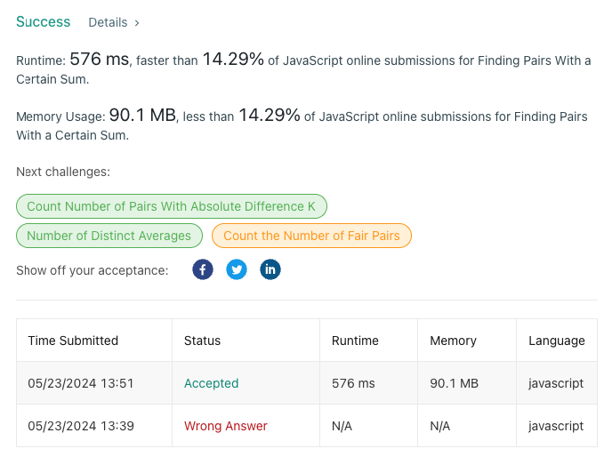

# ❇ finding-pairs-with-a-certain-sum👌 🏆O(N)❤️ Javascript🎯 Memory👀14.45%🕕 ++Explanation✍️ 🔴🔥

**Author:** anurag-sindhu
**Votes:** 2
**Link:** [https://leetcode.com/problems/finding-pairs-with-a-certain-sum/solutions/5196555/](https://leetcode.com/problems/finding-pairs-with-a-certain-sum/solutions/5196555/)

---


Time Complexity: O(N)
Space Complexity: O(N)
```
/**
 * @param {number[]} nums1
 * @param {number[]} nums2
 */
var FindSumPairs = function (nums1, nums2) {
    this.numOneObj = (function () {
        const obj = {};
        for (const iterator of nums1) {
            if (!obj[iterator]) {
                obj[iterator] = 0;
            }
            obj[iterator] += 1;
        }
        return obj;
    })();
    this.numTwo = nums2;
    this.numsTwoObj = (function () {
        const obj = {};
        for (const iterator of nums2) {
            if (!obj[iterator]) {
                obj[iterator] = 0;
            }
            obj[iterator] += 1;
        }
        return obj;
    })();
};

/**
 * @param {number} index
 * @param {number} val
 * @return {void}
 */
FindSumPairs.prototype.add = function (index, val) {
    const existingNumAtIndex = this.numTwo[index];
    const updatedKey = existingNumAtIndex + val;
    this.numsTwoObj[existingNumAtIndex] -= 1;
    if (!this.numsTwoObj[updatedKey]) {
        this.numsTwoObj[updatedKey] = 0;
    }
    this.numsTwoObj[updatedKey] += 1;
    this.numTwo[index] += val;
    return null;
};

/**
 * @param {number} tot
 * @return {number}
 */
FindSumPairs.prototype.count = function (tot) {
    let count = 0;
    for (const key in this.numOneObj) {
        const requiredNumKeyInObj2 = tot - Number(key);
        if (this.numsTwoObj[requiredNumKeyInObj2]) {
            count += this.numsTwoObj[requiredNumKeyInObj2] * this.numOneObj[key];
        }
    }
    return count;
};
```

