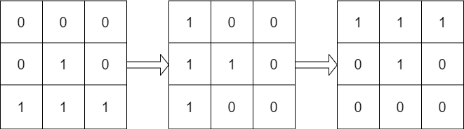

# [1886. Determine Whether Matrix Can Be Obtained By Rotation](https://leetcode.com/problems/determine-whether-matrix-can-be-obtained-by-rotation/)

| Category | Difficulty | Likes | Dislikes |
| :------: | :--------: | :---: | :------: |
| Algorithms | Easy | 1571 | 148 |

**Tags:** [`array`](https://leetcode.com/tag/array), [`matrix`](https://leetcode.com/tag/matrix)

**Companies:** `facebook`, `google`, `amazon`

## Description

Given two `n x n` binary matrices `mat` and `target`, return `true`* if it is possible to make *`mat`* equal to *`target`* by **rotating** *`mat`* in **90-degree increments**, or *`false`* otherwise.*

 

**Example 1:**


```

Input: mat = [[0,1],[1,0]], target = [[1,0],[0,1]]
Output: true
Explanation: We can rotate mat 90 degrees clockwise to make mat equal target.

```

**Example 2:**


```

Input: mat = [[0,1],[1,1]], target = [[1,0],[0,1]]
Output: false
Explanation: It is impossible to make mat equal to target by rotating mat.

```

**Example 3:**


```

Input: mat = [[0,0,0],[0,1,0],[1,1,1]], target = [[1,1,1],[0,1,0],[0,0,0]]
Output: true
Explanation: We can rotate mat 90 degrees clockwise two times to make mat equal target.

```

 

**Constraints:**

	- `n == mat.length == target.length`

	- `n == mat[i].length == target[i].length`

	- `1 <= n <= 10`

	- `mat[i][j]` and `target[i][j]` are either `0` or `1`.

---

**Links:** [Submissions](https://leetcode.com/problems/determine-whether-matrix-can-be-obtained-by-rotation/) | [Solutions](https://leetcode.com/problems/determine-whether-matrix-can-be-obtained-by-rotation/)
