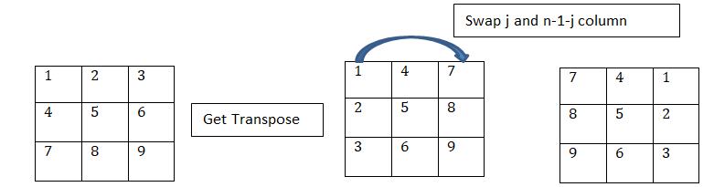

# Python: 4 Times matrix rotation: Time = O(n^2),  Space = Constant

**Author:** meaditya70
**Votes:** 13
**Link:** [https://leetcode.com/problems/determine-whether-matrix-can-be-obtained-by-rotation/solutions/1254071/](https://leetcode.com/problems/determine-whether-matrix-can-be-obtained-by-rotation/solutions/1254071/)

---

```
An easy way to Rotate a matrix once by 90 degrees clockwise, 
is to get the **transpose of a matrix and interchange the 'j'th and 'n-1-j'th column**, 
for 0<=j<=n-1 where n is the number of columns in matrix.
```

```
To get the transpose:
			for i in range(n):
                for j in range(i+1,n):
                    mat[i][j],mat[j][i] = mat[j][i],mat[i][j]
To interchange columns:
			 for i in range(n):
                for j in range(n//2):
                    mat[i][j], mat[i][n-1-j] = mat[i][n-1-j], mat[i][j]
As soon as we get that the rotated matrix is equal to  target, we simply return true,
else we rotate it again(at max 4 times, as we will get the original matrix back after 4th rotation).
```

The full code:
```
def findRotation(self, mat: List[List[int]], target: List[List[int]]) -> bool:
        n = len(mat)
        for times in range(4):
            for i in range(n):
                for j in range(i+1,n):
                    mat[i][j],mat[j][i] = mat[j][i],mat[i][j] # swap(mat[i][j],mat[j][i])
            for i in range(n):
                for j in range(n//2):
                    mat[i][j], mat[i][n-1-j] = mat[i][n-1-j], mat[i][j] #swap(mat[i][j], mat[i][n-1-j])
            if(mat == target):
                return True
        return False
```