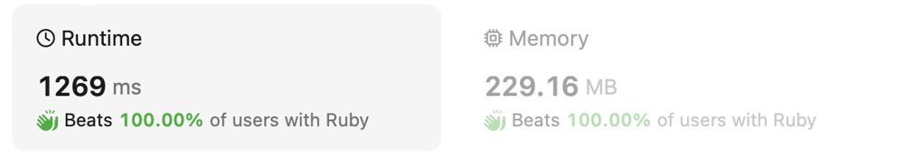

# Ruby one-liner with explanation (beats 100%)

**Author:** el777
**Votes:** 1
**Link:** [https://leetcode.com/problems/reduction-operations-to-make-the-array-elements-equal/solutions/4305426/](https://leetcode.com/problems/reduction-operations-to-make-the-array-elements-equal/solutions/4305426/)

---

# Intuition
<!-- Describe your first thoughts on how to solve this problem. -->
We may find that every value on its way to lowest one goes through steps - other values. So number  of steps to reduce it = number of intermediarory values. If we have several values we just count them the same way.




# Approach
<!-- Describe your approach to solving the problem. -->
0. Imagine you have an array `[1,1,2,2,3]`
1. Calculate frequescies for each number. Ruby method `.tally` can be used to achieve a hash `{1=>2, 2=>2, 3=>1}`.
2. Sort by keys in ascending order - so we have correct steps. `.sort` produces `[[1, 2], [2, 2], [3, 1]]`. That means we have `1` value 2 times, `2` also 2 times, and value `3` only 1 time.
3. One may find we are not interested in specific values are meaningless - only counts of such values. Take only couns `collect {|x| x.last}` produces `[2, 2, 1]`.
4. Add index to each value. Here index show many steps are from lowest value. `.each_with_index` gives enumerator with pairs `[[2, 0], [2, 1], [1, 2]]`
5. Then multiply and sum values with reduce  `.reduce(0) {|sum, pair| sum + pair[0]*pair[1]}` gives `7`.

# Complexity
- Time complexity:
<!-- Add your time complexity here, e.g. $$O(n)$$ -->
$$O(N log N)$$ because sorting is used

- Space complexity:
<!-- Add your space complexity here, e.g. $$O(n)$$ -->
$$O(N)$$

# Code
```
# @param {Integer[]} nums
# @return {Integer}
def reduction_operations(nums)
    nums
        .tally
        .sort
        .collect {|x| x.last}
        .each_with_index
        .reduce(0) { |sum, pair| sum + pair[0]*pair[1] }
end
```

(Code is splitted by lines for better readability. Could be joined in one).