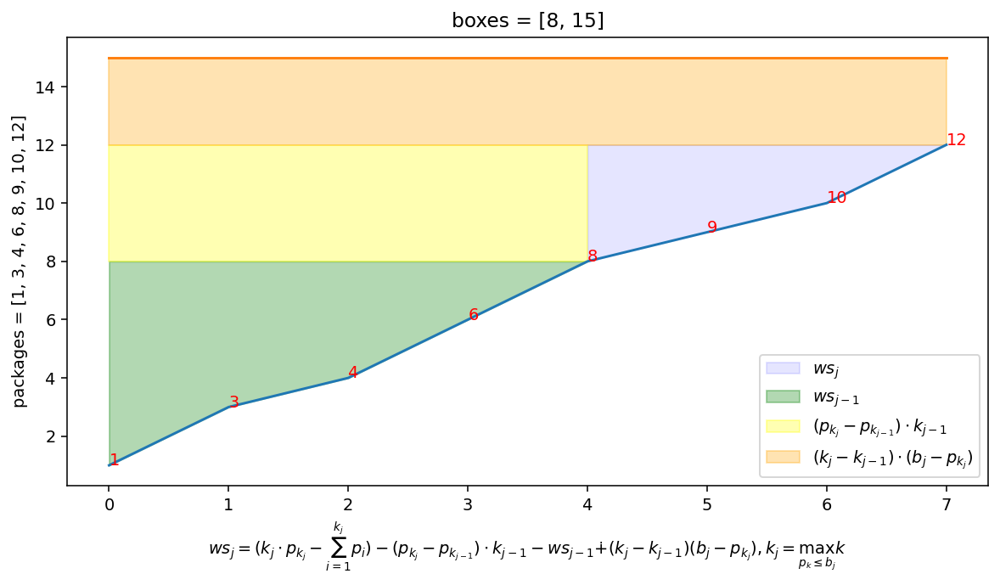

# Scala solution explained: prefix sums + binary search

**Author:** lastseenjustnow
**Votes:** 0
**Link:** [https://leetcode.com/problems/minimum-space-wasted-from-packaging/solutions/1890093/](https://leetcode.com/problems/minimum-space-wasted-from-packaging/solutions/1890093/)

---

Let's assume that box kit contains only one box and it's size equal to the size of k-th package, . Then wasted space for package  is equal to , where  is a prefix sums and can be calculated only once before wasted space evaluation. 
Next, I have tried to put together a function for calculation of wasted space  for each box . This formula consists of 4 components, 4 terms. Obviously, to apply the function properly, both package array and boxes arrays must be sorted in ascending order. Also, I take into consideration only those box kits where maximum size is not less than the maximum package size. 
1. First, I add the wasted space for the first box which exceeds or equal to a corresponding package from the array. Those amounts are already precalculated for me in the beginning of the algorithm: . For efficient searching of the corresponding package binary search should be used. The binary search for this problem is similar to Search Insert Position problem
2. From the amount of net wasted space for i-th package I have to ***subtract*** all the space which will be absorbed by the previous box. This amount is equal to the volume of the previous box multiplied by the number of packages which fit into it, that is an index of the previous largest package that is less or equal to the previous box: 
3. Previous box wasted space  should be extracted out of the sum as well.
4. Finally, the difference between the box size and the maximum package chosen on i-th step should be added to the wasted space: 

To put everything together, the formula looks like 

Illustration:



Initial draft of the code looks like:
```
  def minWastedSpace(packages: Array[Int], boxes: Array[Array[Int]]): Int = {

  def tripletBinarySearch(x: Array[(Int, Long, Long)], toFind: Long, start: Int): Int = {
    if (toFind >= x.last._2) {
      return x.length - 1
    }

    var (left, middle, right) = (start, (x.length - 1) / 2, x.length - 1)
    var res = -1
    var flag = false

    while (!flag && left <= right) {
      middle = (right - left) / 2 + left
      if (x(middle)._2 == toFind && x(middle + 1)._2 != toFind) {
        flag = true
        res = middle
      } else if (toFind < x(middle)._2) {
        right = middle - 1
        res = right
      } else {
        left = middle + 1
        res = right
      }
    }
    res
  }

    val packagesMax = packages.max
    val firstBoxWaste: Array[(Int, Long, Long)] = packages
      .sorted
      .scanLeft((0L, 0L))((t, pack) => (t._1 + pack, pack))
      .zipWithIndex
      .map(t => (t._2, t._1._2, t._1._2 * t._2 - t._1._1))

    var res = Long.MaxValue

    for (box <- boxes) {
      if (!(packagesMax > box.max)) {
        val boxesSorted = box.sorted
        var (j, prevBoxIndex, thisResidual: Long) = (0, 0, 0L)
        while (j < box.length) {
          val prevBox = firstBoxWaste(prevBoxIndex)

          val currentBoxIndex = tripletBinarySearch(firstBoxWaste, boxesSorted(j), prevBoxIndex)
          val currentBox = firstBoxWaste(currentBoxIndex)

          val thisWastedSpace: Long = currentBox._3 - prevBox._3 - (currentBox._2 - prevBox._2) * prevBox._1.toLong + (boxesSorted(j).toLong - currentBox._2) * (currentBox._1.toLong - prevBox._1.toLong)
          thisResidual += thisWastedSpace
          prevBoxIndex = currentBoxIndex
          j += 1
        }
        res = res min thisResidual
      }
    }
    if (res == Long.MaxValue) -1 else (res % (Math.pow(10, 9).toLong + 7)).toInt
  }