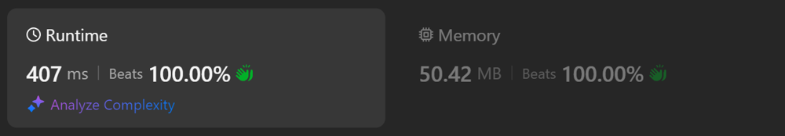

# Kotlin. Beats 100% (389 ms). Binary search.

**Author:** mobdev778
**Votes:** 1
**Link:** [https://leetcode.com/problems/find-the-student-that-will-replace-the-chalk/solutions/5724634/](https://leetcode.com/problems/find-the-student-that-will-replace-the-chalk/solutions/5724634/)

---


# Code
```kotlin []
class Solution {
    fun chalkReplacer(chalk: IntArray, k: Int): Int {
        val sums = sum(chalk)
        var k = k.toLong() % sums[sums.size - 1]

        var left = 0
        var right = sums.size - 1
        while (left < right) {
            val m = (left + right) shr 1
            if (sums[m] > k) {
                right = m - 1
            } else {
                left = m + 1
            }
        }
        if (sums[left] < k) {
            return left + 1
        }
        return left
    }

    private fun sum(chalk: IntArray): LongArray {
        var sum = 0L
        val result = LongArray(chalk.size) {
            sum += chalk[it]
            sum
        }
        return result
    }
}
```

# Approach

In this problem, two things should be taken into account:

1) The sum of all elements of the array chunk can be significantly less than the value of "k", which is why a simple subtraction loop is not suitable - we will have to go through the array idly several times, decreasing the value of "k" by the same amount.

2) If we go through the entire array once (for example, when calculating the sums of elements), then the value of the desired position the next time we can find it using binary search, which will be significantly faster: O(log N) < O(N).

# Alternative approach

We can also use the standard binary search method on an array instead of our own:



```
class Solution {
    fun chalkReplacer(chalk: IntArray, k: Int): Int {
        val sums = sum(chalk)
        var k = k.toLong() % sums[sums.size - 1]

        var index = Arrays.binarySearch(sums, k)
        if (index < 0) index = (-index) - 1
        while (sums[index] <= k) {
            index++
        }
        return index
    }

    private fun sum(chalk: IntArray): LongArray {
        var sum = 0L
        val result = LongArray(chalk.size) {
            sum += chalk[it]
            sum
        }
        return result
    }
}
```