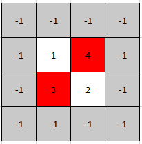
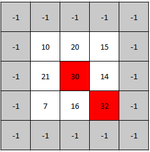

# [1901. Find a Peak Element II](https://leetcode.com/problems/find-a-peak-element-ii/)

| Category | Difficulty | Likes | Dislikes |
| :------: | :--------: | :---: | :------: |
| Algorithms | Medium | 2589 | 161 |

**Tags:** [`array`](https://leetcode.com/tag/array), [`binary-search`](https://leetcode.com/tag/binary-search), [`matrix`](https://leetcode.com/tag/matrix)

**Companies:** `amazon`, `google`, `microsoft`, `facebook`, `tiktok`, `bloomberg`, `xing`

## Description

A **peak** element in a 2D grid is an element that is **strictly greater** than all of its **adjacent **neighbors to the left, right, top, and bottom.

Given a **0-indexed** `m x n` matrix `mat` where **no two adjacent cells are equal**, find **any** peak element `mat[i][j]` and return *the length 2 array *`[i,j]`.

You may assume that the entire matrix is surrounded by an **outer perimeter** with the value `-1` in each cell.

You must write an algorithm that runs in `O(m log(n))` or `O(n log(m))` time.

 

**Example 1:**



```

Input: mat = [[1,4],[3,2]]
Output: [0,1]
Explanation:&nbsp;Both 3 and 4 are peak elements so [1,0] and [0,1] are both acceptable answers.

```

**Example 2:**

****

```

Input: mat = [[10,20,15],[21,30,14],[7,16,32]]
Output: [1,1]
Explanation:&nbsp;Both 30 and 32 are peak elements so [1,1] and [2,2] are both acceptable answers.

```

 

**Constraints:**

	- `m == mat.length`

	- `n == mat[i].length`

	- `1 <= m, n <= 500`

	- `1 <= mat[i][j] <= 10^5`

	- No two adjacent cells are equal.

---

**Links:** [Submissions](https://leetcode.com/problems/find-a-peak-element-ii/) | [Solutions](https://leetcode.com/problems/find-a-peak-element-ii/)
