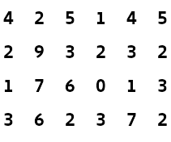
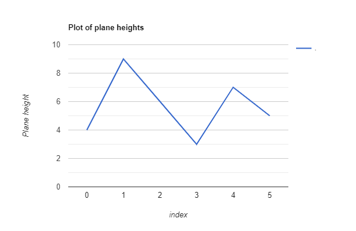

# [Java/Python/C++] Clear Explanation with Images | M*Log(N) | Very Short code

**Author:** 000Prime
**Votes:** 1046
**Link:** [https://leetcode.com/problems/find-a-peak-element-ii/solutions/1276556/](https://leetcode.com/problems/find-a-peak-element-ii/solutions/1276556/)

---

# **Prerequisites:**
Solve the 1D version of this problem first to better understand the 2D version. Here is the link for 1D version : [**Find-Peak-Element-1D**](https://leetcode.com/problems/find-peak-element/)

---

# **Logic:**
For given `matrix[M][N]`, create a new 1D array `maxPlaneOfCol[N]` which stores the largest number in each column.

For the above matrix, **`maxPlaneOfCol = {4, 9, 6, 3, 7, 5}`**
Let `maxPlaneOfCol[i]` represent a height of the plane at index `i`

Now we have reduced the 2D problem to a 1D problem. Using the same logic as in [Solution-Find-Peak-Element](https://leetcode.com/problems/find-peak-element/solution/), we can find the column that has the peak plane. Remember, the elements in **`maxPlaneOfCol`** represent the largest number of each column. If we find a peak plane at index `'p'`, then it means that there is an element in `column# p` which is bigger than all the elments in `column# p-1` and   `column#  p+1`.  Once we have the peak column `p`, we can easily find the `row#` of the peak element in the `column# p`. Now you have both `row#` and `col#` of a peak element in 2D array. Thats it !!

**BUT!! BUT!! BUT!!**

To populate **`maxPlaneOfCol[N]`**, we need to traverse all the columns in the 2D array, which basically means that we have to read all the elements in 2D array. So, when you are reading the entire 2D array, why not just return the coordinates of the largest number in the 2D array ?!! The largest element is gauranteed to be a peak element, isn't it !!??

**HOLD ON** \uD83E\uDD14\uD83E\uDD14\uD83E\uDD14

Do we really need to find the `max` in each and every column? Will it not be sufficent to just find the `max` of the `midColumn` ? If we find the `max` of only the `midColumn`, we will calculate `max` of only `log(N)` columns in our entire algorithm. 
Hence the **Time Complexity is M*log(N)**. Below is the prettiest code I could come up with.

---

**REQUEST :**  If you found this post even remotely helpful, be kind enough to smash a upvote. I will be grateful.

---

# **Code:**

<iframe src="https://leetcode.com/playground/4PdRdeB7/shared" frameBorder="0" width="1050" height="500"></iframe>
