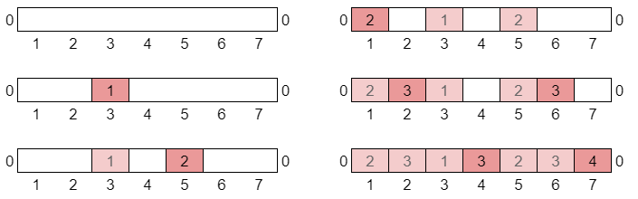

# Interval Array

**Author:** votrubac
**Votes:** 25
**Link:** [https://leetcode.com/problems/depth-of-bst-given-insertion-order/solutions/1280067/](https://leetcode.com/problems/depth-of-bst-given-insertion-order/solutions/1280067/)

---

Since all elements are unique and within `[1..n]`, we can represent our tree as intervals. 

We start with `[1..n]` interval, and the depth of that interval is `0`. When we insert, say, 3, we split that interval into two: `[1..2]` and `[4..n]`, and increment their depth. For any value, we can quickly find it's interval using binary search.

The picture below demonstrates how we split intervals for this test case: `[3,5,1,2,6,7,4]`



To model this logic, we can use a map to store numbers and their depth. When we insert a new number, we first find the insert position (O(n log )). Then, we get the depth of numbers on the left and right (our interval). Finally, we insert a new value, and its depth is the maximum depth of the neighbours, plus `1`.

**C++**
```cpp
int maxDepthBST(vector<int>& order) {
    map<int, int> m{{0, 0}, {100001, 0}};
    for (int i : order) {
        auto it = m.upper_bound(i);
        m[i] = 1 + max(it->second, prev(it)->second);
    }
    return max_element(begin(m), end(m), [](const auto& a, const auto &b){ return a.second < b.second; })->second;
}
```
**Java**
```java
public int maxDepthBST(int[] order) {
    TreeMap<Integer, Integer> m = new TreeMap<>();
    for (int i : order) {
        Map.Entry<Integer, Integer> l = m.floorEntry(i), r = m.ceilingEntry(i);
        m.put(i, 1 + Math.max(l == null ? 0 : l.getValue(), r == null ? 0 : r.getValue()));
    }
    return m.entrySet().stream().max((a, b) -> a.getValue().compareTo(b.getValue())).get().getValue();
}
```
**Python 3**
This also works with standard `bisect_left`; it's just faster with `sortedcontainers`.

```python
class Solution:
    def maxDepthBST(self, order: List[int]) -> int:
        from sortedcontainers import SortedList
        sl, d = SortedList([0, 100001]), { 0 : 0, 100001 : 0 }
        for i in order:
            j = sl.bisect_left(i)
            d[i] = 1 + max(d[sl[j - 1]], d[sl[j]])
            sl.add(i)
        return max(d.values())
```