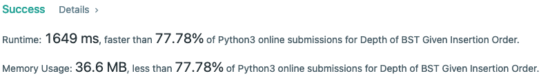
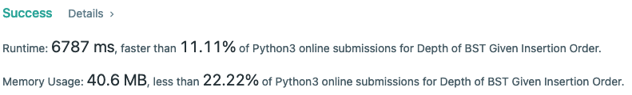
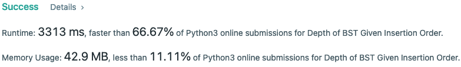

# BST: cache max and min nodes

**Author:** vokasik
**Votes:** 0
**Link:** [https://leetcode.com/problems/depth-of-bst-given-insertion-order/solutions/4695240/](https://leetcode.com/problems/depth-of-bst-given-insertion-order/solutions/4695240/)

---

**Update**: fails for `[1...50000,100000...50001]` see next approach

There's always a way to turn `BST` into a `LinkedList` -> insert `1,2,3,4,5...` or `5,4,3,2,1`
There are a few test cases that might turn simple implementation into n^2 one.
In order to avoid such cases we can speed up the insertion of new min/max values by directly inserting them into leaves w/o traversing the tree.



```
class TreeNode:
    def __init__(self, val, depth):
        self.val = val
        self.left = None
        self.right = None
        self.depth = depth
        
    def __repr__(self):
        return f'{self.val=} {self.depth=}'

class Solution:
    def maxDepthBST(self, order: List[int]) -> int:
        N = len(order)
        max_depth = 1
        root = TreeNode(order[0], 1)
        min_node = max_node = root
        for i in range(1, N):
            n = order[i]
            if n < min_node.val:
                new_min = TreeNode(n, min_node.depth + 1)
                min_node.left = new_min
                min_node = min_node.left
                max_depth = max(max_depth, min_node.depth)
            elif n > max_node.val:
                new_max = TreeNode(n, max_node.depth + 1)
                max_node.right = new_max
                max_node = max_node.right
                max_depth = max(max_depth, max_node.depth)
            else:
                cur = root
                while cur:
                    prev = cur
                    if n > cur.val:
                        cur = cur.right
                        if not cur:
                            prev.right = TreeNode(n, prev.depth + 1)
                            max_depth = max(max_depth, prev.right.depth)
                    else:
                        cur = cur.left
                        if not cur:
                            prev.left = TreeNode(n, prev.depth + 1)
                            max_depth = max(max_depth, prev.left.depth)
        return max_depth
```
> Next approach: intervals with RBT-like DS
> 
Start with `[left=0, right=n + 1, depth=0]`
Insert `5` and get `[left=0, right=4, depth=1][left=6, right=n + 1, depth=1]` and so on...


```
from sortedcontainers import SortedList

class Solution:
    def maxDepthBST(self, order: List[int]) -> int:
        sl = SortedList()
        sl.add((0, len(order) + 1, 0))
        max_depth = 1
        for n in order:
            idx = sl.bisect_left((n, inf, inf)) - 1
            left_part = (sl[idx][0], n - 1, sl[idx][2] + 1)
            right_part = (n + 1, sl[idx][1], sl[idx][2] + 1)
            max_depth = max(max_depth, left_part[2], right_part[2])
            del sl[idx]
            sl.add(left_part)
            sl.add(right_part)
        return max_depth
```
The same idea as above, except depth are in a separate place and instead of range I store upper bound:

```
from sortedcontainers import SortedSet

class Solution:
    def maxDepthBST(self, order: List[int]) -> int:
        N = len(order)
        sl = SortedSet([0, N + 1])
        depths = {N + 1:0, 0:0}
        for n in order:
            idx = sl.bisect_left(n)
            depths[n] = max(depths[sl[idx - 1]], depths[sl[idx]]) + 1
            sl.add(n)
        return max(depths.values())
```