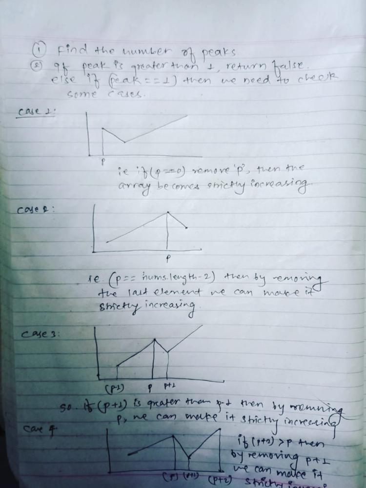

# JAVA EASY TO UNDERSTAND SOLUTION- well explained with picture|| 100% FASTER

**Author:** 20184152
**Votes:** 97
**Link:** [https://leetcode.com/problems/remove-one-element-to-make-the-array-strictly-increasing/solutions/1387010/](https://leetcode.com/problems/remove-one-element-to-make-the-array-strictly-increasing/solutions/1387010/)

---


```
class Solution {
    public boolean canBeIncreasing(int[] nums) {
        int count=0;
        int p=0;
        for(int i=0;i<nums.length-1;i++){
            if(nums[i]>nums[i+1] || nums[i]==nums[i+1]) {
                count++;
                p=i;
            }
        }
        if(count>1) return false;
        else if(count==1){
            if(p==0 || p== nums.length-2) return true;
            if(nums[p+1]>nums[p-1] || nums[p+2]>nums[p]) return true;
            else return false;
        }
        return true;
    }
}
```
**Do upvote if you find it helpful!**